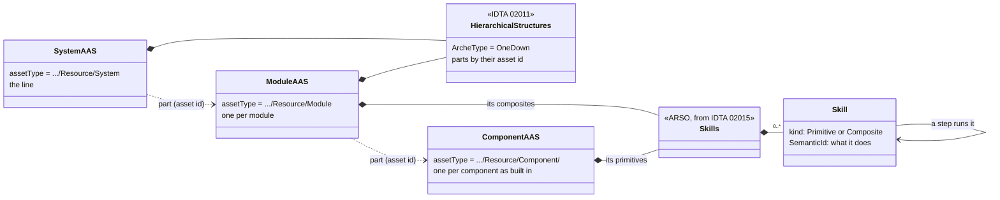
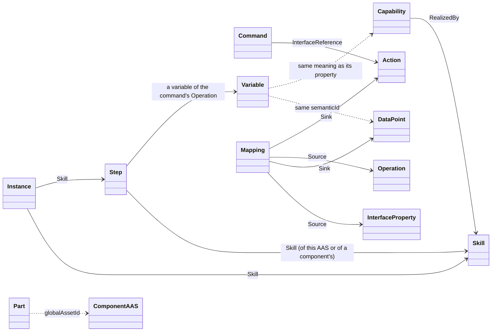
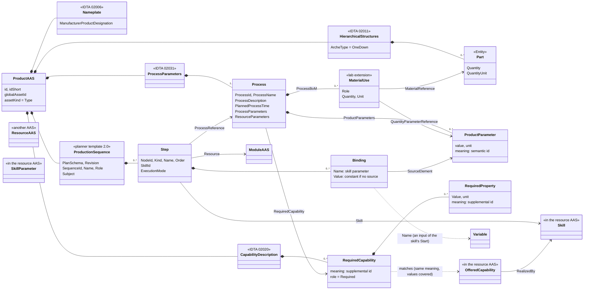
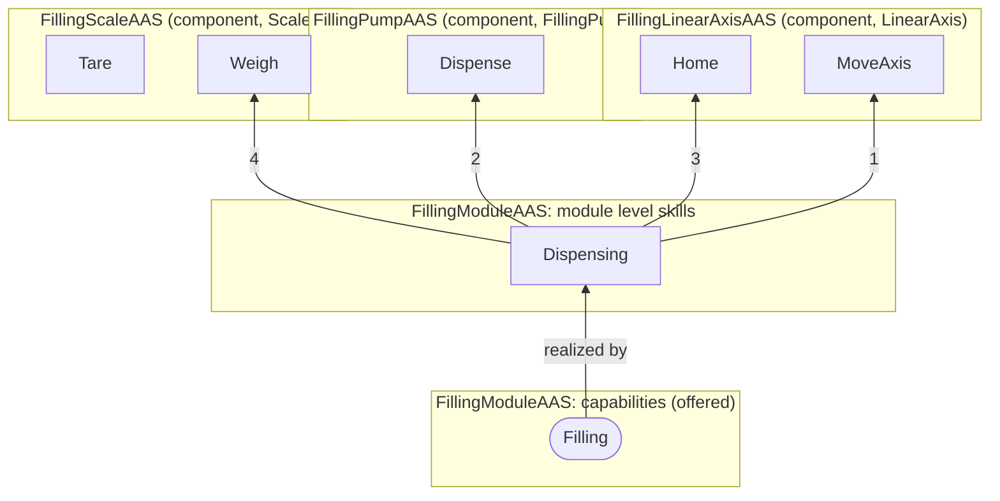
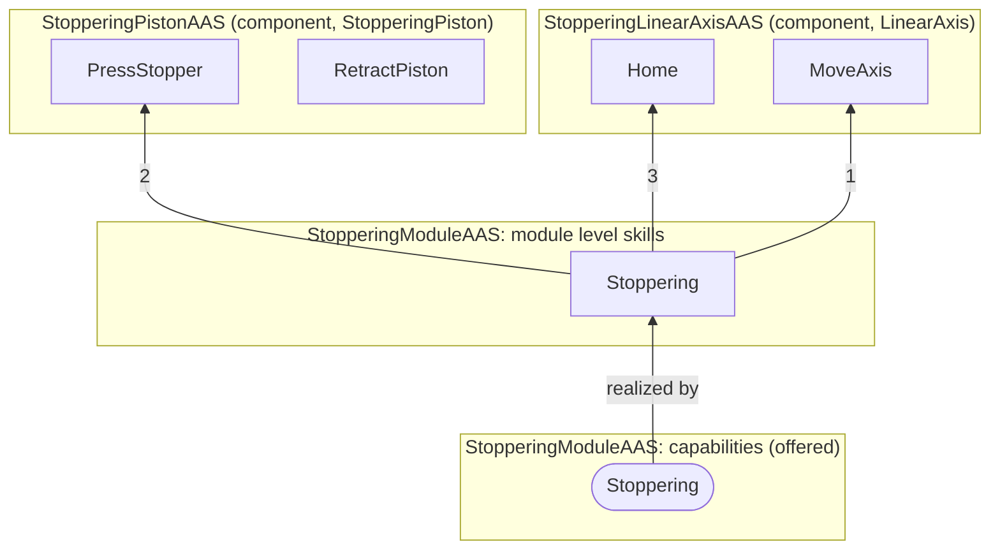
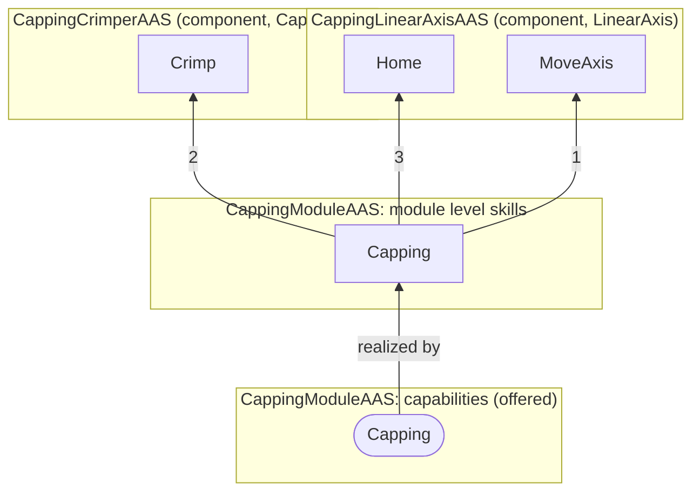
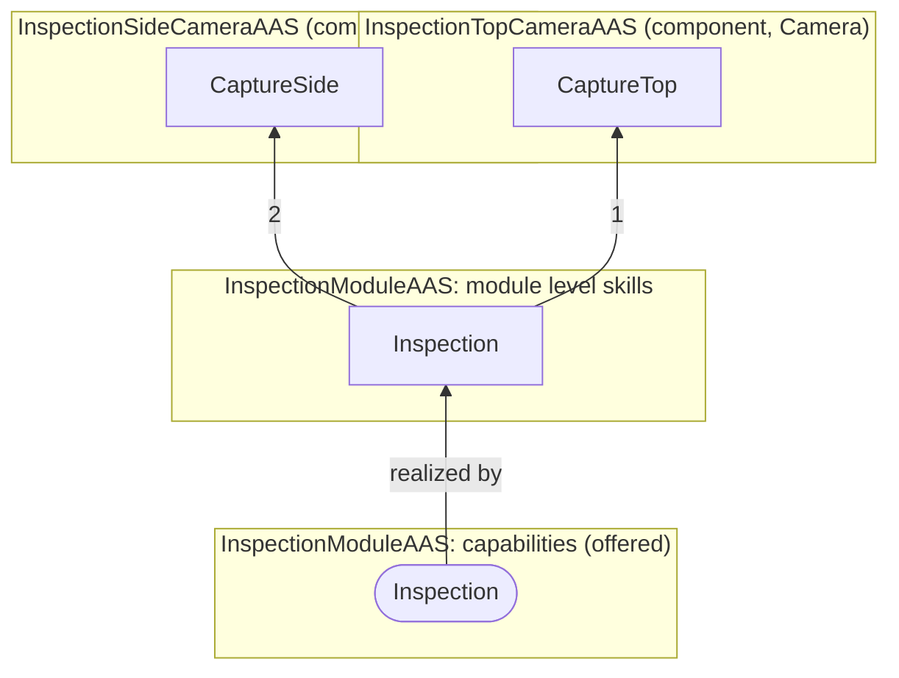
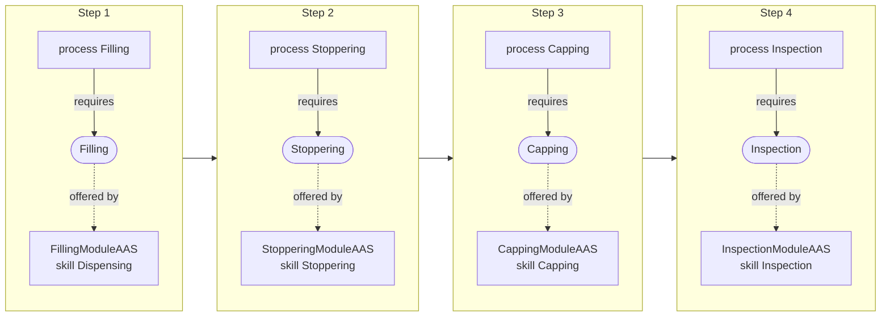

# The example line: its AASs

16 AASs built to the framework: the line, its modules (filling, stoppering, capping, inspection; loading
and unloading are named but not described yet), the components of each module, one product
planned on them (a 2 mL vial) and its process on the line. Each product's plan is followed into
the resources when they are built; a plan that does not fit is refused. The process AAS (a
draft) holds the plan's bindings: per step the resource, the skill and what each of its inputs is
handed, each a reference. What the submodels are and how they link is in [aas-models.md](aas-models.md).

This file is written by `python cell/examples/describe.py`. Every AAS is built by `modreg` from a
profile, the pydantic dump of its type: the profiles of a module and of its components are made
from the module spec (`cell/modules`, `cell/modules/planned`), a product's profile is a file
(`cell/examples/Vial2mLAAS.json`). `python cell/examples/example_line.py --out <folder> --publish
<server>` builds the AASs and puts them on an AAS server.

## The line: what it is made of

```
FillingLineAAS
  point Infeed (PlacePoint) at (60, 180, 0) relative to TableBase
  point Outfeed (PickPoint) at (660, 60, 0) relative to TableBase
  LoadingModule (not described yet)
  FillingModuleAAS at (240, 720, 0), Yaw 180 relative to TableBase
    skill Dispensing(Volume = 1.0 mL) → Weight [g]
    skill Occupy()
    skill Release()
    skill Reset()
    skill Start()
    skill Stop()
    skill Abort()
    skill Clear()
    FillingLinearAxisAAS: Home(), MoveAxis(Position = 0.0 mm)
    FillingPumpAAS: Dispense(Volume = 1.0 mL, FlowRate = 1.0 mL/s)
    FillingScaleAAS: Tare(), Weigh() → Weight [g]
  StopperingModuleAAS at (600, 720, 0), Yaw 180 relative to TableBase
    skill Stoppering()
    skill Occupy()
    skill Release()
    skill Reset()
    skill Start()
    skill Stop()
    skill Abort()
    skill Clear()
    StopperingLinearAxisAAS: Home(), MoveAxis(Position = 0.0 mm)
    StopperingPistonAAS: PressStopper(), RetractPiston()
  CappingModuleAAS at (960, 360, 0), Yaw 90 relative to TableBase
    skill Capping()
    skill Occupy()
    skill Release()
    skill Reset()
    skill Start()
    skill Stop()
    skill Abort()
    skill Clear()
    CappingLinearAxisAAS: Home(), MoveAxis(Position = 0.0 mm)
    CappingCrimperAAS: Crimp(Duration = 1.5 s)
  InspectionModuleAAS at (960, 120, 0), Yaw 90 relative to TableBase
    skill Inspection() → TopPassed, SidePassed
    skill Occupy()
    skill Release()
    skill Reset()
    skill Start()
    skill Stop()
    skill Abort()
    skill Clear()
    InspectionTopCameraAAS: CaptureTop() → Passed
    InspectionSideCameraAAS: CaptureSide() → Passed
  UnloadingModule (not described yet)
  PlanarTable (not described yet)
```

| AAS | Kind | Submodels |
| --- | --- | --- |
| `FillingLineAAS` | system | HierarchicalStructures, OperationalData |
| `FillingModuleAAS` | module | Nameplate, AssetInterfacesDescription, CapabilityDescription, AssetInterfacesMappingConfiguration, HierarchicalStructures, Skills, OperationalData |
| `StopperingModuleAAS` | module | Nameplate, AssetInterfacesDescription, CapabilityDescription, AssetInterfacesMappingConfiguration, HierarchicalStructures, Skills, OperationalData |
| `CappingModuleAAS` | module | Nameplate, AssetInterfacesDescription, CapabilityDescription, AssetInterfacesMappingConfiguration, HierarchicalStructures, Skills, OperationalData |
| `InspectionModuleAAS` | module | Nameplate, AssetInterfacesDescription, CapabilityDescription, AssetInterfacesMappingConfiguration, HierarchicalStructures, Skills, OperationalData |
| `FillingLinearAxisAAS` | component/linearaxis | Skills |
| `FillingPumpAAS` | component/fillingpump | Skills |
| `FillingScaleAAS` | component/scale | Skills |
| `StopperingLinearAxisAAS` | component/linearaxis | Skills |
| `StopperingPistonAAS` | component/stopperingpiston | Skills |
| `CappingLinearAxisAAS` | component/linearaxis | Skills |
| `CappingCrimperAAS` | component/capcrimper | Skills |
| `InspectionTopCameraAAS` | component/camera | Skills |
| `InspectionSideCameraAAS` | component/camera | Skills |
| `Vial2mLAAS` | product | Nameplate, HierarchicalStructures, ProcessParameters, CapabilityDescription, ProductionSequence |
| `Vial2mLOnFillingLineAAS` | process (draft) | ProcessInformation, Bindings, Validation |

## Class diagram: the resources

A line is made of modules and a module of components. What kind of resource an AAS is, is its
asset type; a component's ends in its kind, which every component like it shares (the three
linear axes). A part is found by its asset id.



## Class diagram: a module AAS

What the AAS holds: its submodels and their main elements. A component's AAS holds only Skills,
with the same Skill, Command, Operation, Conditions and Completion.

```mermaid
classDiagram
  direction LR
  class ModuleAAS {
    id, idShort
    globalAssetId
    assetType = .../Resource/Module
  }
  class Nameplate {
    <<IDTA 02006>>
    ManufacturerName
    ManufacturerProductDesignation
  }
  class HierarchicalStructures {
    <<IDTA 02011>>
    ArcheType = OneDown
  }
  class Part {
    <<Entity>>
    idShort
    globalAssetId of its AAS
  }
  class AssetInterfacesDescription {
    <<IDTA 02017>>
  }
  class Interface {
    title
    EndpointMetadata base, security
  }
  class Action {
    title, synchronous
    input, output
    forms href, browse path
    command and skill: supplemental ids
  }
  class InterfaceProperty {
    key, title, type, unit
    observable
    forms href, browse path
  }
  class MappingConfiguration {
    <<IDTA 02027>>
  }
  class Mapping {
    Sources, Sinks
    Transformation
  }
  class CapabilityDescription {
    <<IDTA 02020>>
  }
  class Capability {
    meaning: supplemental id
    role = Offered
  }
  class CapabilityProperty {
    meaning: supplemental id
    value or range, unit
  }
  class Skills {
    <<ARSO>>
    its skills, its own elements
    Errors: name = code
  }
  class Skill {
    semanticId = skill
    supplemental ids: its kind (Primitive,
    Composite or ModuleControl), its type
  }
  class Command {
    Start, Stop, Abort, Reset
    semanticId = skill/Start ...
  }
  class Operation {
    named like the command
    in: Session, parameters
    out: Accepted, ErrorID, results
  }
  class Variable {
    value, unit, limits
    semanticId of its data point
    meaning of a capability property
  }
  class Step {
    Step_0000, ... (the planner's elements)
    NodeId, Kind, Name, Order
    Kind step: Skill, Bindings, Outputs
    parallel, decision: Branches
    decision, conditional: Condition
  }
  class Conditions {
    of a primitive
    Precondition
    Postcondition
    Invariant
  }
  class Completion {
    of a primitive
    After
    Timeout
  }
  class OperationalData {
    <<ARSO>>
  }
  class DataPoint {
    value (decimal)
    semanticId
  }
  class Coordinate {
    <<ARSO 0.13, Measurements/Coordinates>>
    meaning: ModuleBase, Mount, EndEffector, TransferPoint ...
    RelativeTo: another coordinate
    X Y Z mm, Roll Pitch Yaw deg
    XSource ... YawSource: a data point
  }

  ModuleAAS *-- Nameplate
  ModuleAAS *-- HierarchicalStructures
  ModuleAAS *-- AssetInterfacesDescription
  ModuleAAS *-- MappingConfiguration
  ModuleAAS *-- CapabilityDescription
  ModuleAAS *-- Skills
  ModuleAAS *-- OperationalData
  HierarchicalStructures *-- "0..*" Part
  AssetInterfacesDescription *-- "1" Interface
  Interface *-- "0..*" Action
  Interface *-- "0..*" InterfaceProperty
  MappingConfiguration *-- "1..*" Mapping
  CapabilityDescription *-- "1..*" Capability
  Capability *-- "0..*" CapabilityProperty
  Skills *-- "0..*" Skill
  Skill *-- "1..4" Command
  Skill *-- "0..1" Conditions
  Skill *-- "0..1" Completion
  Command *-- "1" Operation
  Operation *-- "2..*" Variable
  Command *-- "0..*" Step : Steps
  OperationalData *-- "1..*" DataPoint
  OperationalData *-- "1..*" Coordinate
  Coordinate --> Coordinate : RelativeTo
  Coordinate --> DataPoint : follows
```

Then how those elements refer to each other. Every solid arrow is a reference stored in the AAS,
named like the element that carries it; a dashed arrow is a link by a shared id.



## Class diagram: a product AAS

The classes marked as another AAS are in the resource AAS above; the dashed arrows are links that
are followed by meaning or by name, not by a stored reference.



## The modules

Read upwards: a module level skill runs skills of the module's components in order, and a
capability is realized by a module level skill.

### FillingModuleAAS

`https://smartproductionlab.aau.dk/aas/FillingModuleAAS`, asset `https://smartproductionlab.aau.dk/assets/FillingModule`. Built: its program is generated and runs on FORTE, on the PC against the simulator and on its own Raspberry Pi 5.



| Skill | Held by | Kind | Start runs | Stop runs |
| --- | --- | --- | --- | --- |
| Dispensing(Volume = 1.0 mL) → Weight [g] | the module | Composite | MoveAxis (Position = 40.0) → Dispense (Volume ← Volume, FlowRate = 1.0) → Home → Weigh (Weight → Weight) | Home |
| Home() | FillingLinearAxisAAS | Primitive | – (Postcondition AtHome; Timeout 60s) | – |
| MoveAxis(Position = 0.0 mm) | FillingLinearAxisAAS | Primitive | – (Precondition Homed; Postcondition NOT Moving AND ABS(ActualPosition - Position) < 0.001; Timeout 30s) | – |
| Dispense(Volume = 1.0 mL, FlowRate = 1.0 mL/s) | FillingPumpAAS | Primitive | – (After Volume / FlowRate) | – |
| Tare() | FillingScaleAAS | Primitive | – (After 2.0) | – |
| Weigh() → Weight [g] | FillingScaleAAS | Primitive | – (After 0.2) | – |

- **Capability Filling** (`https://smartproductionlab.aau.dk/semantics/Filling`), realized by Dispensing: ContainerType vial; GraspDiameter 6.0 to 30.0 mm; AbsoluteFillError 0.05 mL; FillVolume 0.5 to 10.0 mL; Pre ContentVolume = 0.0, Post ContentVolume = FillVolume.
- **The components' capabilities** (role NotAssigned: parts of the module's, what the planner composes skills from), what each needs, does and keeps: LinearAxis's Referencing (Home): Post Position = 0.0, Post Referenced = true; LinearAxis's Positioning (MoveAxis): Pre Referenced = true, Post Position given; Pump's Dosing (Dispense): Post ContentVolume += Volume, Post Weighed = false, Pre LinearAxisPosition = FillPosition, Invariant LinearAxisPosition unchanged; Scale's Taring (Tare): Post Tared = true; Scale's Weighing (Weigh): Pre Tared = true, Post Weight measured, Post Weighed = true, Pre LinearAxisPosition = 0.0, Invariant LinearAxisPosition unchanged.
- **The module's own commands** (skills of the kind ModuleControl): Occupy, Release, Reset (Home → Tare), Start, Stop (Home), Abort, Clear.
- **Components:** LinearAxis → `FillingLinearAxisAAS`, Pump → `FillingPumpAAS`, Scale → `FillingScaleAAS`.
- **Coordinates** (Operational Data, mm and degrees): ModuleBase (ModuleBase) at (240, 720, 0), Yaw 180 relative to TableBase; LinearAxisMount (Mount) at (0, 60, 100), Roll 180 relative to ModuleBase; LinearAxis (EndEffector) at (0, 0, 0) relative to LinearAxisMount, Z = LinearAxis_ActualPosition; Transfer (TransferPoint) at (0, 60, 0), Yaw 180 relative to ModuleBase; Fill (ProcessingPoint) at (0, 60, 60) relative to ModuleBase.
- **Interface:** OPC UA at `opc.tcp://localhost:4840`, 31 actions and 45 properties; 45 data points; 32 mappings.
- **Program:** built by the rule set `https://smartproductionlab.aau.dk/rules/module/2`; module level skills Dispensing built. Which block is which skill or step is the integrator's record, outside the AAS.

### StopperingModuleAAS

`https://smartproductionlab.aau.dk/aas/StopperingModuleAAS`, asset `https://smartproductionlab.aau.dk/assets/StopperingModule`. Built: its program is generated and runs on FORTE, on the PC against the simulator and on its own Raspberry Pi 5.



| Skill | Held by | Kind | Start runs | Stop runs |
| --- | --- | --- | --- | --- |
| Stoppering() | the module | Composite | MoveAxis (Position = 40.0) → PressStopper → Home | Home |
| Home() | StopperingLinearAxisAAS | Primitive | – (Postcondition AtHome; Timeout 8s) | – |
| MoveAxis(Position = 0.0 mm) | StopperingLinearAxisAAS | Primitive | – (Precondition Homed; Postcondition NOT Moving AND ABS(ActualPosition - Position) < 0.001; Timeout 8s) | – |
| PressStopper() | StopperingPistonAAS | Primitive | – (After 3.0) | – |
| RetractPiston() | StopperingPistonAAS | Primitive | – (After 3.0) | – |

- **Capability Stoppering** (`https://smartproductionlab.aau.dk/semantics/Stoppering`), realized by Stoppering: ContainerType vial; GraspDiameter 6.0 to 30.0 mm; StopperDiameter 6.0 to 20.0 mm; Pre ContentVolume > 0.0, Post Stoppered = true.
- **The components' capabilities** (role NotAssigned: parts of the module's, what the planner composes skills from), what each needs, does and keeps: LinearAxis's Referencing (Home): Post Position = 0.0, Post Referenced = true; LinearAxis's Positioning (MoveAxis): Pre Referenced = true, Post Position given; Piston's Pressing (PressStopper): Post Stoppered = true, Pre LinearAxisPosition = PressPosition, Invariant LinearAxisPosition unchanged.
- **The module's own commands** (skills of the kind ModuleControl): Occupy, Release, Reset (RetractPiston → Home), Start, Stop (Home), Abort, Clear.
- **Components:** LinearAxis → `StopperingLinearAxisAAS`, Piston → `StopperingPistonAAS`.
- **Coordinates** (Operational Data, mm and degrees): ModuleBase (ModuleBase) at (600, 720, 0), Yaw 180 relative to TableBase; LinearAxisMount (Mount) at (0, 60, 100), Roll 180 relative to ModuleBase; LinearAxis (EndEffector) at (0, 0, 0) relative to LinearAxisMount, Z = LinearAxis_ActualPosition; Transfer (TransferPoint) at (0, 60, 0), Yaw -90 relative to ModuleBase; Press (ProcessingPoint) at (0, 60, 60) relative to ModuleBase.
- **Interface:** OPC UA at `opc.tcp://localhost:4840`, 27 actions and 32 properties; 32 data points; 28 mappings.
- **Program:** built by the rule set `https://smartproductionlab.aau.dk/rules/module/2`; module level skills Stoppering built. Which block is which skill or step is the integrator's record, outside the AAS.

### CappingModuleAAS

`https://smartproductionlab.aau.dk/aas/CappingModuleAAS`, asset `https://smartproductionlab.aau.dk/assets/CappingModule`. **Planned only:** described from a spec; there is no program and no hardware behind it yet.



| Skill | Held by | Kind | Start runs | Stop runs |
| --- | --- | --- | --- | --- |
| Capping() | the module | Composite | MoveAxis (Position = 40.0) → Crimp → Home | Home |
| Home() | CappingLinearAxisAAS | Primitive | – (Postcondition AtHome; Timeout 8s) | – |
| MoveAxis(Position = 0.0 mm) | CappingLinearAxisAAS | Primitive | – (Precondition Homed; Postcondition NOT Moving AND ABS(ActualPosition - Position) < 0.001; Timeout 8s) | – |
| Crimp(Duration = 1.5 s) | CappingCrimperAAS | Primitive | – (After Duration) | – |

- **Capability Capping** (`https://smartproductionlab.aau.dk/semantics/Capping`), realized by Capping: ContainerType vial; GraspDiameter 6.0 to 30.0 mm; CapDiameter 13.0 to 20.0 mm; Pre Stoppered = true, Post Capped = true.
- **The components' capabilities** (role NotAssigned: parts of the module's, what the planner composes skills from), what each needs, does and keeps: LinearAxis's Referencing (Home): Post Position = 0.0, Post Referenced = true; LinearAxis's Positioning (MoveAxis): Pre Referenced = true, Post Position given; Crimper's Crimping (Crimp): Post Capped = true.
- **The module's own commands** (skills of the kind ModuleControl): Occupy, Release, Reset (Home), Start, Stop (Home), Abort, Clear.
- **Components:** LinearAxis → `CappingLinearAxisAAS`, Crimper → `CappingCrimperAAS`.
- **Coordinates** (Operational Data, mm and degrees): ModuleBase (ModuleBase) at (960, 360, 0), Yaw 90 relative to TableBase; Transfer (TransferPoint) at (0, 120, 0), Yaw -90 relative to ModuleBase.
- **Interface:** OPC UA at `opc.tcp://localhost:4840`, 23 actions and 30 properties; 30 data points; 24 mappings.
- **Program:** built by the rule set `https://smartproductionlab.aau.dk/rules/module/2`; module level skills Capping built. Which block is which skill or step is the integrator's record, outside the AAS.

### InspectionModuleAAS

`https://smartproductionlab.aau.dk/aas/InspectionModuleAAS`, asset `https://smartproductionlab.aau.dk/assets/InspectionModule`. **Planned only:** described from a spec; there is no program and no hardware behind it yet.



| Skill | Held by | Kind | Start runs | Stop runs |
| --- | --- | --- | --- | --- |
| Inspection() → TopPassed, SidePassed | the module | Composite | CaptureTop (Passed → TopPassed) → CaptureSide (Passed → SidePassed) | – |
| CaptureTop() → Passed | InspectionTopCameraAAS | Primitive | – (Postcondition Done; Timeout 3s) | – |
| CaptureSide() → Passed | InspectionSideCameraAAS | Primitive | – (Postcondition Done; Timeout 3s) | – |

- **Capability Inspection** (`https://smartproductionlab.aau.dk/semantics/Inspection`), realized by Inspection: ContainerType vial; GraspDiameter 6.0 to 30.0 mm; InspectionMethod vision; Post Inspected = true.
- **The components' capabilities** (role NotAssigned: parts of the module's, what the planner composes skills from), what each needs, does and keeps: TopCamera's Imaging (CaptureTop): Post Inspected = true; SideCamera's Imaging (CaptureSide): Post Inspected = true.
- **The module's own commands** (skills of the kind ModuleControl): Occupy, Release, Reset, Start, Stop, Abort, Clear.
- **Components:** TopCamera → `InspectionTopCameraAAS`, SideCamera → `InspectionSideCameraAAS`.
- **Coordinates** (Operational Data, mm and degrees): ModuleBase (ModuleBase) at (960, 120, 0), Yaw 90 relative to TableBase.
- **Interface:** OPC UA at `opc.tcp://localhost:4840`, 19 actions and 22 properties; 22 data points; 20 mappings.
- **Program:** built by the rule set `https://smartproductionlab.aau.dk/rules/module/2`; module level skills Inspection built. Which block is which skill or step is the integrator's record, outside the AAS.

## The product

### Vial2mLAAS

`https://smartproductionlab.aau.dk/aas/Vial2mLAAS`, asset `https://smartproductionlab.aau.dk/assets/Vial2mL`.



Bill of material (Hierarchical Structures):

| Part | Name | Quantity |
| --- | --- | --- |
| Vial | Glass vial 2R | 1.0 piece |
| Liquid | Demo liquid | 2.0 mL |
| Stopper | Rubber stopper 13 mm | 1.0 piece |
| Cap | Crimp cap 13 mm | 1.0 piece |

Processes (Process Parameters) and what they require (Capability Description):

| Process | Planned time | Product parameters | Materials | Required capability |
| --- | --- | --- | --- | --- |
| Filling | PT10S | ContainerType = vial, GraspDiameter = 16.0 mm, FillVolume = 2.0 mL | Vial (workpiece, 1.0 piece), Liquid (incorporated, FillVolume) | `https://smartproductionlab.aau.dk/semantics/Filling` |
| Stoppering | PT5S | ContainerType = vial, GraspDiameter = 16.0 mm, StopperDiameter = 13.0 mm | Stopper (incorporated, 1.0 piece) | `https://smartproductionlab.aau.dk/semantics/Stoppering` |
| Capping | PT5S | ContainerType = vial, GraspDiameter = 16.0 mm, CapDiameter = 13.0 mm | Cap (incorporated, 1.0 piece) | `https://smartproductionlab.aau.dk/semantics/Capping` |
| Inspection | PT3S | ContainerType = vial, GraspDiameter = 16.0 mm, InspectionMethod = vision | – | `https://smartproductionlab.aau.dk/semantics/Inspection` |

The plan (Production Sequence, `production-sequence/2.0`):

| Order | Step | Resource | Skill | Bound |
| --- | --- | --- | --- | --- |
| 1 | Filling | FillingModuleAAS | Dispensing | Volume ← FillVolume |
| 2 | Stoppering | StopperingModuleAAS | Stoppering | – |
| 3 | Capping | CappingModuleAAS | Capping | – |
| 4 | Inspection | InspectionModuleAAS | Inspection | – |
