# The filling program, block by block

What every function block of the lab's IEC 61499 module programs does, in plain words, with the
filling module as the example: what a client can call over OPC UA, which blocks a call reaches, how
a command ends up on the Raspberry Pi's pins, and where the values the module shows come from. It is
written for students who make new function blocks by hand in the 4diac IDE for the real stoppering
and capping modules: new skill primitives, and new equipment with its pins.

**What you make, and what you reuse.** Most of a module program is the same in every module and is
already there: who may command the module, its state, the skill's checks and state machine, the run
that every primitive shares, and the blocks for the pins (section 7). You never change those types.
You put blocks of them into yours and give them values. What you make yourself is small:

| You add | Types you make | What is your own in them |
| --- | --- | --- |
| A skill primitive, on equipment that is there | 2: `SK_<Skill>` and its contract `SC_<Skill>` | Two short algorithms in the contract (8 lines for the feeder of section 10), and the 5 connections to the contract in `SK_` (of 44) |
| A piece of equipment | 5: `EQ_<Item>`, `EL_<Item>`, `EC_<Item>`, `EV_<Item>`, `EP_<Item>` | Its pins: one IO block per pin, the pins' names in the algorithms, and its command table. The state machines are the same in every piece of equipment without a position, so you copy them |

You make each new type as a copy of a type that is nearly the same, and change only your own part.
Section 10 does that step by step for a new stopper feeder and its primitive. Section 11 builds
FORTE with your types and puts them on your PC and on the module's Pi.

**New to IEC 61499?** Read sections 1, 2 and 6 first: they say what the program is made of and how
to read the pictures. Then section 4 follows one call through the blocks. Sections 7 and 8 explain
each block on its own: look a block up there when you meet it. Section 9 says what the stoppering
and capping modules have instead of the filling module's own blocks.

**The program explains itself too.** Every block type, pin and block in the program has a comment.
In the IDE, hover over a block, or select it and look at *Properties > Comment*. Give your own
types, pins and blocks one as well (section 12).

**This is the version with screenshots.** The text is that of
[filling-program.md](filling-program.md); where there is a screenshot of the 4diac IDE (in
[figures/4diac_figs/](figures/4diac_figs/)), it is shown instead of the drawing, so you see exactly
what the IDE shows. The other pictures are the drawings of [filling-program/](filling-program/),
made from the program's files with the IDE's positions, groups and sizes. Open a picture on its own
to see it full size. The screenshots of `MOD_StateManager`, `SKILL_Core` and the primitives' insides
were taken before these types changed, so their drawings are shown until they are taken again.

The rules every module follows are in [module-rules.md](module-rules.md), and the lab's modules and
their hardware in [modules.md](modules.md).

## Contents

- [1. The whole program in one picture](#1-the-whole-program-in-one-picture)
- [2. Two kinds of wire](#2-two-kinds-of-wire)
- [3. What a client can see and call](#3-what-a-client-can-see-and-call)
- [4. Following a call through the blocks](#4-following-a-call-through-the-blocks)
  - [4.1 Occupying the module](#41-occupying-the-module)
  - [4.2 Resetting and starting the module](#42-resetting-and-starting-the-module)
  - [4.3 Starting Dispensing](#43-starting-dispensing)
  - [4.4 A primitive on its own](#44-a-primitive-on-its-own)
  - [4.5 Stopping, aborting, releasing](#45-stopping-aborting-releasing)
  - [4.6 Start-up](#46-start-up)
- [5. Every block of the application](#5-every-block-of-the-application)
- [6. Before the blocks: a few words, and how to read the pictures](#6-before-the-blocks-a-few-words-and-how-to-read-the-pictures)
  - [6.1 Types and blocks](#61-types-and-blocks)
  - [6.2 Events and data](#62-events-and-data)
  - [6.3 The start-up chain](#63-the-start-up-chain)
  - [6.4 How the IDE shows the program, and so the pictures](#64-how-the-ide-shows-the-program-and-so-the-pictures)
  - [6.5 Who made a type](#65-who-made-a-type)
  - [6.6 Adapters: one plug, one socket](#66-adapters-one-plug-one-socket)
- [7. The blocks that are always there](#7-the-blocks-that-are-always-there)
  - [7.1 Timers and the start signal](#71-timers-and-the-start-signal)
    - [`E_DELAY`: a kitchen timer](#e_delay-a-kitchen-timer)
    - [`E_CYCLE`: a metronome](#e_cycle-a-metronome)
    - [`E_RESTART`: the power-on signal](#e_restart-the-power-on-signal)
    - [`E_CTU`, `E_T_FF`: in the library, not used](#e_ctu-e_t_ff-in-the-library-not-used)
  - [7.2 Talking: local channels, OPC UA and Modbus](#72-talking-local-channels-opc-ua-and-modbus)
    - [`PUBLISH_n` and `SUBSCRIBE_n`: send and receive](#publish_n-and-subscribe_n-send-and-receive)
    - [`SERVER_2_n`: an OPC UA method, like a phone line](#server_2_n-an-opc-ua-method-like-a-phone-line)
    - [`CLIENT_1_0` and `CLIENT_0_1`: Modbus](#client_1_0-and-client_0_1-modbus)
  - [7.3 Pins: FORTE's own IO blocks](#73-pins-fortes-own-io-blocks)
    - [`IX`, `QX`, `IW`, `QW`](#ix-qx-iw-qw)
    - [`GPIOChip`: set up one Raspberry Pi pin](#gpiochip-set-up-one-raspberry-pi-pin)
    - [`PWMChip`: set up one PWM channel](#pwmchip-set-up-one-pwm-channel)
  - [7.4 Who may command: `MOD_Occupation`](#74-who-may-command-mod_occupation)
    - [`MOD_Occupation` (composite)](#mod_occupation-composite)
    - [`MOD_OccupationIds` (simple)](#mod_occupationids-simple)
    - [`MOD_OccupationLogic` (basic)](#mod_occupationlogic-basic)
    - [`MOD_OwnerView` (composite) and `MOD_OwnerLatch` (simple): the ear for the owner](#mod_ownerview-composite-and-mod_ownerlatch-simple-the-ear-for-the-owner)
  - [7.5 The module's state: `MOD_StateManager`](#75-the-modules-state-mod_statemanager)
    - [`MOD_StateManager` (composite)](#mod_statemanager-composite)
    - [`MOD_StateLogic` (basic): the PackML state machine](#mod_statelogic-basic-the-packml-state-machine)
    - [`MOD_StateGate` (basic): the module's front desk](#mod_stategate-basic-the-modules-front-desk)
    - [`MOD_StateIds` (simple)](#mod_stateids-simple)
    - [`MOD_ActivityCount` (simple): a tally counter at the door](#mod_activitycount-simple-a-tally-counter-at-the-door)
    - [`MOD_StateView` (composite) and `MOD_StateLatch` (simple): the ear for the module state](#mod_stateview-composite-and-mod_statelatch-simple-the-ear-for-the-module-state)
  - [7.6 What every skill shares: `SKILL_Core`](#76-what-every-skill-shares-skill_core)
    - [`SKILL_Core` (composite)](#skill_core-composite)
    - [`SKILL_Gate` (basic): the front desk's decision](#skill_gate-basic-the-front-desks-decision)
    - [`SKILL_Control` (basic): the skill's state machine](#skill_control-basic-the-skills-state-machine)
  - [7.7 What every primitive shares: `SKILL_Run` and its two adapters](#77-what-every-primitive-shares-skill_run-and-its-two-adapters)
    - [`AContract` (adapter): what the contract tells the run](#acontract-adapter-what-the-contract-tells-the-run)
    - [`AEquipment` (adapter): what the run sends the equipment](#aequipment-adapter-what-the-run-sends-the-equipment)
    - [`SKILL_Run` (composite)](#skill_run-composite)
    - [`SKILL_RunLogic` (basic): the cook's routine](#skill_runlogic-basic-the-cooks-routine)
    - [`SKILL_NoEquipment` (basic): for a primitive without equipment](#skill_noequipment-basic-for-a-primitive-without-equipment)
  - [7.8 Parameters and failures](#78-parameters-and-failures)
    - [`SKILL_Param_LREAL` (and `_BOOL`, `_INT`, `_DINT`, `_UINT`): a door check with a memory](#skill_param_lreal-and-_bool-_int-_dint-_uint-a-door-check-with-a-memory)
    - [`SKILL_FailMerge` (simple): a funnel](#skill_failmerge-simple-a-funnel)
    - [`SKILL_Join2` to `SKILL_Join4`, `SKILL_Merge`, `SKILL_Condition_LREAL`, `SKILL_Condition_BOOL`: for later](#skill_join2-to-skill_join4-skill_merge-skill_condition_lreal-skill_condition_bool-for-later)
  - [7.9 The IO blocks: one pin each](#79-the-io-blocks-one-pin-each)
    - [`IO_DI`, `IO_DO`, `IO_AI`, `IO_AO` (composite)](#io_di-io_do-io_ai-io_ao-composite)
    - [`IO_RouteDI`, `IO_RouteDO`, `IO_RouteAI`, `IO_RouteAO` (basic): the switchboard](#io_routedi-io_routedo-io_routeai-io_routeao-basic-the-switchboard)
- [8. The filling module's own blocks](#8-the-filling-modules-own-blocks)
  - [8.1 Equipment: five types for each piece](#81-equipment-five-types-for-each-piece)
  - [8.2 The linear axis: the needle's lift](#82-the-linear-axis-the-needles-lift)
    - [`EQ_LinearAxis` (composite)](#eq_linearaxis-composite)
    - [`EL_LinearAxis` (basic): the axis's rules](#el_linearaxis-basic-the-axiss-rules)
    - [`EC_LinearAxis` (basic): the axis's command table](#ec_linearaxis-basic-the-axiss-command-table)
    - [`EV_LinearAxis` (simple): the axis's report form](#ev_linearaxis-simple-the-axiss-report-form)
    - [`EP_LinearAxis` (composite): the axis's service hatch](#ep_linearaxis-composite-the-axiss-service-hatch)
  - [8.3 The pump](#83-the-pump)
  - [8.4 The scale](#84-the-scale)
  - [8.5 A skill primitive: two types](#85-a-skill-primitive-two-types)
    - [`SK_<Skill>` (composite), with `SK_Home` as the example](#sk_skill-composite-with-sk_home-as-the-example)
    - [`SC_<Skill>` (basic): the recipe card](#sc_skill-basic-the-recipe-card)
  - [8.6 The five filling primitives](#86-the-five-filling-primitives)
    - [`SK_Home`, `SC_Home`: needle up to the switch](#sk_home-sc_home-needle-up-to-the-switch)
    - [`SK_MoveAxis`, `SC_MoveAxis`: needle to a position](#sk_moveaxis-sc_moveaxis-needle-to-a-position)
    - [`SK_Dispense`, `SC_Dispense`: dispense a volume](#sk_dispense-sc_dispense-dispense-a-volume)
    - [`SK_Tare`, `SC_Tare`: tare the scale](#sk_tare-sc_tare-tare-the-scale)
    - [`SK_Weigh`, `SC_Weigh`: read the weight](#sk_weigh-sc_weigh-read-the-weight)
  - [8.7 The subapplications: procedures and the module level skill](#87-the-subapplications-procedures-and-the-module-level-skill)
    - [`Resetting` and `Stopping`: the procedures](#resetting-and-stopping-the-procedures)
    - [`Dispensing`: the module level skill](#dispensing-the-module-level-skill)
- [9. The stoppering and capping modules](#9-the-stoppering-and-capping-modules)
  - [9.1 The same name is not the same type](#91-the-same-name-is-not-the-same-type)
  - [9.2 The piston instead of the pump and the scale](#92-the-piston-instead-of-the-pump-and-the-scale)
  - [9.3 Its primitives](#93-its-primitives)
  - [9.4 The capping module: the crimper](#94-the-capping-module-the-crimper)
- [10. By hand: a new piece of equipment with its pins, and a primitive that uses it](#10-by-hand-a-new-piece-of-equipment-with-its-pins-and-a-primitive-that-uses-it)
  - [10.1 The example: a stopper feeder](#101-the-example-a-stopper-feeder)
  - [10.2 What is reused, and what you make](#102-what-is-reused-and-what-you-make)
    - [What is already there](#what-is-already-there)
    - [How much of each new type is your own](#how-much-of-each-new-type-is-your-own)
    - [Copy, then change](#copy-then-change)
  - [10.3 Step 1: the command table `EC_Feeder`](#103-step-1-the-command-table-ec_feeder)
  - [10.4 Step 2: the rules `EL_Feeder`](#104-step-2-the-rules-el_feeder)
  - [10.5 Step 3: the report form `EV_Feeder`](#105-step-3-the-report-form-ev_feeder)
  - [10.6 Step 4: the equipment block `EQ_Feeder`](#106-step-4-the-equipment-block-eq_feeder)
  - [10.7 Step 5: the port `EP_Feeder`](#107-step-5-the-port-ep_feeder)
  - [10.8 Step 6: the contract `SC_FeedStopper`](#108-step-6-the-contract-sc_feedstopper)
  - [10.9 Step 7: the primitive `SK_FeedStopper`](#109-step-7-the-primitive-sk_feedstopper)
    - [What a primitive connects to](#what-a-primitive-connects-to)
  - [10.10 Step 8: into the application](#1010-step-8-into-the-application)
  - [10.11 Other equipment: what changes](#1011-other-equipment-what-changes)
- [11. Building it, and putting it on the PC and the Pi](#11-building-it-and-putting-it-on-the-pc-and-the-pi)
  - [11.1 What you need](#111-what-you-need)
  - [11.2 Open the project, and check it](#112-open-the-project-and-check-it)
  - [11.3 Does it need a new FORTE?](#113-does-it-need-a-new-forte)
  - [11.4 Try it on the PC](#114-try-it-on-the-pc)
  - [11.5 Put it on the Pi](#115-put-it-on-the-pi)
- [12. Comments: where the descriptions are, and yours](#12-comments-where-the-descriptions-are-and-yours)

## 1. The whole program in one picture

The program runs in FORTE (the IEC 61499 runtime) on the filling module's Raspberry Pi 5
(192.168.0.203). FORTE also runs an OPC UA server, `opc.tcp://192.168.0.203:4840`; everything of
the module is below `/Objects/Filling` there.

```
 OPC UA client (HMI, modlink, an agent)
        │  calls a method (Occupy, Start, ...) / reads a variable (State, Weight, ...)
        ▼
 ┌────────────────────────────── FORTE on the Pi ─────────────────────────────────┐
 │  SERVER blocks: one per OPC UA method; PUBLISH blocks: one per group of variables │
 │        │                                                                         │
 │  Occupation ── who may command            Module ── PackML state, procedures     │
 │        │ owner                                   │ state                         │
 │        ▼  (local channels, not drawn)            ▼                               │
 │  Skills: Dispensing (made of steps), Home, MoveAxis, Dispense, Tare, Weigh       │
 │        │ "switch these outputs" (loc[Filling/<Item>/cmd])                         │
 │        ▼                         ▲ "this is what the inputs say" (.../state)      │
 │  Equipment: LinearAxis, Pump, Scale  ── the only blocks that touch pins           │
 │        │                                                                         │
 │  IO blocks: IO_DI, IO_DO, IO_AO ── one per pin                                    │
 └────────┼─────────────────────────────────────────────────────────────────────────┘
          ▼
 Raspberry Pi pins: GPIO17 Enable, GPIO27 Down, GPIO18 Step (PWM), GPIO23 AtHome
          ▼
 TB6600 stepper driver → stepper motor of the needle's axis; limit switch at the top
```

Four layers, top to bottom:

1. **Module level**: `Occupation` decides who may give commands; `Module` holds the module's
   PackML state (Stopped, Idle, Execute, ...).
2. **Skills**: what the module can do. A *skill primitive* is one action of one piece of equipment
   (move the needle, run the pump, weigh). A *module level skill* (Dispensing) is a sequence of
   primitives. *Procedures* (Resetting, Stopping) are sequences the module runs by itself.
3. **Equipment**: one block per piece of hardware (the axis, the pump, the scale). Only it touches
   the hardware's pins; it does what the skill holding it says.
4. **IO**: one block per pin, which knows how to reach the pin (a Pi GPIO line, a PWM channel, a
   Modbus register, or simulated).

This is the application `Filling_pi` as the IDE shows it. The grey frames are groups: they only
keep the blocks in order, they do nothing. The yellow blocks are subapplications (a folder of
blocks, section 6.1). The small labels at the pins name what each pin is connected to (section 6.4).

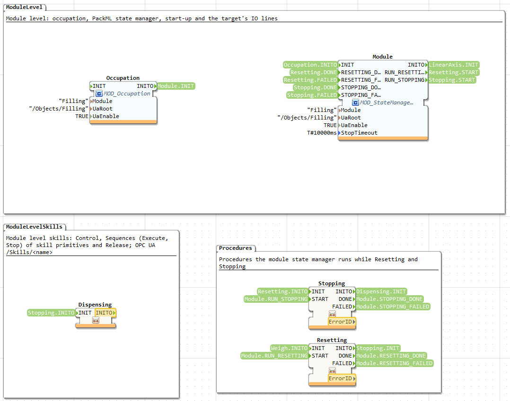

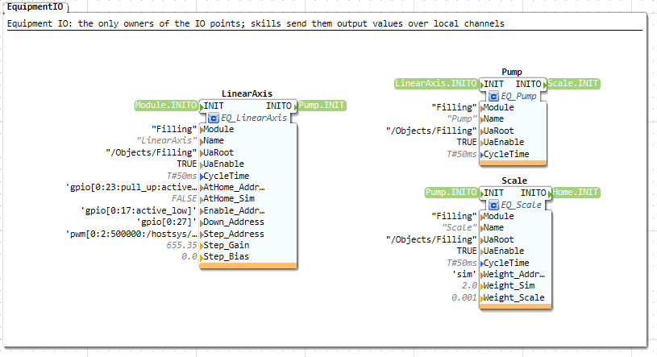

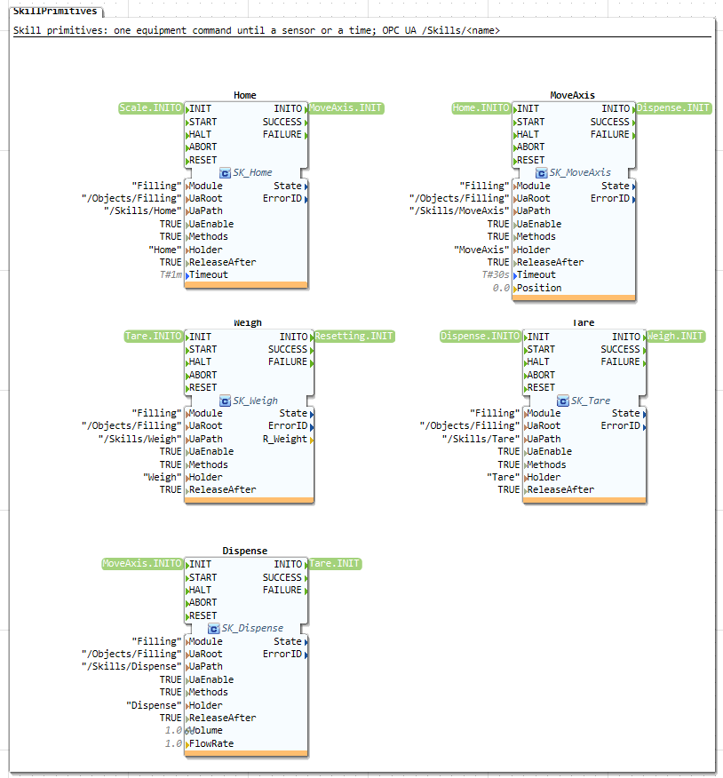

## 2. Two kinds of wire

In the IDE you see lines between blocks: **connections**. Events (the thin lines: "now do this")
and data (the values that go with them). They only connect blocks inside the same network.

Much of the traffic between the layers goes over **local channels** instead: named mailboxes in
FORTE (`loc[<name>]`), written by PUBLISH blocks and read by SUBSCRIBE blocks. Any number of blocks
can write to and read from one channel, and they need no line between them. That is why a skill
added while the program runs needs no wiring to the equipment or to the occupation. The price: these
links are not drawn in the IDE. This map draws them, from the program: each channel is a bar, each
block of the application that uses one is a column, an arrow down onto a bar writes on that channel
and an arrow up from it reads. The 13 primitives (5 offered on their own, 8 as steps of Resetting,
Stopping and Dispensing) are grouped by type.

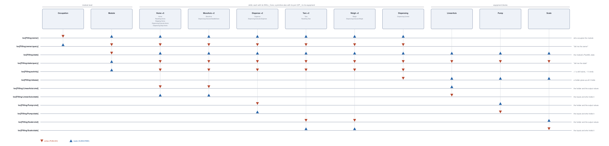

| Channel | Written by | Read by | Carries |
| --- | --- | --- | --- |
| `loc[Filling/owner]` | `Occupation` (its `PubOwner`) | every skill (the `Owner` in its `SKILL_Core`: 14) and `Module` (its `Owner`) | The session id of whoever occupies the module (empty: free) |
| `loc[Filling/owner/query]` | those same 15, once at start-up (their `Owner`'s `Query`) | `Occupation` (its `SubQuery`) | "Tell me the owner": `Occupation` answers on `owner` |
| `loc[Filling/state]` | `Module` (its `PubState`) | every skill (the `Mode` in its `SKILL_Core`: 14) and every equipment block (its `Mode`: 3) | The PackML state (a number, see section 3) |
| `loc[Filling/state/query]` | those same 17, once at start-up (their `Mode`'s `Query`) | `Module` (its `SubQuery`) | "Tell me the state": `Module` answers on `state` |
| `loc[Filling/activity]` | every skill (the `Act` in its `SKILL_Core`: 14) | `Module` (its `SubAct`) | +1 when a skill starts, -1 when it ends (Stopping waits until no skill runs) |
| `loc[Filling/release]` | `Dispensing` (the `PubRelease` in its `Control`), when its run ends | every equipment block (its `SubRelease`: 3) | "The holder Dispensing gives up": what it holds switches off and is free. A primitive's `PubRelease` is switched off (`ReleaseAll` FALSE): it gives its equipment up with its last command instead |
| `loc[Filling/LinearAxis/cmd]` | the skills that move the axis (the `EqCmd` in their port: Home ×5, MoveAxis ×2) | `LinearAxis` (its `SubCmd`) | The holder's name, the release, and the output values to switch (Enable, Down, Step), or a move to a position |
| `loc[Filling/LinearAxis/state]` | `LinearAxis` (its `PubState`) | the same 7 skills (the `EqState` in their port) | AtHome, ActualPosition, Homed, Moving and the holder |
| `loc[Filling/Pump/cmd]`, `.../state` | Dispense ×2 / `Pump` | `Pump` / Dispense ×2 | The holder and the command; the holder |
| `loc[Filling/Scale/cmd]`, `.../state` | Tare ×2, Weigh ×2 / `Scale` | `Scale` / Tare ×2, Weigh ×2 | The holder and the command; Weight and the holder |

Three things to notice in the map:

- **Only the module level talks to everyone.** `owner` and `state` go from one writer to every skill;
  `activity` goes the other way, from every skill to `Module`. The `query` channels are only used once,
  at start-up, so a block that starts late still learns the owner and the state.
- **A skill never talks to another skill.** Skills meet only at the equipment: whoever holds the
  axis is on `LinearAxis/state` for every other skill of the axis to see.
- **A piece of equipment talks only to its own skills** (its `cmd` and `state`), and listens to the
  module (`state`, `release`). That is why adding a primitive or a piece of equipment adds a column,
  and a piece of equipment two bars, but changes nothing else.

The channel names are built at start-up from the module's name (`Module "Filling"`), so the
stoppering module's blocks use `loc[Stoppering/...]` and the two never mix, even in one FORTE.

## 3. What a client can see and call

Every method takes the caller's session id (`Session`, a text the client chose when it occupied the
module) and answers at once with `[Accepted, ErrorID]`. Whether a skill then succeeds is seen in its
`State`.

| OPC UA node below `/Objects/Filling` | Kind | Served by the block | What it does |
| --- | --- | --- | --- |
| `Occupation/Occupy(Session)` | method | `Occupation.Occupy` | Occupy the module with this session id (when it is free, or again by the owner) |
| `Occupation/Release(Session)` | method | `Occupation.Release` | Give the module up (only the owner) |
| `Occupation/Occupied` | variable | `Occupation.PubUa` | Whether it is occupied (the session id is never shown) |
| `Module/Reset`, `Start`, `Stop`, `Abort`, `Clear` (Session) | methods | `Module.Reset` ... `Module.Clear` | Change the PackML state (only the owner, only where PackML allows it) |
| `Module/State` | variable | `Module.PubUa` | The PackML state |
| `Skills/Dispensing/Start(Session, Volume)` | method | `Dispensing.UaStart` | Start Dispensing with this volume (mL) |
| `Skills/Dispensing/Stop`, `Abort`, `Reset` (Session) | methods | `Dispensing.Control` (its `UaStop`, `UaAbort`, `UaReset`) | Stop, abort or reset Dispensing |
| `Skills/Dispensing/State`, `ErrorID` | variables | `Dispensing.Control` (its `PubState`) | Where Dispensing is, why it last failed |
| `Skills/Dispensing/Parameters/Volume`, `Results/Weight` | variables | `Dispensing.PubParams`, `Dispensing.PubResults` | The volume of the current or last run; the weight it measured |
| `Skills/Dispensing/Execute/<step>/State`, `ErrorID`, `Parameters/...` | variables | each step (e.g. `Dispensing.Execute.NeedleDown`) | Where each step of Dispensing is |
| `Skills/Dispensing/Stopping/Home/...` | variables | `Dispensing.Stop.Home` | The step Dispensing runs when it is stopped |
| `Skills/<primitive>/Start(Session, parameters)`, `Stop`, `Abort`, `Reset` | methods | the primitive's block (`Home`, `MoveAxis`, `Dispense`, `Tare`, `Weigh`), inside it `UaStart` and `Control` | Run one primitive on its own: `MoveAxis(Position)`, `Dispense(Volume, FlowRate)`, `Home`, `Tare`, `Weigh` |
| `Skills/<primitive>/State`, `ErrorID`, `Parameters/...`, `Results/...` | variables | the primitive's block | Its state, error, parameters and results (`Weigh`: `Results/Weight`) |
| `Procedures/Resetting/Home`, `.../Tare`, `Procedures/Stopping/Home` (`State`, `ErrorID`) | variables | `Resetting.Home`, `Resetting.Tare`, `Stopping.Home` | Where the procedures are |
| `Equipment/LinearAxis/AtHome`, `ActualPosition`, `Homed`, `Moving` | variables | `LinearAxis` (its `PubUa`) | The axis: at the switch, where it is (mm), whether that is known, whether it moves |
| `Equipment/Scale/Weight` | variable | `Scale` (its `PubUa`) | The weight (g; simulated) |

**PackML states of the module** (`Module/State`): 1 Clearing, 2 Stopped, 3 Starting, 4 Idle,
6 Execute, 7 Stopping, 8 Aborting, 9 Aborted, 15 Resetting.

**States of a skill** (`.../State`): 0 Idle, 1 Running, 2 Stopping, 3 Succeeded, 4 Failed,
5 Aborted. A skill that succeeded returns to Idle by itself after 1.5 s; a failed one stays Failed
until it is started again; an aborted one needs Reset.

**Error codes** (`ErrorID`, also the second answer of every method): 0 none, 1 PreconditionViolated
(the skill cannot start from here, e.g. MoveAxis before the axis is homed), 2 InvariantViolated
(something it needs stopped holding while it ran), 3 Timeout, 4 NotReady (the module is not in
Execute), 5 NotPermitted (the caller does not hold the occupation), 6 Busy (the skill runs, or its
equipment is held by another skill), 7 Interrupted (it was stopped), 8 OutOfRange (a parameter
outside its limits).

## 4. Following a call through the blocks

### 4.1 Occupying the module

1. The client calls `Occupation/Occupy` with a session id of its own, say `hmi-1`.
2. FORTE's OPC UA server hands the call to the block that created the method: `Occupation.Occupy`
   (a `SERVER` block). It gives the session id to `Occupation.Logic`.
3. `Occupation.Logic` accepts if nobody occupies the module (or `hmi-1` already does) and answers
   `[TRUE, 0]` through `Occupation.Occupy` back to the client; otherwise `[FALSE, 5]`.
4. `Occupation.PubOwner` writes `hmi-1` on `loc[Filling/owner]`; every skill and `Module` keep it
   (their `Owner` blocks). `Occupation.PubUa` sets `Occupation/Occupied` to TRUE.

From now on every command must carry `hmi-1`; any other session gets error 5.

### 4.2 Resetting and starting the module

1. `Module/Reset(hmi-1)` reaches `Module.Reset` (a `SERVER` block), which hands it to
   `Module.Logic`. The owner check uses `Module.Owner`; PackML allows Reset from Stopped.
2. `Module.Logic` answers `[TRUE, 0]`, goes to Resetting (15) and publishes it on
   `Module/State` and on `loc[Filling/state]`.
3. It starts the **Resetting procedure**: `Module.RUN_RESETTING` → `Resetting.START`. The procedure
   is a subapplication with two steps: `Resetting.Home` (drive the needle up to the limit switch) and
   then `Resetting.Tare` (tare the scale). Each step works like any primitive (section 4.4); here they
   take their equipment under the name `Procedures/Resetting`.
4. When both have succeeded, `Resetting.DONE` → `Module.RESETTING_DONE`: the module is Idle (4). If
   a step fails (`Resetting.Fail1` joins the two steps' failures), the module aborts: Aborting, then
   Aborted (9), and needs Clear and Reset again.
5. `Module/Start(hmi-1)` → Execute (6). Only now may a client start skills.

### 4.3 Starting Dispensing

The client calls `Skills/Dispensing/Start(hmi-1, 2.0)`: fill 2 mL.

1. **The call arrives** at `Dispensing.UaStart` (a `SERVER_2_2` block: the method's two inputs are
   the session and the volume). It hands the volume to `Dispensing.Volume` to be checked.
2. **The value is checked.** `Dispensing.Volume` (a parameter block) compares 2.0 with its limits
   (0.5 to 10 mL). Then `Dispensing.Control` gets the start request with the session and whether all
   values were in range.
3. **The start is checked.** `Dispensing.Control` (`SKILL_Core`) accepts only if `hmi-1` occupies
   the module (it knows the owner from `loc[Filling/owner]`), the module is in Execute (from
   `loc[Filling/state]`), Dispensing is not running, and the value was in range. Its answer goes
   back through `Dispensing.UaStart` to the client: `[TRUE, 0]`, or `[FALSE, <code>]` and nothing
   happens.
4. **The run begins.** `Dispensing.Control` sets `State` to Running (1), says +1 on
   `loc[Filling/activity]` (the module counts running skills), and fires `RUN`.
   `Dispensing.Volume` now holds 2.0 for the whole run; `Dispensing.PubParams` writes it to
   `Skills/Dispensing/Parameters/Volume`; and `Dispensing.Execute` (the sequence) starts.
5. **Step 1, `Dispensing.Execute.NeedleDown`** (a `MoveAxis` with the constant Position 40 mm):
   - its `Contract` says what to do: command 3 (`MoveTo`) with the argument 40, and whether it
     may start: the axis is homed (`Homed`, which its `Port` hears on
     `loc[Filling/LinearAxis/state]`);
   - its `Run` waits until the axis is free or already held by `Dispensing`;
   - it sends "move to 40 mm, holder Dispensing" on `loc[Filling/LinearAxis/cmd]` (in its `Port`,
     `Driver` turns the command into the values and `EqCmd` publishes them).
6. **The equipment moves.** The `LinearAxis` block hears the command (`SubCmd`). Its `Logic`
   checks the holder, switches the old outputs off first ("break before make"), works out the
   direction (40 mm is further down than 0) and switches Enable on, Down on and Step to 50 %. Its IO
   blocks write the pins: `Out_Enable` pulls GPIO17 low (the driver's enable is active low),
   `Out_Down` sets GPIO27 high, `Out_Step` puts 2 kHz pulses on GPIO18. The TB6600 turns the motor.
   `MoveT` times the move: 40 mm at 12.5 mm/s is 3.2 s.
7. **The equipment reports.** Every cycle `LinearAxis.Cycle` has `In_AtHome` read GPIO23, and the
   axis' `Logic` counts its position on. Changes go out on `loc[Filling/LinearAxis/state]`
   (`PubState`) and to `Equipment/LinearAxis/...` over OPC UA (`PubUa`).
8. **The step ends.** When `MoveT` runs out, the axis switches the outputs off, is no longer
   Moving and is at 40 mm. `NeedleDown` sees that on the state channel (its `Port`): its
   `Contract`'s end condition (not moving and at the position) holds, so it succeeds (State 3) and starts the
   next step. It keeps the axis held: within Dispensing, the steps share the equipment under the
   name `Dispensing`.
9. **Step 2, `Dispensing.Execute.Dispense`**, gets Dispensing's Volume (2.0) through a connection
   and has the constant FlowRate 1.0 mL/s: it sends `Run` to `Pump` and ends after Volume / FlowRate
   = 2 s (the `Timer` in its `Run`). The pump has no pins yet, so dispensing is only a time.
10. **Step 3, `Dispensing.Execute.Home`**: `Up` to the axis until `AtHome` (GPIO23) is on; the
    position is then 0 and known again.
11. **Step 4, `Dispensing.Execute.Weigh`**: `Measure` to the scale for 0.2 s; its result `Weight`
    (from `loc[Filling/Scale/state]`; simulated, 2.0 g) goes out of the sequence as Dispensing's
    result.
12. **The run ends.** `Dispensing.Execute.DONE` → `Dispensing.PubResults` writes
    `Skills/Dispensing/Results/Weight`, and `Dispensing.Control` sets Succeeded (3). It says on
    `loc[Filling/release]` that `Dispensing` gives up its equipment, so every equipment block it held
    switches off and is free; it says -1 on the activity channel; after 1.5 s it is Idle (0) again.

If a step fails (a timeout, the axis not homed, ...), the step's `FAILURE` goes through the
`Dispensing.Execute.Fail1` to `Fail3` blocks (which join the four steps' failures into one) to
`Dispensing.Control`: Dispensing is Failed (4) with that step's error code, and its equipment is
released.

### 4.4 A primitive on its own

`Skills/MoveAxis/Start(hmi-1, 30.0)` reaches the block `MoveAxis` (type `SK_MoveAxis`). Inside it
the same happens as for Dispensing, in one block: `UaStart` takes the call, `Par_Position` checks
30.0 against 0 to 60 mm, `Control` checks the session, the module state, that it is not running and
that the axis is free (`Logic.EquipmentFree`), answers, and starts `Logic`. `Logic` moves the axis as
in 4.3, steps 5 to 8, holding it under the name `MoveAxis`; when it is done, the axis is released
(`ReleaseAfter` is TRUE for a primitive on its own).

### 4.5 Stopping, aborting, releasing

- **`Skills/Dispensing/Stop`**: `Dispensing.Control` halts the running step (its `HALT`), goes to
  Stopping (2), runs the stop sequence `Dispensing.Stop` (Home: the needle back up), and ends Failed
  with error 7 Interrupted.
- **`Module/Stop`**: the module goes to Stopping (7). Every skill a client started stops as above;
  `Module` waits until no skill runs (the activity count is 0), then runs the Stopping procedure
  (`Stopping.Home`) and is Stopped (2). If the skills have not stopped after `StopTimeout` (10 s),
  the module aborts instead.
- **`Module/Abort`** or **`Skills/<skill>/Abort`**: everything stops where it is. The equipment
  blocks switch all outputs off at once (they watch the module state for Aborting), the skills go to
  Aborted (5). `Clear` then `Reset` brings the module back; `Skills/<skill>/Reset` brings an aborted
  skill back to Idle.
- **`Occupation/Release`**: the module is free again. It does not stop running skills: stop the
  module first.

### 4.6 Start-up

When FORTE starts (or the program is deployed), the resource's own `START` block fires and every
block initialises in a chain, each `INITO` to the next `INIT`: `Occupation`, `Module`, the equipment
(which set up their pins and start reading), the offered primitives, the procedures, then
Dispensing. Initialising is when the blocks create their OPC UA methods and variables. A skill added
while the program runs is appended to the end of this chain.

## 5. Every block of the application

The application `Filling_pi` (the one deployed to the Pi; `Filling` is the same for the PC, with its
IO on the Modbus simulator).

| Block | Type | What it does |
| --- | --- | --- |
| `Occupation` | `MOD_Occupation` | Who may command the module (4.1) |
| `Module` | `MOD_StateManager` | The PackML state; runs the procedures (4.2, 4.5) |
| `LinearAxis` | `EQ_LinearAxis` | The needle's axis: owns Enable (GPIO17), Down (GPIO27), Step (PWM on GPIO18) and AtHome (GPIO23); keeps the position by counting time |
| `Pump` | `EQ_Pump` | The filling pump: no pins yet; holds the command `Run` while a skill dispenses |
| `Scale` | `EQ_Scale` | The scale: its Weight is simulated (`'sim'`) |
| `Home` | `SK_Home` | Primitive: the needle up until the limit switch (`Up` until `AtHome`; timeout 60 s) |
| `MoveAxis` | `SK_MoveAxis` | Primitive: the needle to `Position` (0 to 60 mm); needs `Homed`; timeout 30 s |
| `Dispense` | `SK_Dispense` | Primitive: run the pump for `Volume` / `FlowRate` seconds |
| `Tare` | `SK_Tare` | Primitive: tare the scale (2 s) |
| `Weigh` | `SK_Weigh` | Primitive: read the weight (0.2 s); result `Weight` |
| `Resetting` (subapplication) | | The procedure run on Reset: `Resetting.Home`, `Resetting.Tare`, `Resetting.Fail1` |
| `Stopping` (subapplication) | | The procedure run on Stop: `Stopping.Home` |
| `Dispensing` (subapplication) | | The module level skill: |
| `Dispensing.Control` | `SKILL_Core` | Its state machine, Stop/Abort/Reset methods, State and ErrorID (4.3) |
| `Dispensing.UaStart` | `SERVER_2_2` | The method `Skills/Dispensing/Start(Session, Volume)` |
| `Dispensing.Volume` | `SKILL_Param_LREAL` | The parameter Volume: default 1.0, limits 0.5 to 10 mL |
| `Dispensing.PubParams` | `PUBLISH_1` | Writes `Parameters/Volume` |
| `Dispensing.PubResults` | `PUBLISH_1` | Writes `Results/Weight` |
| `Dispensing.Execute` (subapplication) | | The steps, in order: `NeedleDown` (MoveAxis, Position 40), `Dispense` (FlowRate 1.0, Volume from Dispensing), `Home`, `Weigh` (its Weight is Dispensing's result); `Fail1` to `Fail3` join their failures |
| `Dispensing.Stop` (subapplication) | | What Dispensing runs when it is stopped: `Home` |

The steps inside Dispensing and the procedures are blocks of the same primitive types as the
offered ones, each with its own name, OPC UA variables and constants: a primitive can be used in
several places at once.

Each of these blocks, its type and the blocks inside it are explained with pictures in sections 7
(the types every module has) and 8 (the filling module's own types and the subapplications).

## 6. Before the blocks: a few words, and how to read the pictures

### 6.1 Types and blocks

A **block type** is like a cookie cutter, and a **block** (also called an instance) is one cookie
made with it. The type says what pins the block has and what it does; each block has its own name,
its own values and its own memory. `SK_Home` is a type. The filling program has five blocks of that
type: `Home` (offered on its own), `Resetting.Home`, `Stopping.Home`, `Dispensing.Execute.Home` and
`Dispensing.Stop.Home`. Each of them runs on its own and has its own OPC UA folder.

There are five kinds of type, and you meet all of them in this program:

| Kind | What it is | In everyday words | Examples |
| --- | --- | --- | --- |
| **Basic** | A state machine (the IDE calls it the ECC) with small programs in Structured Text | A flow chart: "in this state, when that event comes, do this" | `SKILL_Control`, `SC_Home`, `EL_LinearAxis` |
| **Simple** | One small program per event, no states | A calculator: values in, values out | `EV_LinearAxis`, `SKILL_Param_LREAL`, `MOD_ActivityCount` |
| **Composite** | A network of other blocks, closed into one block | A box of parts with plugs on the outside | `SK_Home`, `EQ_LinearAxis`, `SKILL_Core`, `IO_DO` |
| **Service** | Built into FORTE in C++: talks to the world outside the program (the network, OPC UA, the pins, the clock) | A socket in the wall | `E_DELAY`, `PUBLISH_1`, `SERVER_2_1`, `QX`, `GPIOChip` |
| **Subapplication** | A network of blocks in the application that is drawn as one block, but has no type of its own | A folder | `Dispensing`, `Resetting`, `Stopping` |

### 6.2 Events and data

A block has two kinds of pin:

- **Event pins** (top, triangles) carry a short "now!": like a doorbell. In IEC 61499 a block does
  nothing until an event arrives. `INIT` means "set yourself up", `START` "begin", `DONE` "I am
  finished".
- **Data pins** (bottom, squares) carry values: like the note that comes with the doorbell. Each
  event says which data it brings along (its *WITH*): when `INIT` arrives, the block takes the values
  on `Module`, `UaRoot` and the others at that moment. In the type pictures the thin lines on the
  outside show which data goes with which event.

The data types: `BOOL` is TRUE or FALSE (green in the pictures); `INT`, `UINT`, `USINT` and `DINT`
are whole numbers (U: no minus sign), `LREAL` a number with decimals, `TIME` a time such as
`T#500ms` (blue); `STRING` and `WSTRING` are text (purple); `ANY` is a pin of a generic block that
takes any type (grey).

### 6.3 The start-up chain

Every block must be set up once before it works: told its name, its addresses, and given the
chance to create its OPC UA nodes and open its channels. The program does that like a row of
dominoes: each block's `INITO` ("I am set up") is wired to the next block's `INIT`. The first domino
is the resource's `START` block (section 7.1). In `Filling_pi` the order is `Occupation`, `Module`,
`LinearAxis`, `Pump`, `Scale`, `Home`, `MoveAxis`, `Dispense`, `Tare`, `Weigh`, `Resetting`,
`Stopping`, `Dispensing`. Inside a composite block the chain goes on through its parts the same way.
A skill added while the module runs is put at the end of the chain.

### 6.4 How the IDE shows the program, and so the pictures

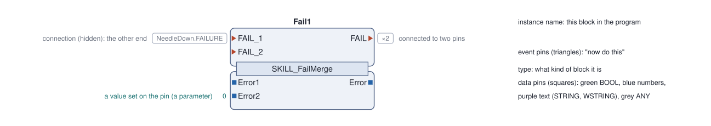

The legend is a drawing; the screenshots differ from it in three things. The IDE colours a label by
the data type of its pin: green for an event, brown for a string (names, paths, channel ids),
grey-green for a BOOL, yellow for an LREAL and blue for a whole number or a time. A label with a
number is a green or coloured box with only the number in it (`2`). And inside a block you opened
from the application, a pin on the outside is named after that block: inside the block `Out_Down`
(an `IO_DO`), its input `INIT` is labelled `Out_Down.INIT`.

- **Name and type.** Above a block is its name (the block in this program); in the narrow band in
  its middle is its type (what kind of block it is). A yellow block is a subapplication.
- **Values.** Text left of an input pin is a value set on that pin (a *parameter*): `"Filling"`,
  `TRUE`, `T#500ms`. Text in quotes is a string.
- **Connections are hidden.** The program has hundreds of connections; drawn as lines they would fill
  the screen. So they are hidden, and the IDE writes a small label at each connected pin
  instead, naming the other end: `Control.START_REQ` is the pin `START_REQ` of the block
  `Control`. A label with a number (`×2`) means the pin is connected to that many pins. A label
  without a dot (`INIT`, `Module`) is a pin on the outside of the network you are looking into: of
  the composite type, or of the subapplication.
- **The outside pins** of a composite type or subapplication are drawn at the left (inputs) and
  right (outputs) edge of its network, as the IDE draws them.
- **Groups** are the grey frames with a title and a comment. They only keep blocks together for the
  reader; they change nothing in the program.
- **Plugs and sockets** (orange, below the data pins: a filled tab on the right is a plug, an open
  notch on the left a socket) are adapters: one connection that carries a bundle of events and data
  (section 6.6).
- **State machines** (the pictures named `ecc-`) show each state as a blue box with its actions to
  the right (the algorithm, then the event it sends) and each transition as a curve through its
  condition. The initial state has a double frame and is at the top; the pictures use the states'
  places in the type files, so they look as the IDE's *ECC* tab shows them.

### 6.5 Who made a type

The IDE writes a type with a prefix that says where it comes from:

| Prefix | Where the type comes from | The same in every module? |
| --- | --- | --- |
| `iec61499::events`, `iec61499::net`, `eclipse4diac::io` | The 4diac standard library, built into FORTE | Yes |
| `modlib::` | The lab's module library ModLib, in every module's project: you use it, you never change it | Yes |
| `filling::` | The filling module's own types | No: the stoppering module has `stoppering::`, the capping module `capping::`. Your new types go into the package of the module you work on |

The start of a type's name says what it is for: `MOD_` the module level, `SKILL_` the parts every
skill shares, `IO_` a pin, `SK_` a skill primitive, `SC_` its contract (the part that is its own),
`EQ_` a piece of equipment, `EL_` its logic, `EP_` the equipment as its skills see it, `EV_` its state
for a skill, `EC_` its command table.

**Section 7** explains the types that are the same in every module: you never change them for a new
module, you only give them values. **Section 8** explains the filling module's own types: another
module has others (section 9), and the types you make are of this kind (section 10).

### 6.6 Adapters: one plug, one socket

Some blocks talk to each other with a whole bundle of events and data: "start, with these seven
values", "here is the newest state, with these three", "done". Wiring each of those as its own
connection gives a dozen thin wires between two blocks. An **adapter** bundles them into one, like a
multi-pin connector on a cable: one block has the **plug**, the other the **socket**, and one
connection joins them.

- An adapter type (a file `.adp`, the prefix `A`) lists what the connection carries: its outputs go
  from the plug to the socket, its inputs come back.
- A block declares its plugs and sockets below its data pins. In the pictures a plug is a filled
  orange tab on the right, a socket an open orange notch on the left; the label at it names the
  other end, as for any connection.
- Inside a basic block, the adapter's events and data are used with the adapter's name in front:
  an action `Run.START` sends the event `START` out of the plug `Run`, `Run.Pre := Homed;` sets the
  value that goes with it, and a transition on `Skill.SEND` waits for the event `SEND` at the
  socket `Skill`.
- Inside a composite, the type's own plugs and sockets appear as blocks of their own (at the edge of
  the network), whose pins are wired to the blocks inside like any other.

The program uses two adapters, both inside every skill primitive (section 7.7): `AContract`, from
the primitive's contract to its run, and `AEquipment`, from the run to the equipment's port. The
application itself has none, so nothing changes for what runs or is created online.

## 7. The blocks that are always there

These come from the 4diac standard library and from ModLib. They are the same in the filling,
stoppering and capping modules, and in any other module. You never change them: you put blocks of
them into your own types and give them values. Because the same type runs in every module, a
change to one would change all of them.

### 7.1 Timers and the start signal

#### `E_DELAY`: a kitchen timer

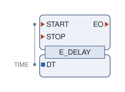

`START` starts the timer for the time on `DT`; when that time has passed, `EO` fires once. `STOP`
cancels it. Whenever something in the program must wait, an `E_DELAY` does the waiting:

- `WaitT` in `SKILL_Run`: waits up to 0.5 s for the equipment to become free;
- `Timer` in `SKILL_Run`: how long a timed skill runs, or the timeout of a skill a sensor ends;
- `PhaseT` in an equipment port: how long a phase of a command lasts (stoppering's `Back`, section 9.2);
- `MoveT` in the axis: how long a move to a position takes;
- `ToIdle` in every skill: 1.5 s after success the skill shows Idle again;
- `Wd` in the state manager: the watchdog, how long Stopping may take (`StopTimeout`, 10 s).

#### `E_CYCLE`: a metronome

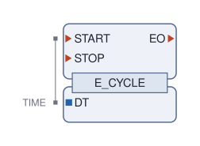

After `START`, `EO` fires again and again, every `DT`, until `STOP`. Inside it is only an `E_DELAY`
whose end starts it again:

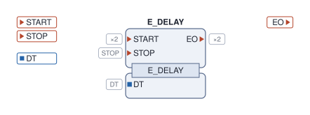

Every equipment block has one (`Cycle`, every 50 ms): on each tick it reads its inputs and writes its
outputs again.

#### `E_RESTART`: the power-on signal

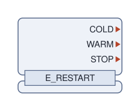

It has no inputs. It fires `COLD` when FORTE starts, `WARM` when it restarts, and `STOP` when the
resource is stopped. The resource the program runs in (`EMB_RES`) has one, named `START`, and the
system file wires `START.COLD` and `START.WARM` to `Occupation.INIT`: the first domino of the
start-up chain (section 6.3). You see it in the IDE in the device's resource, not in the
application.

#### `E_CTU`, `E_T_FF`: in the library, not used

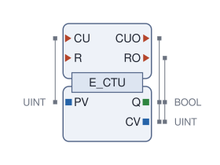 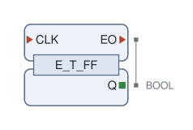

They come with the standard library. `E_CTU` counts events (`CU` counts one up, `R` back to 0;
`Q` is TRUE once the count `CV` reaches `PV`). `E_T_FF` flips `Q` between TRUE and FALSE on every
`CLK`. The filling program uses neither.

### 7.2 Talking: local channels, OPC UA and Modbus

#### `PUBLISH_n` and `SUBSCRIBE_n`: send and receive

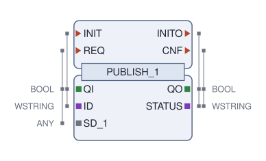 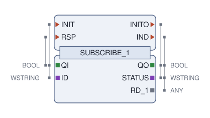

A `PUBLISH` sends its values `SD_1` to `SD_n` to the address on `ID`, each time `REQ` arrives. A
`SUBSCRIBE` listens on its `ID`; when something arrives it fires `IND`, with the values on `RD_1` to
`RD_n`. `n` is how many values: the program has `PUBLISH_0`, `_1`, `_2`, `_4`, `_5`, `_8` and
`SUBSCRIBE_0`, `_1`, `_2`, `_5`, `_8` (4diac makes them from one template, for any `n`). `QI` must be
TRUE for the block to work: the program sets it FALSE to switch a block off (for example the OPC UA
ones when `UaEnable` is FALSE).

What the `ID` says:

- `loc[Filling/owner]`: a **local channel** inside FORTE (section 2). Think of a notice board in
  the hallway: any block can pin up a note (publish), and every block that looks at that board
  (subscribes) reads it. Publisher and subscribers must agree on how many values there are and of
  which type. A subscriber only hears what is sent after it started listening; that is why the
  blocks that need the owner or the module state ask for it once when they start (the `query`
  channels, sections 7.4 and 7.5).
- `opc_ua[WRITE;/Objects/Filling/Module/State]`: write OPC UA **variables** that a client (the HMI,
  UaExpert) can read. One path per value, separated by `;`. FORTE creates the variables if they are
  not there yet.

#### `SERVER_2_n`: an OPC UA method, like a phone line

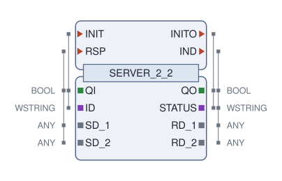

With an `ID` such as `opc_ua[CREATE_METHOD;/Objects/Filling/Module/Reset]` it creates that method
in FORTE's OPC UA server when it is set up. When a client calls the method, `IND` fires with the
call's arguments on `RD_1` to `RD_n`. In this program `RD_1` is always the caller's session id and
the others are the skill's parameters. The program decides, then sends `RSP` with `SD_1` (Accepted)
and `SD_2` (ErrorID): that is the answer the client gets back. The 2 is the number of answers, `n`
the number of inputs: `SERVER_2_1` (the session only), `SERVER_2_2` (one parameter), `SERVER_2_3`
(two).

#### `CLIENT_1_0` and `CLIENT_0_1`: Modbus

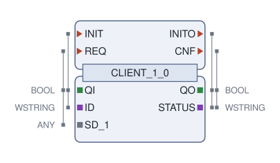 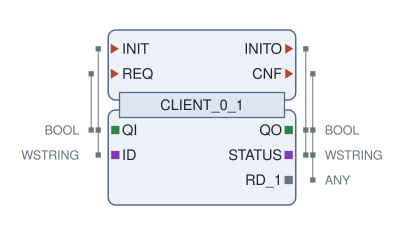

Used only inside the IO blocks (section 7.9), for the PC target, whose pins are registers of the
Modbus simulator. `CLIENT_1_0` writes one value (`SD_1`) to a Modbus coil or register, `CLIENT_0_1`
reads one (`RD_1`). The `ID` names the server and the address, for example
`modbus[127.0.0.1:1502:1:10:d0:]`. On the Pi they stay switched off (`QI` FALSE).

### 7.3 Pins: FORTE's own IO blocks

#### `IX`, `QX`, `IW`, `QW`

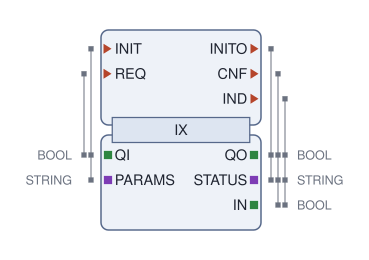 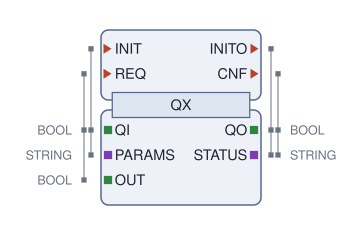
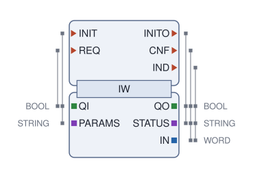 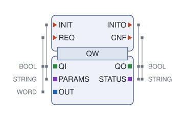

FORTE's blocks for one IO point, named as in a PLC: `I` input, `Q` output, `X` a bit (TRUE or
FALSE), `W` a word (a number from 0 to 65535). `IX` reads a bit, `QX` writes one, `IW` reads a word,
`QW` writes one. `PARAMS` names the point; the IO blocks give it the name a `GPIOChip` or `PWMChip`
registered (below). They are only used inside the IO blocks (`Local`).

#### `GPIOChip`: set up one Raspberry Pi pin

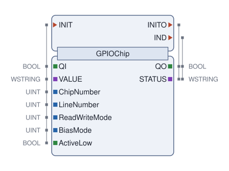

When it is set up, it opens one line (`LineNumber`) of a GPIO chip (`ChipNumber`) of the Pi: as an
input or an output (`ReadWriteMode`), with the pull-up or pull-down resistor on or off
(`BiasMode`), and inverted or not (`ActiveLow`: TRUE means "on" is a low voltage). It registers the
line under the name on `VALUE`; an `IX` or `QX` with that name then reads or writes it. Inside
`IO_DI` and `IO_DO` (`Line`).

#### `PWMChip`: set up one PWM channel

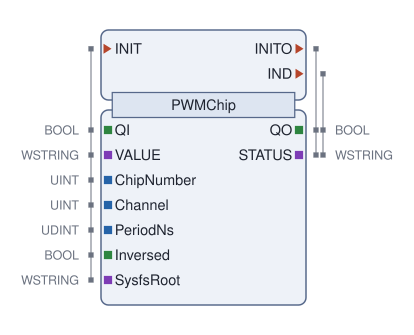

PWM switches a pin on and off very fast; the share of the time it is on is the *duty*. When it is
set up, `PWMChip` opens one channel (`ChipNumber`, `Channel`) with its period (`PeriodNs`: 500 000
ns is 2 kHz), in the folder `SysfsRoot` (in the Pi's container the Pi's `/sys/class/pwm` is passed
in as `/hostsys/class/pwm`), and registers it as `VALUE`. A `QW` with that name then sets the duty:
0 is off, 65535 always on. Inside `IO_AO` (`Line`). The axis's step pulses come from one: every
period is one step of the motor.

### 7.4 Who may command: `MOD_Occupation`

Think of the key to a shared lab machine: whoever holds the key may use the machine; everyone else
waits until it is handed back. The key here is a session id, a text the client makes up.

#### `MOD_Occupation` (composite)

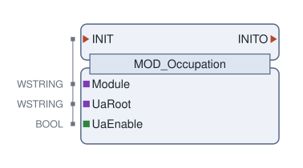

Its inputs are the module's name (`Module`, `"Filling"`), its OPC UA folder (`UaRoot`,
`"/Objects/Filling"`) and whether to use OPC UA at all (`UaEnable`). It offers the methods
`Occupation/Occupy(Session)` and `Occupation/Release(Session)`, remembers the owner, publishes
`Occupation/Occupied` (never the session id itself: it works like a password) and tells every block
of the module who the owner is, on `loc[Filling/owner]`.

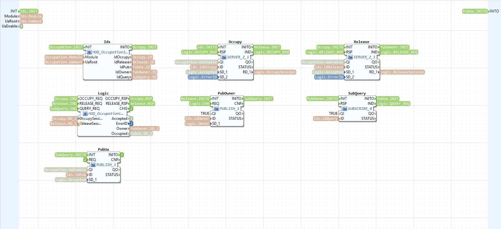

| Inside | Type | What it does |
| --- | --- | --- |
| `Ids` | `MOD_OccupationIds` | Builds the addresses below from the module's name and OPC UA folder |
| `Occupy`, `Release` | `SERVER_2_1` | The two OPC UA methods (one input: the session; two answers: Accepted, ErrorID) |
| `Logic` | `MOD_OccupationLogic` | Decides who may occupy and release |
| `PubOwner` | `PUBLISH_1` | Tells every block the owner, on `loc[Filling/owner]` |
| `SubQuery` | `SUBSCRIBE_0` | Hears a block that asks for the owner (on `loc[Filling/owner/query]`) |
| `PubUa` | `PUBLISH_1` | Writes `Occupation/Occupied` |

How it runs: at start-up `Ids` builds the addresses, the methods are created and `Occupied` is
written once (FALSE). A call of `Occupy` goes `Occupy.IND → Logic.OCCUPY_REQ`; `Logic` answers on
`OCCUPY_RSP → Occupy.RSP` (back to the client) and, when something changed, fires `CHG`:
`PubOwner` and `PubUa` send the new owner and `Occupied`. When a block that starts later asks
(`SubQuery.IND → Logic.QUERY_REQ`), `CHG` fires once more, so the owner is sent again.

#### `MOD_OccupationIds` (simple)

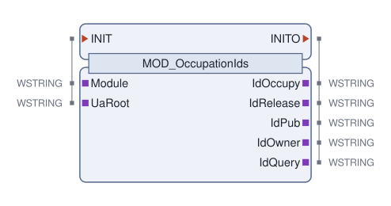

Builds the five addresses once, at start-up: `opc_ua[CREATE_METHOD;/Objects/Filling/Occupation/Occupy]`,
the same for `Release`, `opc_ua[WRITE;/Objects/Filling/Occupation/Occupied]`, `loc[Filling/owner]`
and `loc[Filling/owner/query]`. Because they are built from `Module` and `UaRoot`, the same block
works in every module.

#### `MOD_OccupationLogic` (basic)

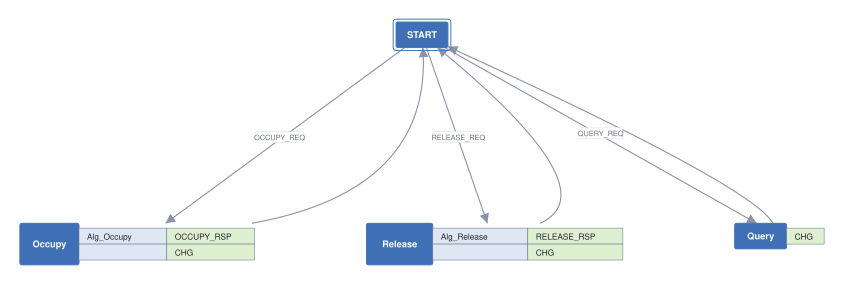

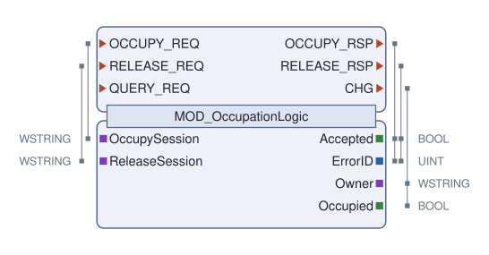

The whole rule in two sentences: `Occupy` is accepted when the session id is not empty and the
module is free or already held by that same session; `Release` is accepted only from the owner.
Otherwise the answer is `[FALSE, 5]` (NotPermitted). Its state machine waits in `START`; each request
moves it to a state that runs one small program, answers and goes back. Note that releasing does not
stop skills that are running: stop the module first.

#### `MOD_OwnerView` (composite) and `MOD_OwnerLatch` (simple): the ear for the owner

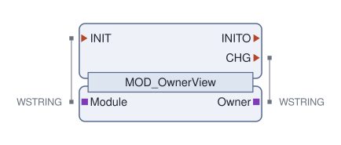 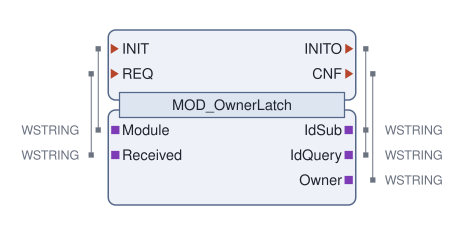

Every block that must know the owner has a `MOD_OwnerView` inside (`Owner` in `SKILL_Core` and in
`MOD_StateManager`). It gives the owner on its output `Owner` and fires `CHG` when it changes.

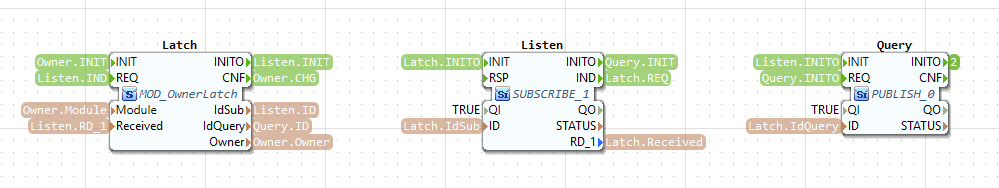

Inside: `Latch` (a `MOD_OwnerLatch`) builds the two channel names and keeps the last owner heard;
`Listen` (`SUBSCRIBE_1`) listens on `loc[Filling/owner]`; `Query` (`PUBLISH_0`) sends one empty
message on `loc[Filling/owner/query]` at start-up, which means "who is the owner?". The occupation
then sends the owner again (above). Without the question, a skill added while the module runs would
not know the owner until it changed.

### 7.5 The module's state: `MOD_StateManager`

The module's state is like the main switch and the traffic light of a machine together: it says
whether the module may work now. The states and their numbers are those of PackML, a standard for
machine states.

#### `MOD_StateManager` (composite)

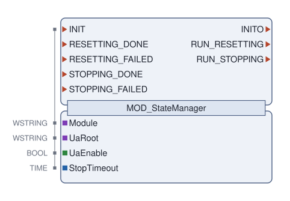

Inputs: `Module`, `UaRoot`, `UaEnable`, and `StopTimeout` (`T#10s`: how long Stopping may wait for
the skills). It offers `Module/Reset`, `Start`, `Stop`, `Abort` and `Clear` (each with the session
id), publishes `Module/State` and `loc[Filling/state]`, and runs the two procedures: `RUN_RESETTING`
and `RUN_STOPPING` are wired to the subapplications `Resetting.START` and `Stopping.START`, and their
`DONE` and `FAILED` come back on `RESETTING_DONE` and the others.

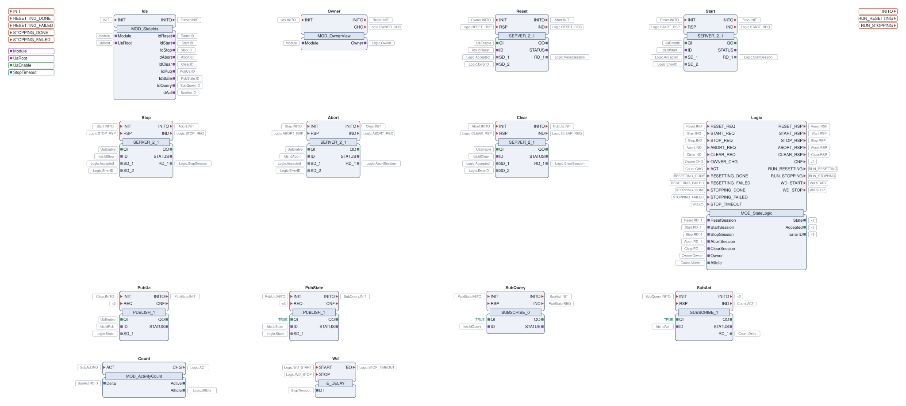

| Inside | Type | What it does |
| --- | --- | --- |
| `Ids` | `MOD_StateIds` | Builds the addresses (`/Objects/Filling/Module/...`) and channel names |
| `Owner` | `MOD_OwnerView` | Knows the owner: only the owner may change the state |
| `Reset`, `Start`, `Stop`, `Abort`, `Clear` | `SERVER_2_1` | The five OPC UA methods |
| `Logic` | `MOD_StateLogic` | The PackML state machine |
| `PubUa`, `PubState` | `PUBLISH_1` | Write the state to `Module/State` and to `loc[Filling/state]` |
| `SubQuery` | `SUBSCRIBE_0` | Hears a block that asks for the state; `PubState` then sends it again |
| `SubAct`, `Count` | `SUBSCRIBE_1`, `MOD_ActivityCount` | Hear the skills' +1 and -1 on `loc[Filling/activity]` and count how many run |
| `Wd` | `E_DELAY` | The watchdog: when the skills have not stopped after `StopTimeout`, the module aborts |

#### `MOD_StateLogic` (basic): the PackML state machine

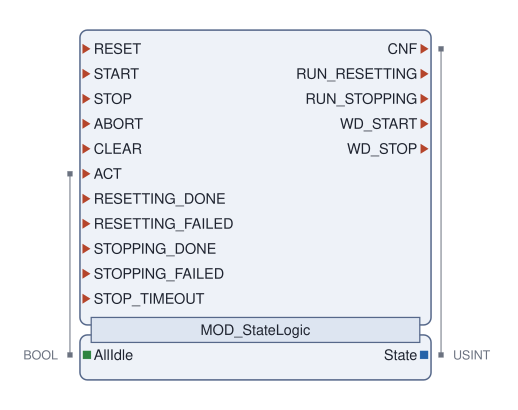

```
 Stopped (2) ──Reset──► Resetting (15) ──procedure done──► Idle (4) ──Start──► Starting (3) ──► Execute (6)
                            │ procedure failed
                            ▼
                         Aborting (8)

 Resetting, Idle or Execute ──Stop──► Stopping (7) ──no skill runs any more──► Stopping procedure
                                         │                                        │ done
                                         │ StopTimeout, or the procedure failed    ▼
                                         ▼                                     Stopped (2)
                                      Aborting (8)

 any state but Aborted ──Abort──► Aborting (8) ──► Aborted (9) ──Clear──► Clearing (1) ──► Stopped (2)
```

| Command | Accepted only in | What happens |
| --- | --- | --- |
| Reset | Stopped | Resetting: runs the Resetting procedure (home, tare). Idle when it is done, Aborting if it fails |
| Start | Idle | Starting, at once Execute. Only now may skills be started |
| Stop | Resetting, Idle, Execute | Stopping: every skill a client started stops; when none runs any more (the count is 0) the Stopping procedure runs (home), then Stopped. If the skills still run after `StopTimeout`, or the procedure fails: Aborting |
| Abort | every state but Aborted | Aborting, at once Aborted. Every skill aborts and every piece of equipment switches all off |
| Clear | Aborted | Clearing, at once Stopped |

Every command must come from the owner (otherwise `[FALSE, 5]`), and in a state where it is not
allowed the answer is `[FALSE, 4]` (NotReady). That is decided in front of the state machine, by
`MOD_StateGate` (below): `MOD_StateLogic` itself only takes the accepted commands, `RESET`, `START`,
`STOP`, `ABORT` and `CLEAR`, from state to state (13 states, 24 transitions):

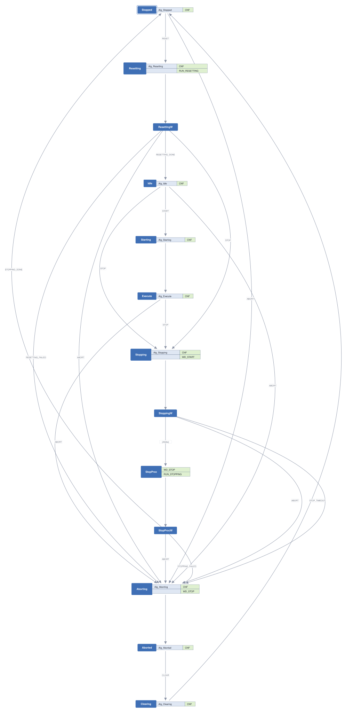

#### `MOD_StateGate` (basic): the module's front desk

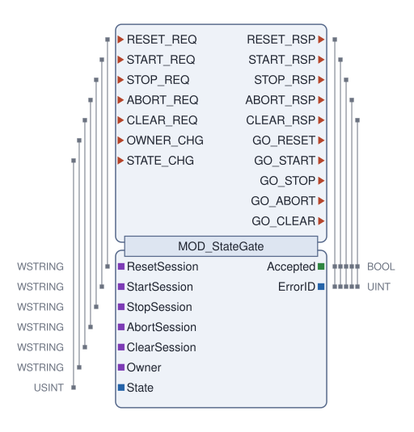

It answers each of the five methods at once, `[Accepted, ErrorID]`: only the owner (5), only in a
state the table above allows (4). It decides on the state `MOD_StateLogic` publishes (`STATE_CHG`),
and passes an accepted command on (`GO_RESET`, `GO_START`, ...). Each method has a check state
(`Chk...`, which answers) and a go state (`Go...`, which passes it on):

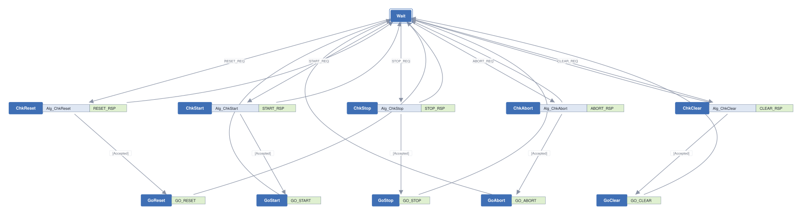

#### `MOD_StateIds` (simple)

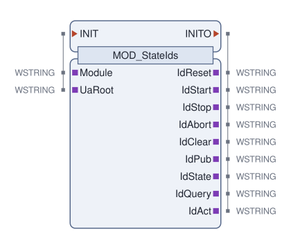

Builds the nine addresses at start-up: the five methods `opc_ua[CREATE_METHOD;/Objects/Filling/Module/Reset]`
and the others, `opc_ua[WRITE;/Objects/Filling/Module/State]`, and the channels `loc[Filling/state]`,
`loc[Filling/state/query]` and `loc[Filling/activity]`.

#### `MOD_ActivityCount` (simple): a tally counter at the door

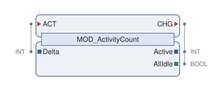

Every skill says +1 on the activity channel when it starts and -1 when it ends. This block adds them
up (`Active`, never below 0) and says `AllIdle` when the count is 0. Stopping waits for that.

#### `MOD_StateView` (composite) and `MOD_StateLatch` (simple): the ear for the module state

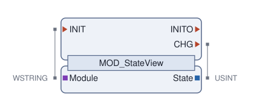 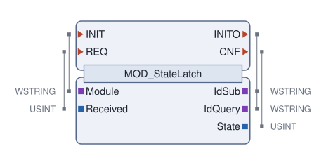

Built exactly like `MOD_OwnerView` (section 7.4), for the module state: it listens on
`loc[Filling/state]`, asks once on `loc[Filling/state/query]`, and gives `State` with `CHG`. Every
skill has one (`Mode` in `SKILL_Core`: may it start, must it stop?) and every piece of equipment
(`Mode` in `EQ_...`: everything off when the module aborts).

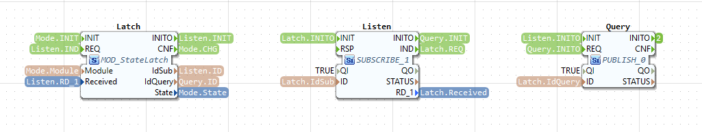

### 7.6 What every skill shares: `SKILL_Core`

Think of the front desk of a workshop: it takes the customer's order, checks that the customer may
order and that the workshop is open, says yes or no, keeps the status board up to date, and only
then hands the job to the people who do the work. Every skill has one, whatever it does: each
primitive as `Control` inside its `SK_` block, and each module level skill as its `Control` block.

#### `SKILL_Core` (composite)

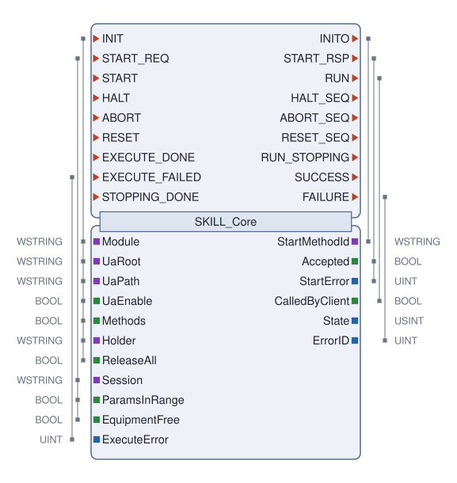

The inputs set once at start-up: `Module`, `UaRoot`, `UaPath` (the skill's folder below `UaRoot`,
such as `/Skills/Dispensing`), `UaEnable`, `Methods` (offer Start, Stop, Abort and Reset over OPC UA:
TRUE when the skill is offered on its own, FALSE for a step that its parent runs), `Holder` (the name
the equipment is held under) and `ReleaseAll` (TRUE for a module level skill: give up everything held
under `Holder` when a run ends).

Its events, in plain words:

| In | Means | Out | Means |
| --- | --- | --- | --- |
| `START_REQ` | A client called Start (the parameters are already checked) | `START_RSP` | The answer to the client |
| `START`, `HALT`, `ABORT`, `RESET` | The same, from a parent (a step in a sequence): no session check | `RUN` | Go: the parameters are taken and the work starts |
| `EXECUTE_DONE`, `EXECUTE_FAILED` | The work ended well, or failed (`ExecuteError`) | `HALT_SEQ`, `ABORT_SEQ`, `RESET_SEQ` | Stop, abort or reset the work |
| `STOPPING_DONE` | The stop sequence ended | `RUN_STOPPING` | Run the stop sequence |
| | | `SUCCESS`, `FAILURE` | Tell the parent how the run ended |

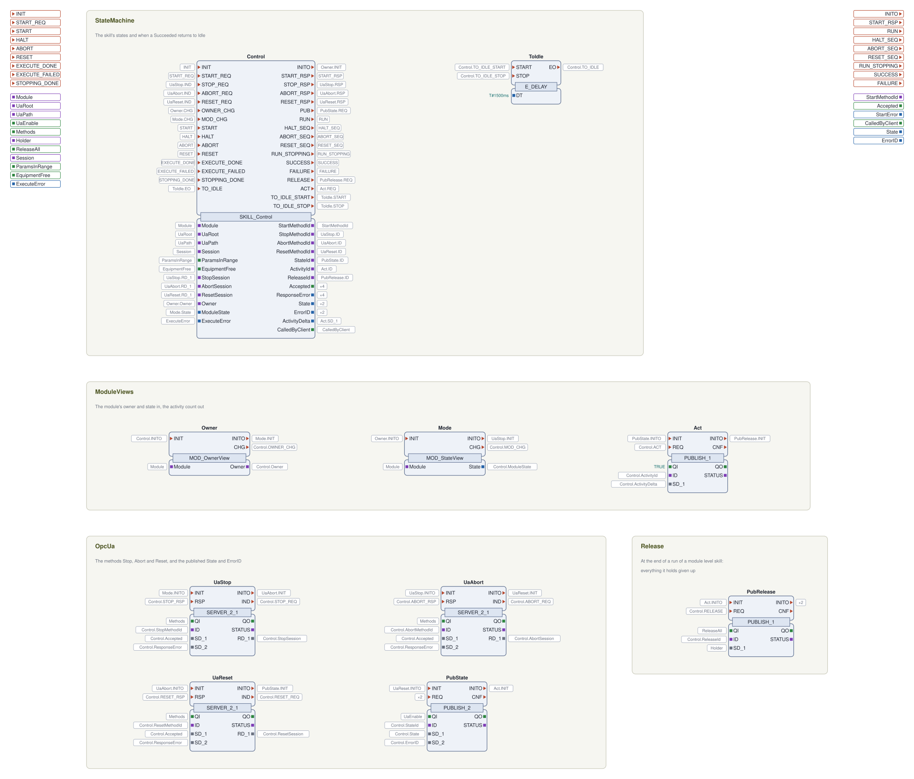

| Inside | Type | What it does |
| --- | --- | --- |
| `Gate` | `SKILL_Gate` | The front desk itself: decides a client's command and answers it; passes on what it accepts, a parent's commands, and what the module's state means for the skill (below) |
| `Control` | `SKILL_Control` | The skill's state machine (below) |
| `Owner` | `MOD_OwnerView` | Knows the owner (only the owner may command the skill over OPC UA) |
| `Mode` | `MOD_StateView` | Knows the module state: start only in Execute; stop or abort with the module |
| `UaStop`, `UaAbort`, `UaReset` | `SERVER_2_1` | The OPC UA methods Stop, Abort, Reset. The Start method is outside `SKILL_Core`, because its size follows the skill's parameters |
| `PubState` | `PUBLISH_2` | Writes `State` and `ErrorID` |
| `Act` | `PUBLISH_1` | Says +1 or -1 on the activity channel |
| `ToIdle` | `E_DELAY` | Brings a succeeded skill back to Idle after 1.5 s |
| `PubRelease` | `PUBLISH_1` | When a run ends, says on `loc[Filling/release]` that `Holder` gives up its equipment. Only switched on with `ReleaseAll` (a module level skill); a primitive gives its equipment up with its last command instead |

Two questions are kept apart here: *may this caller do this now?* (`Gate`) and *what does the skill
do?* (`Control`). One block for both would need a state machine in which every state takes every
request and every check finds its way back; kept apart, each stays small enough to read.

#### `SKILL_Gate` (basic): the front desk's decision

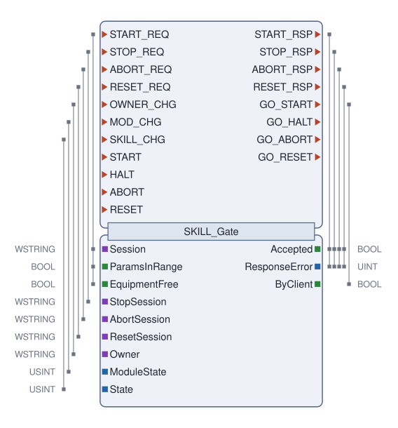

A client's Start is checked in this order; the first that fails gives the answer:

| Check | If it fails |
| --- | --- |
| The caller holds the occupation | `[FALSE, 5]` NotPermitted |
| The module is in Execute | `[FALSE, 4]` NotReady |
| The skill does not run (not Running or Stopping) | `[FALSE, 6]` Busy |
| The skill is not Aborted | `[FALSE, 4]` NotReady (Reset it first) |
| Every parameter is within its limits | `[FALSE, 8]` OutOfRange |
| Its equipment is free, or held by this skill | `[FALSE, 6]` Busy |

Stop is accepted only while Running, Abort in every state but Aborted, Reset only in Aborted; each
only from the owner (5) and otherwise 4. An accepted command goes on to `Control` as `GO_START`
(with `ByClient` TRUE), `GO_HALT`, `GO_ABORT` or `GO_RESET`: the same commands a parent gives, which
the gate passes on unchecked (`ByClient` FALSE for a parent's start). The module commands the skill
too: when the module aborts, the gate aborts the skill; when the module is cleared or stopped, it
resets an aborted skill; and when the module stops, it halts a skill a client started (a step is
stopped by its parent instead). The gate decides on the skill's state as `Control` publishes it
(`SKILL_CHG`).

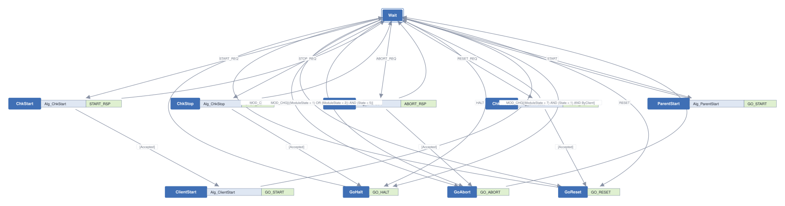

#### `SKILL_Control` (basic): the skill's state machine

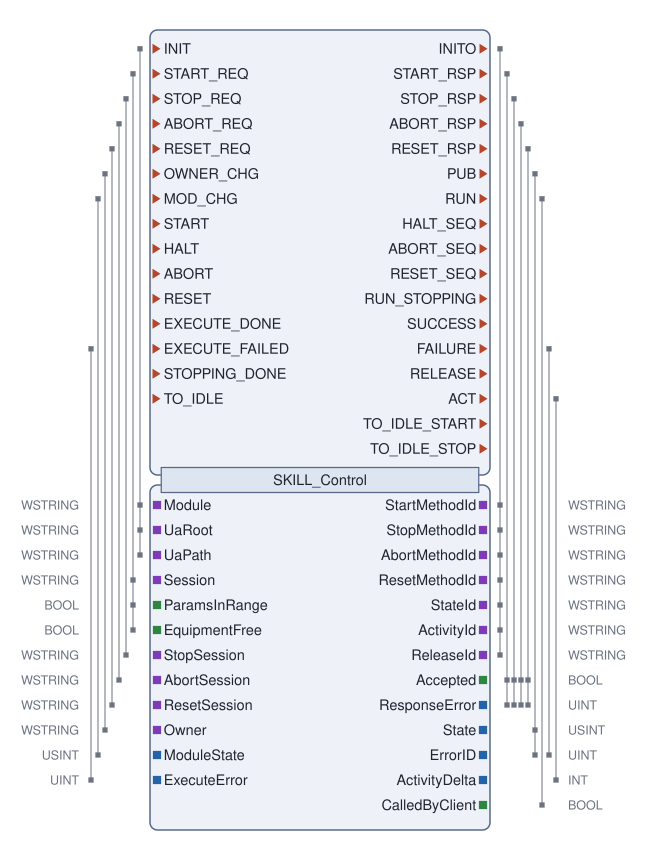

```
 Idle (0) ──START──► Running (1) ──work done──► Succeeded (3) ──1.5 s later──► Idle (0)
                        │    └──work failed──► Failed (4): stays so until the next START
                        │
                        └──HALT──► Stopping (2): the work ends, the stop sequence runs ──► Failed (4), error 7

 any state but Aborted ──ABORT──► Aborted (5) ──RESET──► Idle (0)
```

It takes four commands, `START`, `HALT`, `ABORT` and `RESET`, and does not care who gave them: the
gate has already decided. A `START` while Aborted fails at once with 4. Every start says +1 on the
activity channel and every end -1, and every end says `RELEASE` (a module level skill then gives up
what it holds). 20 states and 32 transitions; the picture is the state machine as the IDE lays it
out, the initial state at the top:

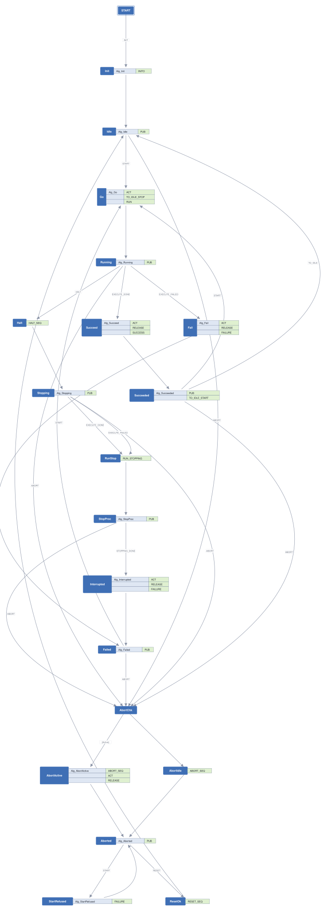

### 7.7 What every primitive shares: `SKILL_Run` and its two adapters

The cook in the kitchen: every recipe is different, but the way a cook works is always the same.
Wait until the stove is free, check that the ingredients are there, turn the stove on, watch the pot
until the dish is done (or the time is up, or something boils over), turn the stove off, and only
then say "done". `SKILL_Run` is that cook. What the recipe is (which stove, how hot, done when)
comes in from the primitive's contract (`SC_<Skill>`, section 8.5) on one adapter, and the cook's
orders go out to the stove (the equipment's port) on another.

```
 SC_<Skill> (the contract) ═══ AContract ═══► SKILL_Run (the run) ═══ AEquipment ═══► EP_<Item> (the port)
   plug Run                                  socket Contract     plug Equipment            socket Skill
   START: what to do, may it start?                              SEND: a command ──►
   SAMPLE: is it done? may it go on?                             ◄── PLAYED
```

#### `AContract` (adapter): what the contract tells the run

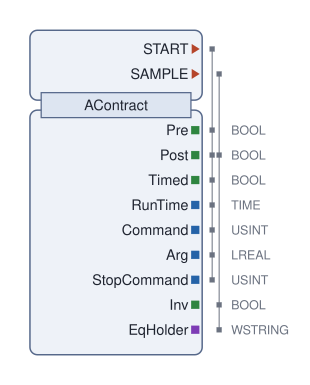

| Event (plug to socket) | With | Means |
| --- | --- | --- |
| `START` | `Pre`, `Post`, `Timed`, `RunTime`, `Command`, `Arg`, `StopCommand` | A run starts: whether it may (`Pre`), whether it is already done (`Post`), what to send (`Command`, `Arg`), for how long (`RunTime`: the time a timed skill runs, or the timeout of one a sensor ends; `Timed` says which), and what to send at the end (`StopCommand`) |
| `SAMPLE` | `Post`, `Inv`, `EqHolder` | The equipment's newest state, judged: is the skill done, may it go on, and who holds the equipment now |

#### `AEquipment` (adapter): what the run sends the equipment

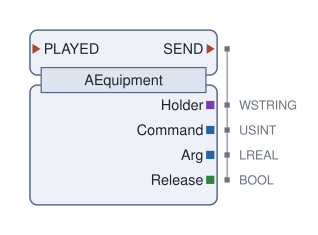

| Event | With | Means |
| --- | --- | --- |
| `SEND` (plug to socket) | `Holder`, `Command`, `Arg`, `Release` | Play this command for this holder; give the equipment up after it if `Release` |
| `PLAYED` (socket to plug) | | All phases of the command are out |

#### `SKILL_Run` (composite)

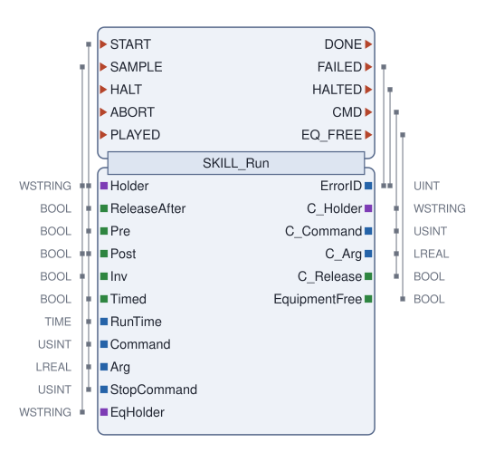

Its socket `Contract` (`AContract`) takes what the contract says; its plug `Equipment`
(`AEquipment`) goes to the equipment's port. Besides them:

| In | With | Means |
| --- | --- | --- |
| `INIT` | `Holder`, `ReleaseAfter` | Start-up: the name it holds the equipment under, and whether to give it up at the end |
| `HALT`, `ABORT` | | Stop the run; abort it (all off) |

| Out | With | Means |
| --- | --- | --- |
| `DONE`, `FAILED`, `HALTED` | `ErrorID` | How the run ended, once its last command was played |
| `EQ_FREE` | `EquipmentFree` | Whether the equipment is free for this skill (for the Start check) |


Inside: `Logic` (`SKILL_RunLogic`, below), `Timer` (the run's time, or its time-out) and `WaitT`
(waits up to 0.5 s for another holder to let go). The socket's events and values go to `Logic`'s
pins of the same name (`Contract.START` → `Logic.START`, `Contract.Pre` → `Logic.Pre`, ...), and
`Logic`'s command goes out on the plug (`Logic.CMD` → `Equipment.SEND`, `Logic.C_Holder` →
`Equipment.Holder`, ...; `Equipment.PLAYED` → `Logic.PLAYED`).

#### `SKILL_RunLogic` (basic): the cook's routine

1. **Start.** If `Pre` does not hold: fail with 1 (PreconditionViolated). If someone else holds
   the equipment: wait up to 0.5 s for them to let go, else fail with 6 (Busy). If `Post` already
   holds (and the skill is not timed): done at once, without moving anything. Otherwise send
   `Command` with `Arg`, and start the timer for `RunTime`.
2. **Running**, at every new state of the equipment: `Inv` no longer holds → stop with 2
   (InvariantViolated); someone else took the equipment → 6 (Lost); `Post` holds → done. When the
   timer runs out: done, for a timed skill (`Timed`); 3 (Timeout) for one a sensor ends.
3. **The end.** Send the closing command: `StopCommand` when it is done or halted, all off (0) when
   it failed or was aborted, giving the equipment up with it when `ReleaseAfter` is set (always on
   an abort). Only when the port says `PLAYED` does it report `DONE`, `FAILED` or `HALTED`, so a
   command with timed phases (stoppering's `Back`) has really ended.

22 states and 40 transitions; drawn as the IDE lays it out, the start at the top, the end at the
bottom:


There is one `SKILL_Run` for every primitive: a primitive brings only its contract.

#### `SKILL_NoEquipment` (basic): for a primitive without equipment

A primitive that only waits, with no equipment, has no port: this block sits
in its place and answers every `SEND` on its socket `Skill` with `PLAYED` at once. None of the lab's
modules has such a primitive.

### 7.8 Parameters and failures

#### `SKILL_Param_LREAL` (and `_BOOL`, `_INT`, `_DINT`, `_UINT`): a door check with a memory


One block per parameter of a skill. Like a door check that compares a value with the allowed range
and then remembers it for the whole run:

- `INIT`: the value is the default (`Default`).
- `CHECK`: is the value the client asks for (`Requested`) between `Lower` and `Upper`? `AllInRange`
  is TRUE only if this one and all checked before it (`PreviousInRange`) are.
- `LATCH`: take the value for this run. If a client started the skill (`CalledByClient`), its value;
  if a parent did, `Default`. A step gets its value from its parent through `Default`: a constant
  (`NeedleDown`'s Position 40) or a wire from the parent's own parameter (`Dispense`'s Volume).

With several parameters the blocks are chained: `CHECKED → next CHECK`, `AllInRange → next
PreviousInRange`, and the last one's `AllInRange` goes to `Control.ParamsInRange`; then `LATCHED →
next LATCH`, and the last `LATCHED` publishes the values and starts the work. `_BOOL` has no limits.

#### `SKILL_FailMerge` (simple): a funnel


Joins two failures into one: `FAIL_1` (with `Error1`) or `FAIL_2` (with `Error2`) gives `FAIL` with
that error code. It is needed because a data input can take only one wire: four steps cannot all
wire their `ErrorID` to one pin. In `Dispensing.Execute`, `Fail1` joins `NeedleDown` and
`Dispense`, `Fail2` joins `Fail1` and `Home`, `Fail3` joins `Fail2` and `Weigh`; in `Resetting`,
`Fail1` joins `Home` and `Tare`.

#### `SKILL_Join2` to `SKILL_Join4`, `SKILL_Merge`, `SKILL_Condition_LREAL`, `SKILL_Condition_BOOL`: for later

 


For skills whose steps run side by side or depend on a decision (rule set 2,
[module-rules.md](module-rules.md), section 3). A `Join` waits until every branch is done (`DONE`);
if one fails, it says `HALT` to the others and `FAILED` once all have ended. A `Condition` compares
`Operand` with `Expected` (`Operator` `eq`, `ne`, `gt`, `gte`, `lt`, `lte`) and answers `YES` or
`NO`. A `Merge` is where the two branches of a decision meet again. The lab's module programs do not
use them yet.

### 7.9 The IO blocks: one pin each

Think of a travel plug adapter. The equipment block plugs into an IO block in the same way whether
the pin is a GPIO line on the Pi, a register of the Modbus simulator on the PC, or only simulated.
Only the address changes, so the same equipment type runs on every target.

#### `IO_DI`, `IO_DO`, `IO_AI`, `IO_AO` (composite)

 
 

`D` digital (TRUE or FALSE), `A` analog (a number), `I` input, `O` output. Each has `INIT` with
`Address` (set up the pin) and `REQ` (read the pin, or write `OUT` to it); `QO` says whether the pin
can be reached and the last access worked, and an input gives its value on `IN`. The extras:
`IO_DI` and `IO_AI` have `SimValue` (the value when simulated), `IO_AI` has `Scale` (the value per
raw count: the scale's 0.001 g), and `IO_AO` has `EN` (FALSE writes 0), `Gain` and `Bias`: it writes
`Bias + OUT × Gain`, kept between 0 and 65535. The axis's `Step` has the gain 655.35, so 50 % becomes
32 767, half of 65 535: the pin is on for half of each period.

| Address | Meaning |
| --- | --- |
| `gpio[0:23:pull_up:active_low]` | Raspberry Pi GPIO chip 0, line 23, with the pull-up on, read inverted |
| `gpio[0:17:active_low]` | Line 17 as an output, written inverted |
| `pwm[0:2:500000:/hostsys/class/pwm]` | PWM chip 0, channel 2, period 500 000 ns (2 kHz), in the folder the container passes in |
| `modbus[127.0.0.1:1502:1:10:d0:]` | A Modbus register of the simulator on the PC |
| `sim` | Simulated: an input gives `SimValue`, an output goes nowhere |
| another name | An IO point set up somewhere else in FORTE, read or written by that name |
| empty | Not connected: `QO` is FALSE |


| Inside | Type | What it does |
| --- | --- | --- |
| `Route` | `IO_RouteDO` (`IO_RouteDI`, `IO_RouteAI`, `IO_RouteAO`) | Reads the address and decides which way the value goes (below) |
| `Line` | `GPIOChip` (in `IO_DI`, `IO_DO`), `PWMChip` (in `IO_AO`); `IO_AI` has none | Sets up the Pi line or PWM channel when the address names one |
| `Local` | `QX` (`IX`, `IW`, `QW`) | Reads or writes the point by its name |
| `Bus` | `CLIENT_1_0` (`CLIENT_0_1` for inputs) | Reads or writes the Modbus register |

How it runs: at start-up `Route` reads the address and switches on only the part that is needed (the
others get `QI` FALSE); then `Line`, `Local` and `Bus` are set up in turn and `Route` reports
whether the pin is reachable (`INITO` with `QO`). On each `REQ`, `Route` passes the value to `Local`
or `Bus`, or answers itself (simulated, or not connected), and `CNF` comes back.

#### `IO_RouteDI`, `IO_RouteDO`, `IO_RouteAI`, `IO_RouteAO` (basic): the switchboard


Inside each IO block. At start-up it takes the address apart (`gpio[chip:line:...]`,
`pwm[chip:channel:period:folder]`, `modbus[...]`, `sim`, a name, or empty) into the numbers the
`Line` block needs, and remembers which way the pin is reached. Then it passes every value that way
only. `IO_RouteAO` also turns `OUT` into the raw value with `Gain` and `Bias`, and `IO_RouteAI` the
raw value into `IN` with `Scale`.

## 8. The filling module's own blocks

These are the filling module's own types, in the package `filling::`. They come in two families:

- **a piece of equipment** gets five types: `EQ_<Item>`, `EL_<Item>`, `EC_<Item>`, `EV_<Item>`,
  `EP_<Item>` (the axis, the pump, the scale: sections 8.1 to 8.4);
- **a skill primitive** gets two: `SK_<Skill>` and its contract `SC_<Skill>` (Home, MoveAxis,
  Dispense, Tare, Weigh: sections 8.5 and 8.6).

The module level skill (Dispensing) and the procedures (Resetting, Stopping) have no types of their
own: they are subapplications of blocks of these types (section 8.7).

### 8.1 Equipment: five types for each piece

Think of a machine in a workshop with one operator:

- `EQ_<Item>` is **the operator**: the only one who touches the machine's buttons (its output pins)
  and reads its gauges (its input pins). It is the block you see in the application.
- `EL_<Item>` is **the operator's rules**, inside the `EQ_` block: one customer at a time; let go of
  a button before pressing another; everything off when the customer leaves or the alarm goes.
- `EP_<Item>` is **the service hatch** customers use: you hand in an order ("Up") through its socket
  `Skill` (the adapter `AEquipment`, section 7.7), and you can see the machine's gauges and who is
  using it. It sits inside every skill that uses the equipment, the same in each. Inside it are the
  other two:
- `EC_<Item>`, **the cheat sheet**: "Up means: Enable on, Step at 50 %". It is on the customers'
  side of the hatch, not in the equipment, so the equipment block only ever hears "switch these
  outputs", whatever they mean;
- `EV_<Item>`, **the report form**: it unpacks what the operator reports into values with names,
  and knows the names of the two channels.

How a skill and its equipment talk, here `MoveAxis` and the axis:

```
 SK_MoveAxis (the skill)                        EQ_LinearAxis (the equipment)
 Contract (SC_MoveAxis): command 3 (MoveTo), argument 40
 Run (SKILL_Run): sends it
   ║ AEquipment (one adapter connection): holder, command 3, argument 40
   ▼
 Port (EP_LinearAxis), at its socket Skill
   Driver (EC_LinearAxis): the values to send
     │ holder, release, Enable, Down, Step, ...
     ▼
   EqCmd ═════ loc[Filling/LinearAxis/cmd] ═════► SubCmd
                                                    ▼
                                                  Logic (EL_LinearAxis): one holder, off before on
                                                    ▼
                                                  Out_Enable, Out_Down, Out_Step ──► GPIO17, GPIO27, GPIO18
                                                  In_AtHome ◄── GPIO23
                                                    ▼
   EqState ◄══ loc[Filling/LinearAxis/state] ════ PubState: AtHome, ActualPosition, Homed, Moving, holder
     ▼
   EqView (EV_LinearAxis): the values by name
   │ STATE: AtHome, ActualPosition, Homed, Moving, holder
   ▼
 Contract: "not moving, and at 40 mm" is TRUE ──► Run: done
```

**Holding.** One skill at a time holds a piece of equipment, under a name (its `Holder`): `MoveAxis`
when it runs on its own, `Dispensing` for every step of Dispensing, `Procedures/Resetting` for the
steps of Resetting. The equipment takes commands only from its holder, or from anyone when it is
free; it reports the holder on its state channel, so the other skills can see it is taken. It is
free again when the holder's last command says so (`release`), when a module level skill says so on
`loc[Filling/release]`, or when the module aborts.

### 8.2 The linear axis: the needle's lift

The hardware: a stepper motor behind a TB6600 driver, which needs three outputs (`Enable` on GPIO17,
active low; `Down` on GPIO27; `Step`, pulses from PWM on GPIO18) and has one input, the limit switch
at the top (`AtHome` on GPIO23). Each pulse is a small step: 160 pulses per mm, so at 2 kHz the
needle moves 12.5 mm/s. There is no sensor for the position: the axis counts the time it moves.

#### `EQ_LinearAxis` (composite)


Its inputs: `Module`, `Name` (`"LinearAxis"`: its channels and OPC UA folder), `UaRoot`, `UaEnable`,
`CycleTime` (50 ms: how often the switch is read), and for each pin its address: `AtHome_Address`
(with `AtHome_Sim`, its value when simulated), `Enable_Address`, `Down_Address`, `Step_Address`
(with `Step_Gain` 655.35 and `Step_Bias` 0). In `Filling_pi` the addresses are the Pi's pins, in
`Filling` the simulator's registers; that is the only difference between the two applications.


| Inside | Type | What it does |
| --- | --- | --- |
| `Logic` | `EL_LinearAxis` | The rules (below) |
| `SubCmd` | `SUBSCRIBE_8` | Hears the commands on `loc[Filling/LinearAxis/cmd]`: holder, release, Enable, Down, Step, Step enabled, Move, Goal |
| `SubRelease` | `SUBSCRIBE_1` | Hears `loc[Filling/release]` |
| `Mode` | `MOD_StateView` | Knows the module state (all off when the module aborts) |
| `Cycle` | `E_CYCLE` | Ticks every 50 ms: read the switch, write the outputs again |
| `MoveT` | `E_DELAY` | Times a move to a position |
| `In_AtHome` | `IO_DI` | The limit switch |
| `Out_Enable`, `Out_Down` | `IO_DO` | The driver's enable and direction |
| `Out_Step` | `IO_AO` | The step pulses: 50 % while it moves |
| `PubState` | `PUBLISH_5` | Writes AtHome, ActualPosition, Homed, Moving and the holder on `loc[Filling/LinearAxis/state]` |
| `PubUa` | `PUBLISH_4` | Writes the same four values (not the holder) to `Equipment/LinearAxis/...` over OPC UA |

How it runs: every tick of `Cycle`, `In_AtHome` reads the switch and `Logic` gets the value
(`SAMPLE`); `Logic` also writes its outputs again (`REFRESH`). When `Logic` switches outputs
(`DRIVE`), the three output blocks write one after the other (`Out_Enable`, then `Out_Down`, then
`Out_Step`) and the last one says `DRIVEN`.

#### `EL_LinearAxis` (basic): the axis's rules


1. **One holder at a time.** A command is taken only when nobody holds the axis or its sender
   already does. Any other is ignored; that skill sees the holder on the state channel and waits, or
   fails with Busy.
2. **Off before on** ("break before make"). For a new command the axis first switches off what the
   new command does not want on, writes that, and only then switches the new values on. The motor
   never gets a new direction while it is still being driven the old way. A command that arrives
   while the outputs are being written waits its turn.
3. **The position, by counting time.** While moving, `ActualPosition` is where the move began plus
   12.5 mm/s times the time since. At the switch it is 0 and the axis is `Homed`. For a move to a
   position (`MoveTo`, only when homed) it works out the direction and the time the move takes (the
   distance divided by 12.5 mm/s), switches Enable, Down (when going down) and Step on, and starts
   `MoveT`; when `MoveT` ends, the axis is at the goal and everything goes off. When a skill drives
   the axis with plain `Up` or `Down` instead (Home uses `Up`), the axis cannot count, so it is no
   longer `Homed` until it reaches the switch.
4. **Everything off** when its holder gives it up and when the module aborts.
5. **Reporting.** It sends its state when something changed, at least once a second, and every
   0.2 s while it moves.

The speed, 12.5 mm/s, is written into this type's algorithms. Another speed means another type,
not another value on the block: that is why the stoppering module has its own (section 9).

#### `EC_LinearAxis` (basic): the axis's command table


| Number | Command | Outputs |
| --- | --- | --- |
| 0 | Stop | Everything off (the safe command, always the first) |
| 1 | Up | Enable on, Step 50 % |
| 2 | Down | Enable on, Down on, Step 50 % |
| 3 | MoveTo | Move to the position given as the argument (the axis works out the direction itself) |

`PLAY` (with `Holder`, `Command`, `Arg` and `Release`) plays a command; `OUT` gives the values to
send. A command may have several timed phases: then the table asks for a timer (`PHASE_START`),
plays the next phase when it ends (`PHASE_T`), and says `PLAYED` after the last. The axis's
commands have one phase each. The release is sent only with the last phase.


#### `EV_LinearAxis` (simple): the axis's report form


`INIT` (with `Module`) names the axis's two channels, `loc[Filling/LinearAxis/state]`
and `loc[Filling/LinearAxis/cmd]` (`IdState`, `IdCmd`). `REQ` with the values as they arrived on the
state channel (`I_AtHome`, `I_ActualPosition`, `I_Homed`, `I_Moving`, `I_Holder`) gives them on `CNF`
with their names (`AtHome`, ...).

#### `EP_LinearAxis` (composite): the axis's service hatch


What every skill of the axis uses to reach it, the same in `Home` and `MoveAxis`: on its socket
`Skill` (`AEquipment`), `SEND` (with `Holder`, `Command`, `Arg` and `Release`) plays a command and
`PLAYED` answers when all its phases are out; `STATE` gives the axis's newest state (`AtHome`, `ActualPosition`, `Homed`, `Moving`, and
who holds it, `EqHolder`). At `INIT` (with `Module`) it names the channels and
starts listening.


| Inside | Type | What it does |
| --- | --- | --- |
| `EqView` | `EV_LinearAxis` | Names the channels; unpacks the state (above) |
| `EqState` | `SUBSCRIBE_5` | Hears `loc[Filling/LinearAxis/state]`: four signals and the holder |
| `Driver` | `EC_LinearAxis` | The cheat sheet: turns the command number into output values, phase by phase |
| `PhaseT` | `E_DELAY` | Times a command made of phases |
| `EqCmd` | `PUBLISH_8` | Sends the holder, the release and the output values on `loc[Filling/LinearAxis/cmd]` |

### 8.3 The pump

No pump is wired yet, so the pump has no pins. It is there all the same, so that `Dispense` can hold
it while it "dispenses" (by time).


`EQ_Pump` has the same parts as the axis without the pins: `Logic` (`EL_Pump`), `SubCmd`
(`SUBSCRIBE_2`: only the holder and the release), `SubRelease`, `Mode`, `Cycle` and `PubState`
(`PUBLISH_1`: only the holder). It has no `PubUa`, because there is no input to show.

 
 

`EL_Pump` only keeps the holder. `EC_Pump` has two commands, 0 `Idle` and 1 `Run`, with no outputs
to switch. `EV_Pump` gives only `Holder`, and so `EP_Pump`'s `STATE` gives only `EqHolder`. When a pump is wired, its outputs go into
its five types (section 10 shows how, for a feeder); `SK_Dispense` and its contract stay as they are.

### 8.4 The scale

The hardware has no scale yet: its weight is simulated.


`EQ_Scale` has one input, `Weight`, read by `In_Weight` (an `IO_AI`). In `Filling_pi` its address
is `sim`, so it always gives `Weight_Sim`, 2.0 g; in `Filling` it reads the simulator's register
times `Weight_Scale` (0.001 g per count). `PubState` (`PUBLISH_2`) sends Weight and the holder,
`PubUa` (`PUBLISH_1`) writes `Equipment/Scale/Weight`.

 
 

`EL_Scale` keeps the holder and reports the weight when it changes. `EC_Scale` has 0 `Idle`, 1
`Tare` and 2 `Measure`, but the scale has no outputs: taring and measuring only hold the scale for a
time (2 s and 0.2 s). Taring does not zero anything yet. `EV_Scale` gives `Weight` and `Holder`; `EP_Scale` is the hatch
that `Tare` and `Weigh` share.

### 8.5 A skill primitive: two types

A primitive is **one command to one piece of equipment, until a sensor says it is done or a time has
passed**. `SK_<Skill>` is the whole job (the front desk, the cook, the hatch to the equipment);
`SC_<Skill>` is the recipe card: the only part that is the primitive's own.

#### `SK_<Skill>` (composite), with `SK_Home` as the example


**The inputs of a primitive block** (what you set on a block of this type): `Module` (the module's
name, for the channel names), `UaRoot` and `UaPath` (where its OPC UA variables go), `UaEnable`
(publish them at all), `Methods` (offer Start, Stop, Abort and Reset over OPC UA: TRUE when it is
offered on its own, FALSE as a step), `Holder` (the name it holds the equipment under),
`ReleaseAfter` (give the equipment up when it ends: TRUE on its own, FALSE as a step, so the next
step keeps it), `Timeout` (only a skill a sensor ends has one), and one input per parameter, whose
value is the default. Its events are those a parent needs: `INIT`, `START` (with the parameters),
`HALT`, `ABORT`, `RESET`; `SUCCESS` (with the results) and `FAILURE` (with `ErrorID`).


| Inside | Type | What it does | Changes with |
| --- | --- | --- | --- |
| `Control` | `SKILL_Core` | The front desk: checks a Start, the state machine, the methods Stop, Abort and Reset (section 7.6) | Never |
| `UaStart` | `SERVER_2_1` (`SERVER_2_<1 + parameters>`) | The OPC UA method `Start(Session, parameters)` | The number of parameters |
| `Par_<p>` | `SKILL_Param_...` | One per parameter (Home has none; MoveAxis has `Par_Position`) | The parameters |
| `PubParams` | `PUBLISH_<parameters>` | Writes `Parameters/...` (Home has none) | The parameters |
| `PubResults` (only `SK_Weigh`) | `PUBLISH_<results>` | Writes `Results/...` | The results |
| `Contract` | `SC_Home` | The recipe card (below) | **This is the primitive** |
| `Run` | `SKILL_Run` | The cook: one run, the same for every primitive (section 7.7) | Never |
| `Port` | `EP_LinearAxis` | The hatch to the equipment: the command out, its state in (section 8.1) | The equipment (the same in every skill of it) |

A client's Start, step by step: the call arrives at `UaStart`; the parameter blocks check the values
(Home has none, so `UaStart.IND` goes straight to `Control.START_REQ`); `Control` answers through
`UaStart` and, when it accepts, fires `RUN`; the parameter blocks take the values for the run and
start `Contract`, which says what to do (`Run.START`, over the adapter `AContract`); `Run` does it,
sending the command to `Port` over the adapter `AEquipment`. A parent's `START` goes to
`Control.START` and from there the same way, with the defaults. Each new state of the equipment goes
from `Port` (`STATE`) to `Contract`, which judges it (`Run.SAMPLE`: is it done? may it go on?) for
`Run`. Three blocks, two adapter connections:

```
 Contract (SC_Home) ══ AContract ══► Run (SKILL_Run) ══ AEquipment ══► Port (EP_LinearAxis)
        ▲                                                                   │
        └──────────── STATE: AtHome, ..., who holds it ─────────────────────┘
```

#### `SC_<Skill>` (basic): the recipe card


Everything that makes a primitive this primitive is in two small algorithms, in Structured Text.
What they say goes to the run over the plug `Run` (the adapter `AContract`), so each line starts
with `Run.`:

| Algorithm | Runs | Says | `SC_Home` | `SC_MoveAxis` |
| --- | --- | --- | --- | --- |
| `Alg_Start` | when a run starts | `Timed`: does a time end it (TRUE) or a sensor (FALSE)? `RunTime`: that time, or the timeout. `Command`, `Arg`: what to send. `StopCommand`: what to send at the end | `Run.Timed := FALSE; Run.RunTime := Timeout; Run.Command := 1; Run.Arg := 0.0; Run.StopCommand := 0;` | `Run.Timed := FALSE; Run.RunTime := Timeout; Run.Command := 3; Run.Arg := Position; Run.StopCommand := 0;` |
| `Alg_Evaluate` | when a run starts, and at every new state of the equipment | `Pre`: may it start? `Post`: is it done? `Inv`: may it go on? And the results | `Run.Pre := TRUE; Run.Post := AtHome; Run.Inv := TRUE;` | `Run.Pre := Homed; Run.Post := NOT Moving AND ABS(ActualPosition - Position) < 0.001; Run.Inv := TRUE;` |

`Command` and `StopCommand` are the command's number in the equipment's cheat sheet (`EC_`): the
commands in the order of its table, so for the axis `Stop` 0, `Up` 1, `Down` 2, `MoveTo` 3. Its inputs
are the parameters (with `START`), `Timeout` for a skill a sensor ends, and the equipment's signals
the conditions use and who holds it (with `SAMPLE`). Two more algorithms are the same in every
contract: `Alg_Init` names the OPC UA variables of its parameters and results, `Alg_Sample` passes on
who holds the equipment (`Run.EqHolder := EqHolder;`). Its state machine is always the same six
states: a start (`Start`, then `Started`, which sends `Run.START`) and a new state of the equipment
(`Sample`, then `Judge`, which sends `Run.SAMPLE`):


The *precondition* must hold for the skill to start; the *postcondition* says when it is done; the
*invariant* must hold all the while it runs. The closing command is the equipment's safe command
(all off) unless the contract gives another (`Run.StopCommand`). What `Run` does with them is in section 7.7.

### 8.6 The five filling primitives

| Primitive | Precondition | Command (equipment) | Ends when | Timeout | Parameters | Results |
| --- | --- | --- | --- | --- | --- | --- |
| `Home` | – | `Up` (LinearAxis) | `AtHome` (sensor) | 60 s | – | – |
| `MoveAxis` | `Homed` | `MoveTo(Position)` (LinearAxis) | not `Moving` and at `Position` (sensor, the axis' own count) | 30 s | Position 0 to 60 mm | – |
| `Dispense` | – | `Run` (Pump) | after Volume / FlowRate s (time) | – | Volume 0.5 to 10 mL, FlowRate 0.1 to 5 mL/s | – |
| `Tare` | – | `Tare` (Scale) | after 2 s (time) | – | – | – |
| `Weigh` | – | `Measure` (Scale) | after 0.2 s (time) | – | – | Weight (the scale's input) |

Each row is one contract; everything else in the five `SK_` types is the same, or follows from the
number of parameters and results.

#### `SK_Home`, `SC_Home`: needle up to the switch

The pictures are in section 8.5. It drives the axis `Up` until the limit switch closes; then the
position is 0 and known (`Homed`). If the needle is at the switch already, it is done at once. If the
switch never closes, the timeout (60 s) stops the motor and the skill fails with 3. It is used five
times: on its own, as the first step of Resetting, as Stopping, as the third step of Dispensing, and
as Dispensing's stop sequence.

#### `SK_MoveAxis`, `SC_MoveAxis`: needle to a position

 


It needs the axis homed (otherwise it fails at once with 1, PreconditionViolated). It sends `MoveTo`
with the position (0 to 60 mm, measured down from the switch); the axis itself times the move, and
the skill only waits until the axis reports that it no longer moves and is within 0.001 mm of the
position. Timeout 30 s. It has one parameter, so `UaStart` is a `SERVER_2_2`, with `Par_Position` and
`PubParams` (`PUBLISH_1`). In Dispensing it is the step `NeedleDown`, with the constant Position 40.

#### `SK_Dispense`, `SC_Dispense`: dispense a volume

 


It holds the pump with `Run` for Volume / FlowRate seconds (2 mL at 1 mL/s: 2 s), then sends `Idle`:
`Run.Timed := TRUE; Run.RunTime := MUL_TIME(T#1s, Volume / FlowRate);`. Two parameters, so `SERVER_2_3`,
`Par_Volume` and `Par_FlowRate` (checked one after the other) and `PubParams` (`PUBLISH_2`). It has
no timeout: the time ends it. In Dispensing, FlowRate is the constant 1.0 and Volume comes from
Dispensing's own parameter.

#### `SK_Tare`, `SC_Tare`: tare the scale

 


It holds the scale with `Tare` for 2 s. No parameters, no results. The second step of Resetting.

#### `SK_Weigh`, `SC_Weigh`: read the weight

 


It holds the scale with `Measure` for 0.2 s; its contract takes the weight the scale reports as its
result (`R_Weight := Weight;`), and when the run is done `PubResults` writes the last one to
`Results/Weight`. The block's `SUCCESS` carries it to a parent: in Dispensing it becomes
Dispensing's result.

### 8.7 The subapplications: procedures and the module level skill

#### `Resetting` and `Stopping`: the procedures


`Resetting` is what the module does when it is reset: `START → Home.START`, `Home.SUCCESS →
Tare.START`, `Tare.SUCCESS → DONE`. Either step's failure goes through `Fail1` to `FAILED`, with its
error code on `ErrorID`. The state manager starts it (`Module.RUN_RESETTING`) and hears how it ended.
Its steps have `Methods` FALSE (a client cannot start them; their State and ErrorID are still
published, at `/Procedures/Resetting/Home` and `.../Tare`), the holder `Procedures/Resetting`, and
`ReleaseAfter` TRUE.


`Stopping` is one step, `Home`: after a stop, the needle goes back up to the switch.

#### `Dispensing`: the module level skill


| Block | Type | What it does here |
| --- | --- | --- |
| `Control` | `SKILL_Core` | The front desk of Dispensing: `UaPath "/Skills/Dispensing"`, `Holder "Dispensing"`, `ReleaseAll` TRUE (when a run ends, every piece of equipment its steps held is released) |
| `UaStart` | `SERVER_2_2` | The method `Skills/Dispensing/Start(Session, Volume)` |
| `Volume` | `SKILL_Param_LREAL` | The parameter: default 1.0, limits 0.5 to 10 mL |
| `PubParams` | `PUBLISH_1` | Writes `Skills/Dispensing/Parameters/Volume` |
| `Execute` | subapplication | The steps (below) |
| `Stop` | subapplication | What runs when Dispensing is stopped: `Home` |
| `PubResults` | `PUBLISH_1` | Writes `Skills/Dispensing/Results/Weight` when Execute is done |

The wiring, in words: the call goes `UaStart.IND → Volume.CHECK`, the check `Volume.CHECKED →
Control.START_REQ`, the answer `Control.START_RSP → UaStart.RSP`. When accepted, `Control.RUN →
Volume.LATCH`, and `Volume.LATCHED` both publishes the volume and starts `Execute`, with the volume
on `Execute.Volume`. `Execute.DONE` tells `Control` and `PubResults`; `Execute.FAILED` with its
`ErrorID` tells `Control`. When Dispensing is stopped, `Control.HALT_SEQ` halts `Execute`, then
`Control.RUN_STOPPING` starts `Stop`, whose end comes back on `Control.STOPPING_DONE`.


`Execute` holds the four steps, each a block of a primitive type with `Methods` FALSE,
`Holder "Dispensing"` and `ReleaseAfter` FALSE (the next step keeps the equipment):
`NeedleDown` (`SK_MoveAxis`, Position 40), `Dispense` (`SK_Dispense`, FlowRate 1.0, Volume from
`Execute.Volume`), `Home` (`SK_Home`) and `Weigh` (`SK_Weigh`, its `R_Weight` is `Execute.Weight`).
The chain: `START → NeedleDown.START`, each step's `SUCCESS` to the next step's `START`, `Weigh.SUCCESS →
DONE`. `HALT`, `ABORT` and `RESET` go to every step. `Fail1` to `Fail3` join the four steps' failures
into one `FAILED` (section 7.8).


`Stop` holds one step, `Home`, with the holder `Dispensing`.

## 9. The stoppering and capping modules

The stoppering module (the project `cell/control/StopperingModule`, its Pi 5 at 192.168.0.134) and
the capping module (`cell/control/CappingModule`, its Pi at `capping-module.local`) are built in
the same way as the filling module. Everything in section 7 is the same, block for block. Their own
types, what section 8 describes for the filling module, are in their own packages, `stoppering::`
and `capping::`: some are like the filling ones, others are new.

| | Filling | Stoppering | Capping |
| --- | --- | --- | --- |
| Module name, OPC UA folder | `Filling`, `/Objects/Filling` | `Stoppering`, `/Objects/Stoppering` | `Capping`, `/Objects/Capping` |
| Equipment | `LinearAxis` (the needle), `Pump`, `Scale` | `LinearAxis` (the head), `Piston` | `LinearAxis` (the crimping head), `Crimper` |
| The axis | 12.5 mm/s, PWM 2 kHz | 20 mm/s (assumed until measured), PWM 1 kHz | 12.5 mm/s, PWM 2 kHz |
| Primitives | `Home` (60 s), `MoveAxis` (30 s), `Dispense`, `Tare`, `Weigh` | `Home` (8 s), `MoveAxis` (8 s), `PressStopper`, `RetractPiston` | `Home` (60 s), `MoveAxis` (30 s), `Crimp` |
| Module level skill | `Dispensing`: NeedleDown (40 mm), Dispense, Home, Weigh; parameter Volume, result Weight | `Stoppering`: HeadDown (40 mm), PressStopper, Home; no parameters, no results | `Capping`: HeadDown (40 mm), Crimp, Home; no parameters, no results |
| Resetting | Home, Tare | RetractPiston, Home (the piston in before the head moves) | Home |
| Stopping | Home | Home | Home |
| Not real yet | The pump has no pins; the scale is simulated | The piston has no sensor (only times); the axis's speed is assumed | The crimper has no pin yet (`'sim'` on the Pi) |

The last row is where your work starts: a sensor for the piston, the crimper's pin, a new piece of
equipment. Section 10 shows how.


### 9.1 The same name is not the same type

Both modules have an `EL_LinearAxis`, but `filling::EL_LinearAxis` counts the position at 12.5 mm/s
and `stoppering::EL_LinearAxis` at 20 mm/s: the speed is written into the type's algorithms
(section 8.2). `SK_Home` differs in its default timeout (60 s and 8 s). Because the packages
differ, both can be built into one FORTE. So copy types within the project of the module you work
on: its own types are there already, in its package. A type copied from another module's project
brings that module's package, speeds and times with it.

### 9.2 The piston instead of the pump and the scale

The piston is a small linear actuator on an L298N motor driver: two outputs, `Retract` (GPIO 5, the
driver's IN1) and `Extend` (GPIO 6, IN2), and no sensors.


Compared with the filling equipment: two output blocks (`Out_Retract`, `Out_Extend`, both `IO_DO`);
no input blocks and so no `PubUa`; `PubState` sends only the holder (`PUBLISH_1`); `SubCmd` is a
`SUBSCRIBE_4` (holder, release, Retract, Extend); no position, so no `MoveT`.


Its command table has the first command with **timed phases**: 0 `Stop`, 1 `Extend`, 2 `Retract`,
and 3 `Back`, which is Retract on for 3 s and then everything off. The `Driver` in the piston's port
(`EP_Piston`, in every skill of the piston) plays the first phase, `PhaseT` waits 3 s, then it plays
the second; the release goes with the last phase only, and only then does the port say `PLAYED`, so
the skill ends when the piston is really back. In the filling module every command has one phase,
so `PhaseT` is never used there.

### 9.3 Its primitives


`PressStopper` extends the piston for 3 s and then closes with `Back` (its contract says
`Run.StopCommand := 3;`) instead of the safe command, also when it is stopped halfway: so it ends
with the piston back in. An abort switches everything off at once; `RetractPiston` retracts the
piston for 3 s afterwards (it is the first step of Resetting). Both are open loop: no sensor says
where the piston is, only the time. `Home` and `MoveAxis` are the filling ones with the head's
timeouts.

### 9.4 The capping module: the crimper


The crimper closes a crimping head around the cap. It is the piston's simpler cousin: one output,
`Close`, and no sensor. Its pin is not chosen yet: in `Capping_pi` its address is `'sim'` (the
output goes nowhere), in `Capping` the simulator's coil.


`EQ_Crimper` has one output block (`Out_Close`, an `IO_DO`), `SubCmd` a `SUBSCRIBE_3` (holder,
release, Close) and `PubState` a `PUBLISH_1` (the holder). Its command table, `EC_Crimper`: 0 `Open`
(everything off, the safe command), 1 `Close`.


`Crimp` closes the crimper for `Duration` seconds (a parameter, 0 to 5 s, default 1.5) and then
opens it: a timed primitive like `Dispense`, with `Run.Timed := TRUE;
Run.RunTime := MUL_TIME(T#1s, Duration);` and `Run.Command := 1;` in its contract `SC_Crimp`. With
one parameter, `SK_Crimp` has `UaStart` as a `SERVER_2_2`, `Par_Duration` and `PubParams`, as
`SK_MoveAxis` has. When the crimper gets its pin, only `Close_Address` in `Capping_pi` changes; a
sensor on it (closed, open) means a new input in its five types (section 10).

## 10. By hand: a new piece of equipment with its pins, and a primitive that uses it

### 10.1 The example: a stopper feeder

Say the stoppering module gets a feeder: a small double-acting air cylinder that pushes the next
rubber stopper under the head. It has two valve coils, `Advance` (out) and `Retract` (in), and a
reed switch at its front end, `Advanced`, that closes when the cylinder is fully out. We want a
primitive `FeedStopper`: push until the switch closes, and fail if that takes longer than 2 s.

For the example the pins are GPIO 22 (Advance, Pi pin 15), GPIO 25 (Retract, pin 22) and GPIO 24
(Advanced, pin 18), which the stoppering module does not use yet (it uses 23, 17, 27, 18, 5 and 6).
Check them against the real wiring first.

You make seven types, in the stoppering module's project, from the bottom up: a type can only use
types that are already there.

| Step | Type | What it is | Copied from |
| --- | --- | --- | --- |
| 1 | `EC_Feeder` (basic) | The command table: which outputs each command switches on | `EC_Piston` |
| 2 | `EL_Feeder` (basic) | The rules: one holder, off before on, all off on release or abort, the switch reported | `EL_Piston` |
| 3 | `EV_Feeder` (simple) | The report form: the channels' names, the state by name | `EV_Piston` |
| 4 | `EQ_Feeder` (composite) | The equipment block: the pins, the rules, the channels | `EQ_Piston` |
| 5 | `EP_Feeder` (composite) | The port, inside every skill of the feeder | `EP_Piston` |
| 6 | `SC_FeedStopper` (basic) | The primitive's contract | `SC_Home` |
| 7 | `SK_FeedStopper` (composite) | The primitive | `SK_Home` |

Step 8 puts `Feeder` and `FeedStopper` into the two applications. Section 11 builds FORTE with
them and tries them out.

### 10.2 What is reused, and what you make

#### What is already there

You do not make these; your new types only use them.

| What | Where it comes from | What your new types do with it |
| --- | --- | --- |
| `SKILL_Core` (with `SKILL_Gate`, `SKILL_Control`, `MOD_OwnerView`, `MOD_StateView` inside) | ModLib, the same in every module (section 7.6) | The front desk and the skill's state machine; its OPC UA methods Stop, Abort, Reset; State and ErrorID |
| `SKILL_Run` (with `SKILL_RunLogic` and two timers inside) | ModLib (section 7.7) | One run: the lock, the command, the end condition, the timeout, the closing command |
| `AContract`, `AEquipment` | ModLib (section 7.7) | The two adapters: contract to run, run to port |
| `SKILL_Param_<type>` | ModLib (section 7.8) | One per parameter: the range check and the value of the run |
| `IO_DI`, `IO_DO`, `IO_AI`, `IO_AO` | ModLib (section 7.9) | One per pin of the equipment: the Pi's GPIO, PWM, Modbus or simulated, chosen by the address |
| `MOD_StateView` | ModLib (section 7.5) | In the equipment block: everything off when the module aborts |
| `E_CYCLE`, `E_DELAY`, `SERVER_2_n`, `PUBLISH_n`, `SUBSCRIBE_n` | FORTE (section 7) | The cycle, the timers, the Start method, the channels. FORTE makes any `n` from the name |
| `Occupation`, `Module` | The module level (sections 7.4, 7.5) | Nothing directly: `SKILL_Core` listens to the owner and the module state |

#### How much of each new type is your own

| Type | Made of | The same in every one: keep it as copied | Your own |
| --- | --- | --- | --- |
| `EC_Feeder` | 6 states, 8 transitions, 3 algorithms | The state machine, `Alg_Play`, `Alg_Next`, the events and the inputs | One output per output pin (`N_<output>`), and the table in `Alg_Send` |
| `EL_Feeder` | 18 states, 31 transitions, 13 algorithms | The state machine (the same in `EL_Piston`, `EL_Crimper` and every piece of equipment without a position), 6 of the algorithms, the events | Two pins and one internal variable per input and per output, and one line per pin in the 7 algorithms that handle the pins |
| `EV_Feeder` | 2 algorithms | The holder and the channel ids | The item's name in the two ids, and one line per input |
| `EQ_Feeder` | 10 blocks, 22 event and 26 data connections | 7 blocks (`Logic`, `Cycle`, `Mode`, `SubCmd`, `SubRelease`, `PubState`, `PubUa`) and their wiring | One IO block per pin with its wires, and the sizes of `SubCmd`, `PubState`, `PubUa` |
| `EP_Feeder` | 5 blocks, 12 event and 15 data connections | The 5 blocks and every event connection | The sizes of `EqState` and `EqCmd`, one wire per pin, one output per input |
| `SC_FeedStopper` | 6 states, 8 transitions, 4 algorithms | The state machine, `Alg_Init`, `Alg_Sample`, the plug `Run` | `Alg_Start` and `Alg_Evaluate` (8 lines), one input per signal the conditions use |
| `SK_FeedStopper` | 5 blocks, 44 connections | 4 blocks (`Control`, `UaStart`, `Run`, and `Port` for every skill of the feeder) and 39 connections | The `Contract` block and its 5 connections |

The equipment is the larger job, but most of it is the pins. A primitive on equipment that is
there already is two types, and its own part is the contract.

#### Copy, then change

Make every new type as a copy of the type the table in 10.1 names, and change only what is your own:

1. In the IDE's *System Explorer*, open the project's *Type Library* and select the type to copy
   (for step 1, `EC_Piston` in `Equipment/Commands`).
2. *Copy* (Ctrl+C), select the same folder, *Paste* (Ctrl+V). The IDE asks for the new name:
   `EC_Feeder`. The copy is a type of its own, with everything the old one has, in the same package
   (`stoppering::`). Keep the package as it is.
3. Open the copy and change it as the step says. A pin is renamed in the *Interface* tab; an
   algorithm does not follow a renamed pin, so change its name in the algorithms' text too.
4. Inside a composite copy, the blocks still have the old types (the copied `EQ_Piston` has an
   `EL_Piston` inside). Right-click such a block, *Change Type*, and choose the new one. Connections
   to pins the new type does not have are shown as errors: delete them and draw the new ones.

A type made from nothing instead: *File > New > Type*, with the template *Basic*, *Simple* or
*Composite*. Save often (Ctrl+S), and check the project before you build (section 11.2).

**Sizes of `PUBLISH`, `SUBSCRIBE` and `SERVER`.** The project declares every size it uses in
*Type Library/Generic* (`PUBLISH_4`, `SUBSCRIBE_5`, ...), so the IDE knows its pins. FORTE makes
any size from the name. When you need a size that is not there (the feeder's port needs
`SUBSCRIBE_2`), copy the next smaller one (`SUBSCRIBE_1`) as `SUBSCRIBE_2` and add the output
`RD_2` of type `ANY`, with the event `IND` (its *With*, as `RD_1` has). For `PUBLISH_n` it is the
input `SD_n` with `REQ`; for `SERVER_2_n` the output `RD_n` with `IND`.

### 10.3 Step 1: the command table `EC_Feeder`


Copy `EC_Piston` as `EC_Feeder`. The piston's outputs are `N_Retract` and `N_Extend`; rename them
to the feeder's outputs, `N_Advance` and `N_Retract`, and keep them in the order of the
equipment's output pins, as everywhere else in the equipment's types.

| Pin | Kind | Type | With | Keep or change |
| --- | --- | --- | --- | --- |
| `PLAY` | event in | | `Holder`, `Command`, `Release` | Keep |
| `PHASE_T` | event in | | – | Keep |
| `OUT` | event out | | `O_Holder`, `O_Release`, one `N_<output>` per output | Change the `N_` |
| `PHASE_START` | event out | | `PhaseDT` | Keep |
| `PHASE_STOP`, `PLAYED` | events out | | – | Keep |
| `Holder` | data in | `WSTRING` | | Keep |
| `Command` | data in | `USINT` | | Keep |
| `Release` | data in | `BOOL` | | Keep |
| `O_Holder`, `O_Release`, `PhaseDT` | data out | `WSTRING`, `BOOL`, `TIME` | | Keep |
| `N_Advance`, `N_Retract` | data out | `BOOL` | | **Your own**: one per output pin |

The internal variables `Phase` (`USINT`) and `Timed` (`BOOL`), the state machine and the
algorithms `Alg_Play` (`Phase := 0;`) and `Alg_Next` (`Phase := Phase + 1;`) stay as copied.


`Alg_Send` is the table itself. It switches everything off, then on what the command wants. The
numbers are the commands in order: 0 is always the safe one (everything off), here 1 `Advance` and
2 `Retract`.

```
N_Advance := FALSE;
N_Retract := FALSE;
Timed := FALSE;
PhaseDT := T#0ms;
IF Command = 1 THEN
  N_Advance := TRUE;
ELSIF Command = 2 THEN
  N_Retract := TRUE;
END_IF;
O_Holder := Holder;
O_Release := Release AND NOT Timed;
```

A command with **timed phases** (the piston's `Back`: Retract on for 3 s, then everything off)
sets `Timed` and `PhaseDT` in its first phase. The port's timer then sends `PHASE_T`, and
`Alg_Send` runs again with `Phase` 1. That is how `EC_Piston` has it:

```
ELSIF Command = 3 THEN
  IF Phase = 0 THEN
    N_Retract := TRUE;
    PhaseDT := T#3000ms;
    Timed := TRUE;
  ELSE
  END_IF;
```

The release goes out only with the last phase (`Release AND NOT Timed`), so the equipment is given
up when the command has really ended.

### 10.4 Step 2: the rules `EL_Feeder`


Copy `EL_Piston` as `EL_Feeder`. The state machine is the same in every piece of equipment without
a position, so it stays exactly as copied; what changes is the pins and one line per pin in the
algorithms. The piston has no input; the feeder has one, `Advanced`, so you add its pins.

| Pin | Kind | Type | With | Keep or change |
| --- | --- | --- | --- | --- |
| `INIT` | event in | | `Module`, `Name`, `UaRoot` | Keep |
| `CMD` | event in | | `C_Holder`, `C_Release`, one `C_<output>` per output | Change the `C_` |
| `RELEASE` | event in | | `R_Holder` | Keep |
| `SAMPLE` | event in | | one `I_<input>` per input (none for the piston) | Change |
| `REFRESH`, `DRIVEN` | events in | | – | Keep |
| `MOD_CHG` | event in | | `ModuleState` | Keep |
| `INITO` | event out | | `IdCmd`, `IdRelease`, `IdState`, `IdPub` | Keep |
| `DRIVE` | event out | | one `O_<output>` per output | Change |
| `STATE` | event out | | one `<input>` per input, `Holder` | Change |
| `Module`, `Name`, `UaRoot`, `C_Holder`, `R_Holder` | data in | `WSTRING` | | Keep |
| `C_Release` | data in | `BOOL` | | Keep |
| `ModuleState` | data in | `USINT` | | Keep |
| `C_Advance`, `C_Retract` | data in | `BOOL` | | **Your own**: what a command wants, per output |
| `I_Advanced` | data in | `BOOL` | | **Your own**: the input as read, per input |
| `IdCmd`, `IdRelease`, `IdState`, `IdPub`, `Holder` | data out | `WSTRING` | | Keep |
| `O_Advance`, `O_Retract` | data out | `BOOL` | | **Your own**: what to write, per output |
| `Advanced` | data out | `BOOL` | | **Your own**: the input for the skills, per input |

The internal variables: keep `Publish` (`BOOL`), `Beat` (`USINT`), `LastHolder` (`WSTRING`),
`Pending` and `OffPending` (`BOOL`); yours are `N_<output>` per output (the next value: `N_Advance`,
`N_Retract`) and `L_<input>` per input (the last value reported: `L_Advanced`), all `BOOL`.

The algorithms. The six not shown are the same in every piece of equipment: `Alg_QueueB` and
`Alg_QueueM` (`Pending := TRUE;`), `Alg_OffB` and `Alg_OffM` (`OffPending := TRUE;`),
`Alg_CmdPend` (`Pending := FALSE;`), `Alg_Report` (`LastHolder := Holder; Beat := 0;`).

```
Alg_Init:     IdCmd := CONCAT(CONCAT(CONCAT(CONCAT("loc[", Module), "/"), Name), "/cmd]");
              IdRelease := CONCAT(CONCAT("loc[", Module), "/release]");
              IdState := CONCAT(CONCAT(CONCAT(CONCAT("loc[", Module), "/"), Name), "/state]");
              IdPub := CONCAT(CONCAT(CONCAT(CONCAT(CONCAT("opc_ua[WRITE;", UaRoot), "/Equipment/"), Name), "/Advanced"), "]");
                                       (one path per input, separated by ";"; the piston has IdPub := "";)

Alg_Sample:   Advanced := I_Advanced;                                       (one line per input)
              Publish := (Advanced <> L_Advanced) OR (Holder <> LastHolder) OR (Beat >= 20);
                                       (one "(<input> <> L_<input>) OR" per input)
              Beat := Beat + 1;

Alg_Publish:  L_Advanced := Advanced;                                       (one line per input)
              LastHolder := Holder;
              Beat := 0;

Alg_Cmd:      Holder := C_Holder;
              N_Advance := C_Advance;                                       (one line per output)
              N_Retract := C_Retract;
              IF C_Release THEN
                Holder := "";
              END_IF;

Alg_Off:      N_Advance := FALSE;                                           (one line per output)
              N_Retract := FALSE;
              Holder := "";
              OffPending := FALSE;

Alg_Break:    O_Advance := O_Advance AND N_Advance;                         (one line per output)
              O_Retract := O_Retract AND N_Retract;

Alg_Make:     O_Advance := N_Advance;                                       (one line per output)
              O_Retract := N_Retract;
```

`Alg_Break` is "off before on": an output stays on only if the new command wants it on too. The
outputs are written (`DRIVE`, then `DRIVEN` when the IO blocks are done), and only then does
`Alg_Make` switch the new ones on. With several inputs, `IdPub` names one path per input,
separated by `;` and in the order of the inputs on `STATE`; the axis's `Alg_Init` has four
(`/AtHome;`, `/ActualPosition;`, `/Homed;`, `/Moving`).

The state machine, as copied:


| State | Actions | |
| --- | --- | --- |
| `START` (initial) | – | Waits |
| `Init` | `Alg_Init` → `INITO` | Names the channels |
| `Sample` | `Alg_Sample` | An input was read: report it? |
| `Publish` | `Alg_Publish` → `STATE` | Yes: report |
| `Refresh` | → `DRIVE` | Write the outputs again (every cycle) |
| `Cmd` | `Alg_Cmd` | A command from the holder (or anyone, when free) |
| `Off` | `Alg_Off` | Released, or the module aborts: all off, free |
| `Break` | `Alg_Break` → `DRIVE` | Off what the new values do not want |
| `BreakW` | – | Wait until written |
| `Make` | `Alg_Make` → `DRIVE` | On the new values |
| `MakeW` | – | Wait until written |
| `QueueB`, `QueueM` | `Alg_QueueB`, `Alg_QueueM` | A command came while writing: keep it for later |
| `OffB`, `OffM` | `Alg_OffB`, `Alg_OffM` | A release or abort came while writing: keep it for later |
| `Settled` | – | Written: anything kept? |
| `CmdPend` | `Alg_CmdPend` | Take the kept command |
| `Report` | `Alg_Report` → `STATE` | Report the new state |

| From | To | Condition |
| --- | --- | --- |
| `START` | `Init` | `INIT` |
| `START` | `Sample` | `SAMPLE` |
| `START` | `Refresh` | `REFRESH` |
| `START` | `Cmd` | `CMD[(Holder = "") OR (C_Holder = Holder)]` |
| `START` | `Off` | `RELEASE[(R_Holder = Holder) AND (Holder <> "")]` |
| `START` | `Off` | `MOD_CHG[(ModuleState = 8) OR (ModuleState = 9)]` |
| `Init`, `Publish`, `Refresh`, `Report` | `START` | `1` |
| `Sample` | `Publish` | `[Publish]` |
| `Sample` | `START` | `1` |
| `Cmd`, `Off` | `Break` | `1` |
| `Break` | `BreakW` | `1` |
| `BreakW` | `Make` | `DRIVEN` |
| `BreakW` | `QueueB` | `CMD` |
| `BreakW` | `OffB` | `RELEASE[(R_Holder = Holder) AND (Holder <> "")]` |
| `BreakW` | `OffB` | `MOD_CHG[(ModuleState = 8) OR (ModuleState = 9)]` |
| `QueueB`, `OffB` | `BreakW` | `1` |
| `Make` | `MakeW` | `1` |
| `MakeW` | `Settled` | `DRIVEN` |
| `MakeW` | `QueueM` | `CMD` |
| `MakeW` | `OffM` | `RELEASE[(R_Holder = Holder) AND (Holder <> "")]` |
| `MakeW` | `OffM` | `MOD_CHG[(ModuleState = 8) OR (ModuleState = 9)]` |
| `QueueM`, `OffM` | `MakeW` | `1` |
| `Settled` | `Off` | `[OffPending]` |
| `Settled` | `CmdPend` | `[Pending]` |
| `Settled` | `Report` | `1` |
| `CmdPend` | `Cmd` | `[(Holder = "") OR (C_Holder = Holder)]` |
| `CmdPend` | `Report` | `1` |

The order of a state's transitions matters: the first whose condition holds is taken, so
`[Publish]` comes before `1`. ModuleState 8 is Aborting, 9 Aborted.

Equipment **with a position** (the axis) has more: a `MoveTo` command, the time a move takes, and
`ActualPosition`, `Homed`, `Moving`. Copy the axis's types (`EL_LinearAxis` and the others) for
that; the speed is written into its algorithms (section 8.2).

### 10.5 Step 3: the report form `EV_Feeder`


Copy `EV_Piston` as `EV_Feeder`. A simple type: one algorithm per event, no states.

| Pin | Kind | Type | With | Keep or change |
| --- | --- | --- | --- | --- |
| `INIT` | event in | | `Module` | Keep |
| `REQ` | event in | | one `I_<input>` per input, `I_Holder` | Add `I_Advanced` |
| `INITO` | event out | | `IdState`, `IdCmd` | Keep |
| `CNF` | event out | | one `<input>` per input, `Holder` | Add `Advanced` |
| `Module`, `I_Holder` | data in | `WSTRING` | | Keep |
| `I_Advanced` | data in | `BOOL` | | **Your own** |
| `Holder`, `IdState`, `IdCmd` | data out | `WSTRING` | | Keep |
| `Advanced` | data out | `BOOL` | | **Your own** |

```
INIT:  IdState := CONCAT(CONCAT("loc[", Module), "/Feeder/state]");
       IdCmd := CONCAT(CONCAT("loc[", Module), "/Feeder/cmd]");
REQ:   Advanced := I_Advanced;            (one line per input)
       Holder := I_Holder;
```

The item's name, `Feeder`, is written into the two ids: it must be the name of the equipment block
in the application (step 8), because the equipment builds its own channel names from that name.

### 10.6 Step 4: the equipment block `EQ_Feeder`


Copy `EQ_Piston` as `EQ_Feeder`. Its interface: `INIT` (with every data input) and `INITO`, and the
data inputs

| Pin | Type | Initial value | Keep or change |
| --- | --- | --- | --- |
| `Module`, `UaRoot` | `WSTRING` | | Keep |
| `Name` | `WSTRING` | `"Feeder"` | Change: the item's name |
| `UaEnable` | `BOOL` | | Keep |
| `CycleTime` | `TIME` | `T#50ms` | Keep |
| `Advanced_Address`, `Advance_Address`, `Retract_Address` | `STRING` | | **Your own**: one per pin, `<pin>_Address` |
| `Advanced_Sim` | `BOOL` | `FALSE` | **Your own**: one per input, its value when simulated |

An `LREAL` input also has `<input>_Scale` (the value per raw count); an `LREAL` output `<output>_Gain`
and `<output>_Bias`.


| Block | Type | Values | Keep or change |
| --- | --- | --- | --- |
| `Logic` | `stoppering::EL_Feeder` | | *Change Type* to your step 2 |
| `Cycle` | `iec61499::events::E_CYCLE` | | Keep |
| `Mode` | `modlib::MOD_StateView` | | Keep |
| `SubCmd` | `iec61499::net::SUBSCRIBE_4` | `QI` TRUE | Size: 2 + one per output (the holder, the release, the outputs) |
| `SubRelease` | `iec61499::net::SUBSCRIBE_1` | `QI` TRUE | Keep |
| `PubState` | `iec61499::net::PUBLISH_2` | `QI` TRUE | Size: one per input + 1 (the holder): the piston's `PUBLISH_1` becomes `PUBLISH_2` |
| `PubUa` | `iec61499::net::PUBLISH_1` | | Size: one per input. New: the piston has no input, so no `PubUa` |
| `In_Advanced` | `modlib::IO_DI` | | New: one `In_<input>` per input (`IO_AI` for an `LREAL`) |
| `Out_Advance`, `Out_Retract` | `modlib::IO_DO` | | The piston's `Out_Retract`, `Out_Extend`, renamed: one `Out_<output>` per output (`IO_AO` for an `LREAL`) |

Put them in the groups `Core` (`Logic`, `Cycle`, `Mode`), `Channels` (`SubCmd`, `SubRelease`,
`PubState`, `PubUa`), `Inputs` and `Outputs`. The connections:

| What | Connections |
| --- | --- |
| The start-up chain | `INIT` → `Logic.INIT`; `Logic.INITO` → `Mode.INIT` → ... each `INITO` to the next `INIT`: `Mode`, `SubCmd`, `SubRelease`, `PubState`, `PubUa`, then each `In_`, then each `Out_`; the last `Out_.INITO` → `Cycle.START` and → `INITO` |
| Names and channels | `Module` → `Logic.Module` and `Mode.Module`; `Name` → `Logic.Name`; `UaRoot` → `Logic.UaRoot`; `Logic.IdCmd` → `SubCmd.ID`; `Logic.IdRelease` → `SubRelease.ID`; `Logic.IdState` → `PubState.ID`; `Logic.IdPub` → `PubUa.ID`; `UaEnable` → `PubUa.QI`; `CycleTime` → `Cycle.DT` |
| Commands in | `SubCmd.IND` → `Logic.CMD`; `SubCmd.RD_1` → `Logic.C_Holder`; `SubCmd.RD_2` → `Logic.C_Release`; `SubCmd.RD_3` → `Logic.C_Advance`; `SubCmd.RD_4` → `Logic.C_Retract` (one `RD_` per output, in order); `SubRelease.IND` → `Logic.RELEASE`; `SubRelease.RD_1` → `Logic.R_Holder`; `Mode.CHG` → `Logic.MOD_CHG`; `Mode.State` → `Logic.ModuleState` |
| Reading the inputs | `Cycle.EO` → `Logic.REFRESH` and → `In_Advanced.REQ`; `In_Advanced.CNF` → `Logic.SAMPLE`. With several inputs, one after the other: `Cycle.EO` → the first `In_.REQ`, each `CNF` → the next `REQ`, the last `CNF` → `Logic.SAMPLE`. Without inputs: `Cycle.EO` → `Logic.SAMPLE` |
| Per input | `Advanced_Address` → `In_Advanced.Address`; `Advanced_Sim` → `In_Advanced.SimValue`; `In_Advanced.IN` → `Logic.I_Advanced`; `Logic.Advanced` → `PubState.SD_1` and → `PubUa.SD_1` (the k-th input on `SD_k`) |
| Reporting | `Logic.Holder` → `PubState.SD_2` (the last `SD_`); `Logic.STATE` → `PubState.REQ` and → `PubUa.REQ` |
| Writing the outputs | `Logic.DRIVE` → `Out_Advance.REQ`; `Out_Advance.CNF` → `Out_Retract.REQ`; `Out_Retract.CNF` → `Logic.DRIVEN` (one after the other, the last back to `Logic`) |
| Per output | `Advance_Address` → `Out_Advance.Address`; `Logic.O_Advance` → `Out_Advance.OUT`; the same for `Retract`. An `IO_AO` also gets `<output>_Gain` → `Gain`, `<output>_Bias` → `Bias`, and its "enabled" from `Logic` → `EN` |

### 10.7 Step 5: the port `EP_Feeder`


Copy `EP_Piston` as `EP_Feeder`. Its interface: `INIT` (with `Module`) and `INITO`; `STATE` (with
one output per input and `EqHolder`); the data input `Module` (`WSTRING`); the data outputs
`Advanced` (`BOOL`, **your own**: one per input) and `EqHolder` (`WSTRING`); and the socket
`Skill` of the adapter type `modlib::AEquipment`, as copied.


| Block | Type | Values | Keep or change |
| --- | --- | --- | --- |
| `EqView` | `stoppering::EV_Feeder` | | *Change Type* to your step 3 |
| `EqState` | `iec61499::net::SUBSCRIBE_2` | `QI` TRUE | Size: the same as `PubState` in `EQ_` (one per input + the holder). The piston's is `SUBSCRIBE_1` |
| `Driver` | `stoppering::EC_Feeder` | | *Change Type* to your step 1 |
| `PhaseT` | `iec61499::events::E_DELAY` | | Keep |
| `EqCmd` | `iec61499::net::PUBLISH_4` | `QI` TRUE | Size: the same as `SubCmd` in `EQ_` |

In the groups `StateIn` (`EqView`, `EqState`) and `CommandOut` (`Driver`, `PhaseT`, `EqCmd`). The
connections:

| What | Connections |
| --- | --- |
| The start-up chain | `INIT` → `EqView.INIT`; `EqView.INITO` → `EqState.INIT`; `EqState.INITO` → `EqCmd.INIT`; `EqCmd.INITO` → `INITO` |
| The channels | `Module` → `EqView.Module`; `EqView.IdState` → `EqState.ID`; `EqView.IdCmd` → `EqCmd.ID` |
| The state, in | `EqState.IND` → `EqView.REQ`; `EqState.RD_1` → `EqView.I_Advanced` (one per input, in order); `EqState.RD_2` → `EqView.I_Holder` (the last); `EqView.CNF` → `STATE`; `EqView.Advanced` → `Advanced`; `EqView.Holder` → `EqHolder` |
| The command, out | `Skill.SEND` → `Driver.PLAY`; `Skill.Holder` → `Driver.Holder`; `Skill.Command` → `Driver.Command`; `Skill.Release` → `Driver.Release`; `Driver.OUT` → `EqCmd.REQ`; `Driver.O_Holder` → `EqCmd.SD_1`; `Driver.O_Release` → `EqCmd.SD_2`; `Driver.N_Advance` → `EqCmd.SD_3`; `Driver.N_Retract` → `EqCmd.SD_4` (one per output, in order); `Driver.PLAYED` → `Skill.PLAYED` |
| Phases | `Driver.PHASE_START` → `PhaseT.START`; `Driver.PHASE_STOP` → `PhaseT.STOP`; `PhaseT.EO` → `Driver.PHASE_T`; `Driver.PhaseDT` → `PhaseT.DT` |

`Skill.SEND`, `Skill.Holder` and the others are the pins of the socket: inside a composite, a
socket of the type is a block of its own at the edge of the network (section 6.6). `Skill.Arg` is
only used by equipment with a position.

The equipment is done. Check the project now (section 11.2) before you go on: a mistake is easier
to find in one type than in seven.

### 10.8 Step 6: the contract `SC_FeedStopper`


Copy the stoppering module's `SC_Home` (in `Skills/Contract`) as `SC_FeedStopper`. Home is also a
skill a sensor ends, without parameters: only the signal and the conditions change.

| Pin | Kind | Type | With | Keep or change |
| --- | --- | --- | --- | --- |
| `INIT` | event in | | – (with `UaRoot`, `UaPath` when the skill has parameters or results) | Keep |
| `START` | event in | | `Timeout` (and the parameters, if any) | Keep |
| `SAMPLE` | event in | | `Advanced` (the equipment's signals the conditions use) and `EqHolder` | `AtHome` becomes `Advanced` |
| `INITO` | event out | | – (`IdParams`, `IdResults` when it has them) | Keep |
| `Timeout` | data in | `TIME` | | Keep |
| `Advanced` | data in | `BOOL` | | **Your own**: rename `AtHome` |
| `EqHolder` | data in | `WSTRING` | | Keep |
| `Run` | plug | `modlib::AContract` | (section 7.7) | Keep |

Everything it says goes out on the plug `Run`, so it has no data outputs of its own (a primitive
with results has `R_<result>` outputs and an event `RESULTS` with them). The two algorithms
(*Algorithms* tab, language ST) are all that is FeedStopper's own:

```
Alg_Start:     Run.Timed := FALSE;          (a sensor ends it, not a time)
               Run.RunTime := Timeout;      (so RunTime is how long it may take)
               Run.Command := 1;            (Advance: the commands of EC_Feeder are Stop 0, Advance 1, Retract 2)
               Run.Arg := 0.0;              (Advance takes no argument)
               Run.StopCommand := 0;        (Stop when it is done: both coils off)

Alg_Evaluate:  Run.Pre := TRUE;             (it may always start)
               Run.Post := Advanced;        (done when the front switch closes)
               Run.Inv := TRUE;             (nothing else must hold while it runs)
```

`Alg_Start` is the same as Home's: Home's `Up` is command 1 of the axis, as `Advance` is of the
feeder. Only `Run.Post := AtHome;` becomes `Run.Post := Advanced;`. One more algorithm is the same
in every contract: `Alg_Sample`, `Run.EqHolder := EqHolder;` (who holds the equipment now, for the
run). A timed primitive (like `Dispense`, or capping's `Crimp`) has `Run.Timed := TRUE;
Run.RunTime := MUL_TIME(T#1s, <seconds>);` and `Run.Post := FALSE;`, and no `Timeout` input. A
result is one more line in `Alg_Evaluate` (`R_Weight := Weight;`). A primitive that must end with
another command than the safe one sets `Run.StopCommand` to it (stoppering's `PressStopper`: 3,
`Back`).

The state machine (*ECC* tab) is the same in every contract, so it stays as copied: six states and
eight transitions, in this order.

| State | Actions |
| --- | --- |
| `Wait` (the first, initial) | – |
| `Init` | → `INITO` (with `Alg_Init` first when it has parameters or results) |
| `Start` | `Alg_Start` |
| `Started` | `Alg_Evaluate` → `Run.START` |
| `Sample` | `Alg_Sample` |
| `Judge` | `Alg_Evaluate` → `Run.SAMPLE` |

| From | To | Condition |
| --- | --- | --- |
| `Wait` | `Init` | `INIT` |
| `Init` | `Wait` | `1` |
| `Wait` | `Start` | `START` |
| `Start` | `Started` | `1` |
| `Started` | `Wait` | `1` |
| `Wait` | `Sample` | `SAMPLE` |
| `Sample` | `Judge` | `1` |
| `Judge` | `Wait` | `1` |


### 10.9 Step 7: the primitive `SK_FeedStopper`

Copy the stoppering module's `SK_Home` (in `Skills`) as `SK_FeedStopper`. Then:

1. In its interface, give `Timeout` the initial value `T#2000ms` (Home's is `T#8000ms`).
2. Inside, *Change Type* of `Contract` to `SC_FeedStopper`, and of `Port` to `EP_Feeder`.
3. The connection `Port.AtHome` → `Contract.AtHome` is now an error: delete it, and connect
   `Port.Advanced` → `Contract.Advanced`.

That is all of a new primitive. The rest of this step says what you copied, so you can check it,
or build it from nothing.


| Pin | Kind | Type | With |
| --- | --- | --- | --- |
| `INIT` | event in | | every data input |
| `START`, `HALT`, `ABORT`, `RESET` | events in | | – (`START` with the parameters, if any) |
| `INITO`, `SUCCESS` | events out | | – (`SUCCESS` with the results, if any) |
| `FAILURE` | event out | | `ErrorID` |
| `Module`, `UaRoot`, `UaPath`, `Holder` | data in | `WSTRING` | |
| `UaEnable`, `Methods` | data in | `BOOL` | |
| `ReleaseAfter` | data in | `BOOL`, initial value `TRUE` | |
| `Timeout` | data in | `TIME`, initial value `T#2000ms` | |
| `State` | data out | `USINT` | |
| `ErrorID` | data out | `UINT` | |

Only one of its five blocks, `Contract`, is the primitive's own; the others are the same in every
primitive, or the same in every primitive of the same equipment, or sized by the number of
parameters and results.

| Block | Type | Values | Changes with |
| --- | --- | --- | --- |
| `Control` | `modlib::SKILL_Core` | – | **Never** |
| `Run` | `modlib::SKILL_Run` | – | **Never** |
| `Port` | `stoppering::EP_Feeder` | – | The equipment (the same in every skill of the feeder) |
| `UaStart` | `iec61499::net::SERVER_2_1` | – | The parameters: `SERVER_2_<1 + parameters>` |
| `Par_<p>`, `PubParams`, `PubResults` | `modlib::SKILL_Param_<type>`, `iec61499::net::PUBLISH_n` | `Lower`, `Upper` | The parameters and results (FeedStopper has none) |
| `Contract` | `stoppering::SC_FeedStopper` | – | **The primitive itself** |

They are in three groups: `SkillControl` (`Control`, `UaStart`, and `Par_`, `PubParams`,
`PubResults` when there are any), `Execution` (`Contract`, `Run`) and `Equipment` (`Port`). The 44
connections (22 event, 20 data, 2 adapter), by what they do. Only the row marked *own* depends on
the primitive; every other row is the same in every primitive:

| What | Connections |
| --- | --- |
| The two adapters | `Contract.Run` → `Run.Contract` (the contract's plug into the run's socket); `Run.Equipment` → `Port.Skill` (the run's plug into the port's socket). In the IDE: drag from the plug to the socket |
| The start-up chain (the order matters: `Control` makes the Start method's id that `UaStart` needs; the contract names the OPC UA variables before `PubParams` and `PubResults` start) | `INIT` → `Control.INIT`; `Control.INITO` → `Contract.INIT`; `Contract.INITO` → `UaStart.INIT`; `UaStart.INITO` → `Run.INIT`; `Run.INITO` → `Port.INIT`; `Port.INITO` → `INITO` |
| The outside to `Control` and back | `Module`, `UaRoot`, `UaPath`, `UaEnable`, `Methods` → the inputs of the same name on `Control`; `Methods` → `UaStart.QI`; `START`, `HALT`, `ABORT`, `RESET` → `Control` (same names); `Control.SUCCESS` → `SUCCESS`; `Control.FAILURE` → `FAILURE`; `Control.State` → `State`; `Control.ErrorID` → `ErrorID` |
| The Start method | `Control.StartMethodId` → `UaStart.ID`; `UaStart.IND` → `Control.START_REQ`; `UaStart.RD_1` → `Control.Session`; `Control.START_RSP` → `UaStart.RSP`; `Control.Accepted` → `UaStart.SD_1`; `Control.StartError` → `UaStart.SD_2` |
| The contract, *own* | `Control.RUN` → `Contract.START`; `Timeout` → `Contract.Timeout`; `Port.STATE` → `Contract.SAMPLE`; `Port.Advanced` → `Contract.Advanced` (one per signal the conditions use); `Port.EqHolder` → `Contract.EqHolder` |
| `Control`, the run and the port | `Holder`, `ReleaseAfter` → `Run` (same names); `Module` → `Port.Module`; `Control.HALT_SEQ` → `Run.HALT`; `Control.ABORT_SEQ` → `Run.ABORT`; `Run.DONE` → `Control.EXECUTE_DONE`; `Run.FAILED` and `Run.HALTED` → `Control.EXECUTE_FAILED`; `Run.ErrorID` → `Control.ExecuteError`; `Run.EquipmentFree` → `Control.EquipmentFree`; and `Control.RUN_STOPPING` → `Control.STOPPING_DONE` (a primitive has no stop procedure) |

The two adapter connections replace 16 single wires: the eight values and two events from the
contract to the run, and the command (its values and its two events) and the holder between the run
and the port.

**With parameters**, copy a primitive with as many (`SK_MoveAxis` has one, filling's `SK_Dispense`
two, capping's `SK_Crimp` one). There is more between `UaStart` and the contract: `UaStart.IND`
goes to the first `Par_<p>.CHECK` instead of `Control.START_REQ`; each `Par_` hands on to the next
(`CHECKED` → `CHECK`, `AllInRange` → `PreviousInRange`, `LATCHED` → `LATCH`); the last one's
`CHECKED` → `Control.START_REQ` and `AllInRange` → `Control.ParamsInRange`; `Control.RUN` → the
first `LATCH`; the last `LATCHED` → `Contract.START` (instead of `Control.RUN`) and
`PubParams.REQ`. Each parameter also needs `UaStart.RD_<k + 1>` → `Par_<p>.Requested`,
`Control.CalledByClient` → `Par_<p>.CalledByClient`, the outside input `<p>` → `Par_<p>.Default`,
`Par_<p>.Value` → `Contract.<p>` and → `PubParams.SD_<k>`; and `Contract.IdParams` →
`PubParams.ID`, `UaEnable` → `PubParams.QI`, `PubParams.INITO` → `PubParams.REQ` (publish the
defaults once), with `UaRoot` and `UaPath` → `Contract`. Results go `Run.DONE` → `PubResults.REQ`,
`Contract.R_<r>` → `PubResults.SD_<k>` and → the outside output `R_<r>`, with `Contract.IdResults`
→ `PubResults.ID` and `UaEnable` → `PubResults.QI`. In the start-up chain the `Par_` blocks,
`PubParams` and `PubResults` come after `UaStart`, before `Run`.

A primitive **without equipment** (one that only waits) has `modlib::SKILL_NoEquipment` as its
`Port`: `Run.Equipment` → `Port.Skill` as above, and nothing from the port to the contract.

#### What a primitive connects to

A primitive has **no wires to anything in the application** but its start-up chain. It reaches
everything else through its outside pins, OPC UA and local channels, and its port builds the
channel names itself at `INIT` from `Module` (the port is made for one piece of equipment, so it
knows its name).

| It talks to | How | Through which block inside `SK_` |
| --- | --- | --- |
| Its parent (the application, or a module level skill it is a step of) | Outside pins: `INIT`/`INITO` (the start-up chain), `START`, `HALT`, `ABORT`, `RESET` in; `SUCCESS`, `FAILURE` out; the values `Module`, `UaRoot`, `UaPath`, `UaEnable`, `Methods`, `Holder`, `ReleaseAfter`, `Timeout`, one per parameter | `Control`, `Contract`, `Run` |
| OPC UA clients | Methods `<UaRoot><UaPath>/Start`, `/Stop`, `/Abort`, `/Reset`; variables `State`, `ErrorID`, `Parameters/...`, `Results/...` | `UaStart`; `Control` (its `UaStop`, `UaAbort`, `UaReset`, `PubState`); `PubParams`; `PubResults` |
| The owner and the module state | `loc[<Module>/owner]`, `loc[<Module>/state]` | inside `Control` (`Owner`, `Mode`) |
| The activity count | `loc[<Module>/activity]` | inside `Control` (`Act`) |
| The equipment | `loc[<Module>/<Equipment>/state]` in, `loc[<Module>/<Equipment>/cmd]` out | `Port` |

### 10.10 Step 8: into the application

Both applications get the two new blocks: `Stoppering` (the PC, `FORTE_PC`) and `Stoppering_pi`
(the Pi, `FORTE_PI`). They differ only in the pins' addresses.

1. **The equipment.** In the group `EquipmentIO`, add a block `Feeder` of type `EQ_Feeder` (the
   name must be the one written into `EV_Feeder`, step 3), with `Module "Stoppering"`,
   `UaRoot "/Objects/Stoppering"`, `UaEnable TRUE`, and the addresses. In `Stoppering_pi`:
   `Advanced_Address 'gpio[0:24:pull_up:active_low]'` (a switch to ground needs the pull-up, and
   reads inverted, like the axis's limit switch), `Advance_Address 'gpio[0:22]'`,
   `Retract_Address 'gpio[0:25]'`. In `Stoppering`, for a try on the PC: `'sim'` for all three
   (section 11.4). Put it into the start-up chain after the other equipment: replace
   `Piston.INITO` → `Home.INIT` by `Piston.INITO` → `Feeder.INIT` and `Feeder.INITO` → `Home.INIT`.
2. **The primitive.** In the group `SkillPrimitives`, add a block `FeedStopper` of type
   `SK_FeedStopper` with `Module "Stoppering"`, `UaRoot "/Objects/Stoppering"`,
   `UaPath "/Skills/FeedStopper"`, `UaEnable TRUE`, `Methods TRUE`, `Holder "FeedStopper"`;
   `ReleaseAfter` and `Timeout` keep their initial values. Put it into the start-up chain after the
   other primitives: replace `RetractPiston.INITO` → `Resetting.INIT` by `RetractPiston.INITO` →
   `FeedStopper.INIT` and `FeedStopper.INITO` → `Resetting.INIT`.
3. **Map** the two blocks: in `Stoppering` to `FORTE_PC`, in `Stoppering_pi` to `FORTE_PI`
   (right-click, *Map to*). Save everything (Ctrl+Shift+S).

No other wire: the primitive finds the equipment, the owner and the module state over the channels
(section 2). To use the feeder in the module's sequence, add a `FeedStopper` block as a step of
`Stoppering.Execute`, with `Methods FALSE`, `Holder "Stoppering"` and `ReleaseAfter FALSE`, and
chain it as the other steps are (section 8.7 shows the same for Dispensing). A second primitive,
`RetractFeeder` (`Run.Command := 2;`, timed, `after` 0.5 s), would pull it back at the end.

### 10.11 Other equipment: what changes

| The equipment has | Then |
| --- | --- |
| Only outputs (the piston, the crimper) | No `In_`, no `PubUa`; `PubState` and `EqState` carry only the holder; `IdPub := "";`; `Cycle.EO` → `Logic.SAMPLE` |
| An analog input (a weight, a pressure) | `IO_AI` instead of `IO_DI`; the pins are `LREAL`; an input `<input>_Scale` on `EQ_` → `In_.Scale`. Filling's `EQ_Scale` has one |
| An analog output or PWM (a speed, a step pulse) | `IO_AO` instead of `IO_DO`; the outputs are `LREAL`; `<output>_Gain` and `_Bias` on `EQ_`; and one more value on the command channel, whether it is enabled. Copy the axis's types, whose `Step` is one |
| A position it counts (an axis) | Copy the axis's types: `MoveTo`, the move's timer `MoveT`, `ActualPosition`, `Homed`, `Moving`, and `Skill.Arg` in the port |
| A command in timed phases | `Timed` and `PhaseDT` in `Alg_Send` (step 1); nothing else changes |
| More inputs or outputs | One more of each pin, line and wire, in the order of the pins, and larger `SubCmd`/`EqCmd` and `PubState`/`EqState` |

And for a primitive: `UaStart` is `SERVER_2_<1 + parameters>`, there is one `Par_<p>` per
parameter and a `PubParams` (`PUBLISH_<parameters>`) if it has any, a `PubResults` if it has
results, and a `Timeout` input if a sensor ends it. `Control`, `Run` and `Port` are the same as in
every other primitive, or every other primitive of the same equipment.

## 11. Building it, and putting it on the PC and the Pi

FORTE is a compiled program, and it can only create blocks of the types it was built with (section
6.1: the cookie cutters are built in). So your new types need a FORTE built with them. The lab's
**FORTE kit** does that: your teacher gives you `forte-kit.zip`, and its README
([runtime/kit/README.md](../runtime/kit/README.md)) is the guide to it. Every command below is run
in PowerShell, in `C:\forte-kit`.

```
 your project: the module's .sys and its Type Library with your types
        │  .\check-project.ps1                     the IDE's checks, nothing built
        │  .\build-project.ps1 -Config modules-win
        ▼
 forte.exe on your PC  ──  Deploy from the IDE to FORTE_PC   try it, without the hardware
        │  .\deploy-pi.ps1
        ▼
 FORTE with your types on the module's Pi, with your program   only with someone at the module
```

### 11.1 What you need

- **The 4diac IDE 3.3** (not 3.4: another version does not match the lab's FORTE).
- **The kit**, with your PC set up once as its README says (section 1 there): git, the FORTE Build
  Environment in `C:\4diac-fbe`, and `FORDIAC_IDE` set to the IDE.
- **An OPC UA client**, to call the module's methods and watch its variables, for example UaExpert.
- **For the Pi**: its address and login, and the teacher's go.

### 11.2 Open the project, and check it

In the IDE: *File > Import > General > Existing Projects into Workspace*, choose the module's project
folder (`cell/control/StopperingModule` or `cell/control/CappingModule`), and tick *Copy projects
into workspace*. Open its system (`StopperingModule.sys`). It has two applications, `Stoppering` for
`FORTE_PC` (your PC) and `Stoppering_pi` for `FORTE_PI` (the module's Pi): the same blocks, other
pin addresses.

Before you build, let the IDE check every type and the system (the project folder is the one with
`StopperingModule.sys` in it; in the IDE: right-click the project, *Properties*, *Resource*,
*Location*):

```powershell
.\check-project.ps1 -ProjectDir C:\path\to\StopperingModule
```

It must report no errors: the build counts the IDE's warnings as errors too.

### 11.3 Does it need a new FORTE?

| You changed | New FORTE? |
| --- | --- |
| A value on a block: an address, a parameter's default or limits, a step's constant, a time-out | No: *Deploy* from the IDE |
| The application: blocks added, connected, a new sequence of primitives that are there | No: *Deploy* from the IDE |
| A comment | No |
| A type: a new one, its pins, its algorithms, its state machine, its network | Yes |

### 11.4 Try it on the PC

1. **Build FORTE for the PC** with your types:

   ```powershell
   .\build-project.ps1 -Project C:\path\to\StopperingModule -Config modules-win
   ```

   The first build takes half an hour or more; after that a few minutes. The result is
   `C:\forte-kit\fbe\build\modules-win\output\bin\forte.exe`.
2. **Start it**: `& C:\forte-kit\fbe\build\modules-win\output\bin\forte.exe`. It waits for a
   program on `localhost:61499` and serves OPC UA at `opc.tcp://localhost:4840`.
3. **Make the PC's pins simulated.** Your PC has no module, so in the application `Stoppering` set
   every pin's address to `'sim'`: an input then gives its `_Sim` value, an output goes nowhere.
   Give the axis's `AtHome_Sim` TRUE, so that Resetting's `Home` succeeds at once.
4. **Deploy**: right-click the device `FORTE_PC`, *Deploy*.
5. **Call it** with the OPC UA client, with a session id of your own, say `"me"`, below
   `/Objects/Stoppering`: `Occupation/Occupy("me")`, `Module/Reset("me")` (wait until
   `Module/State` is 4, Idle), `Module/Start("me")` (6, Execute), then
   `Skills/FeedStopper/Start("me")`. With `Advanced_Sim` FALSE the switch never closes: `State` goes
   1 (Running), then 4 (Failed) after 2 s with `ErrorID` 3 (Timeout). With `Advanced_Sim` TRUE (set
   it, deploy again) it is done at once: 3 (Succeeded), then 0 (Idle).
   `Equipment/Feeder/Advanced` shows the switch.

You can watch any pin while it runs: in the *System Explorer*, right-click the system, *Monitor
System*; then right-click a block or a pin in the application, *Watch*. Section 4 follows these
calls through the blocks.

### 11.5 Put it on the Pi

**Only with someone at the module, and the teacher's go**: once the program runs, a Reset or a
skill moves the head and the piston.

1. In the IDE: the device `FORTE_PI` has the Pi's address in `MGR_ID` (the stoppering Pi
   `"192.168.0.134:61499"`, the capping Pi `"capping-module.local:61499"`), and `Stoppering_pi` is
   mapped to it. Save.
2. In PowerShell:

   ```powershell
   .\deploy-pi.ps1 -Pi <login>@192.168.0.134 -Project C:\path\to\StopperingModule
   ```

   It makes the Pi's program from `Stoppering_pi`, builds FORTE for the Pi with your types, and
   restarts FORTE on the Pi with both. It asks before it restarts FORTE.

After this the module is Stopped and free: occupy, reset and start it as on the PC, at
`opc.tcp://192.168.0.134:4840`. When only the application changed (section 11.3), *Deploy* from the
IDE, or `.\deploy-pi.ps1 ... -SkipBuild` to make it the program the Pi starts with. What went wrong,
and what to do, is in the kit's README (section 6 there).

## 12. Comments: where the descriptions are, and yours

- **A block in a network**: its comment is drawn with it, and shown in *Properties > Comment*. It
  says the block's role in this program: where its OPC UA nodes are, which channels it uses, what
  it is handed.
- **A block type**: its comment (in the type's *Properties*, and as the tooltip in the palette)
  begins with what it is for in plain words; after "Technical:" comes a short technical summary.
- **A pin**: every input and output of the module's types has a comment of its own, in the type's
  *Interface* tab.

A copied type keeps the comments of the type it was copied from: change them to say what yours does
(the feeder, not the piston), and give your blocks in the application a comment too. A comment does
not change a type's hash, so a changed comment needs no new FORTE.
