# The filling program, block by block

What every function block of the filling module's IEC 61499 program does, in plain words: what a
client can call over OPC UA, which blocks a call reaches, how a command ends up on the Raspberry Pi's
pins, and where the values the module shows come from. Written on 28 Oct 2026 for anyone who opens
the program in the 4diac IDE (`cell/control/FillingModule`) or operates the module. Extended on
4 Nov 2026 for students: every block type of the program explained one by one, in everyday words and
with a picture (sections 6 to 8), what the stoppering module has instead (section 9), and what you
add for a new piece of equipment with its own pins and a primitive that uses it (section 10).

The same descriptions are in the program itself: every block type and every block instance has a
comment (in the IDE: hover over a block, or select it and look at *Properties > Comment*). They are
written by the generator (`iec61499-skill-lib/modgen/explain.py`), so they stay when the program is
regenerated, and they do not change a type's hash: a program with new comments runs on the FORTE
that is already on the Pi.

How to build a new skill or a new piece of equipment is in [building-skills.md](building-skills.md).
The rules every module follows are in [module-rules.md](module-rules.md); the hardware in
[modules.md](modules.md).

**New to IEC 61499?** Read sections 1, 2 and 6 first: they say what the program is made of and how
to read the pictures. Then section 4 follows one call through the blocks, and sections 7 and 8
explain each block on its own; look a block up there when you meet it. How to build the program
and run it, on the PC or on the Pi, is in section 11.

**This is the version with screenshots.** The text is that of
[filling-program.md](filling-program.md); where there is a screenshot of the 4diac IDE (in
[figures/4diac_figs/](figures/4diac_figs/)), it is shown instead of the drawing, so you see exactly
what the IDE shows. The other pictures are the drawings of [filling-program/](filling-program/),
made from the program's files with the IDE's positions, groups and sizes. Open a picture on its own
to see it full size. This file is made from filling-program.md by
[filling-program/with_screenshots.py](filling-program/with_screenshots.py) (section 13): change
filling-program.md, not this file.

## Contents

- [1. The whole program in one picture](#1-the-whole-program-in-one-picture)
- [2. Two kinds of wire](#2-two-kinds-of-wire)
- [3. What a client can see and call](#3-what-a-client-can-see-and-call)
- [4. Following a call through the blocks](#4-following-a-call-through-the-blocks)
  - [4.1 Occupying the module](#41-occupying-the-module)
  - [4.2 Resetting and starting the module](#42-resetting-and-starting-the-module)
  - [4.3 Starting Dispensing](#43-starting-dispensing)
  - [4.4 A primitive on its own](#44-a-primitive-on-its-own)
  - [4.5 Stopping, aborting, releasing](#45-stopping-aborting-releasing)
  - [4.6 Start-up](#46-start-up)
- [5. Every block of the application](#5-every-block-of-the-application)
- [6. Before the blocks: a few words, and how to read the pictures](#6-before-the-blocks-a-few-words-and-how-to-read-the-pictures)
  - [6.1 Types and blocks](#61-types-and-blocks)
  - [6.2 Events and data](#62-events-and-data)
  - [6.3 The start-up chain](#63-the-start-up-chain)
  - [6.4 How the IDE shows the program, and so the pictures](#64-how-the-ide-shows-the-program-and-so-the-pictures)
  - [6.5 Who made a type](#65-who-made-a-type)
- [7. The blocks that are always there](#7-the-blocks-that-are-always-there)
  - [7.1 Timers and the start signal](#71-timers-and-the-start-signal)
    - [`E_DELAY`: a kitchen timer](#e_delay-a-kitchen-timer)
    - [`E_CYCLE`: a metronome](#e_cycle-a-metronome)
    - [`E_RESTART`: the power-on signal](#e_restart-the-power-on-signal)
    - [`E_CTU`, `E_T_FF`: in the library, not used](#e_ctu-e_t_ff-in-the-library-not-used)
  - [7.2 Talking: local channels, OPC UA and Modbus](#72-talking-local-channels-opc-ua-and-modbus)
    - [`PUBLISH_n` and `SUBSCRIBE_n`: send and receive](#publish_n-and-subscribe_n-send-and-receive)
    - [`SERVER_2_n`: an OPC UA method, like a phone line](#server_2_n-an-opc-ua-method-like-a-phone-line)
    - [`CLIENT_1_0` and `CLIENT_0_1`: Modbus](#client_1_0-and-client_0_1-modbus)
  - [7.3 Pins: FORTE's own IO blocks](#73-pins-fortes-own-io-blocks)
    - [`IX`, `QX`, `IW`, `QW`](#ix-qx-iw-qw)
    - [`GPIOChip`: set up one Raspberry Pi pin](#gpiochip-set-up-one-raspberry-pi-pin)
    - [`PWMChip`: set up one PWM channel](#pwmchip-set-up-one-pwm-channel)
  - [7.4 Who may command: `MOD_Occupation`](#74-who-may-command-mod_occupation)
    - [`MOD_Occupation` (composite)](#mod_occupation-composite)
    - [`MOD_OccupationIds` (simple)](#mod_occupationids-simple)
    - [`MOD_OccupationLogic` (basic)](#mod_occupationlogic-basic)
    - [`MOD_OwnerView` (composite) and `MOD_OwnerLatch` (simple): the ear for the owner](#mod_ownerview-composite-and-mod_ownerlatch-simple-the-ear-for-the-owner)
  - [7.5 The module's state: `MOD_StateManager`](#75-the-modules-state-mod_statemanager)
    - [`MOD_StateManager` (composite)](#mod_statemanager-composite)
    - [`MOD_StateLogic` (basic): the PackML state machine](#mod_statelogic-basic-the-packml-state-machine)
    - [`MOD_StateIds` (simple)](#mod_stateids-simple)
    - [`MOD_ActivityCount` (simple): a tally counter at the door](#mod_activitycount-simple-a-tally-counter-at-the-door)
    - [`MOD_StateView` (composite) and `MOD_StateLatch` (simple): the ear for the module state](#mod_stateview-composite-and-mod_statelatch-simple-the-ear-for-the-module-state)
  - [7.6 What every skill shares: `SKILL_Core`](#76-what-every-skill-shares-skill_core)
    - [`SKILL_Core` (composite)](#skill_core-composite)
    - [`SKILL_Control` (basic): the skill's state machine](#skill_control-basic-the-skills-state-machine)
  - [7.7 Parameters and failures](#77-parameters-and-failures)
    - [`SKILL_Param_LREAL` (and `_BOOL`, `_INT`, `_DINT`, `_UINT`): a door check with a memory](#skill_param_lreal-and-_bool-_int-_dint-_uint-a-door-check-with-a-memory)
    - [`SKILL_FailMerge` (simple): a funnel](#skill_failmerge-simple-a-funnel)
    - [`SKILL_Join2` to `SKILL_Join4`, `SKILL_Merge`, `SKILL_Condition_LREAL`, `SKILL_Condition_BOOL`: for later](#skill_join2-to-skill_join4-skill_merge-skill_condition_lreal-skill_condition_bool-for-later)
  - [7.8 The IO blocks: one pin each](#78-the-io-blocks-one-pin-each)
    - [`IO_DI`, `IO_DO`, `IO_AI`, `IO_AO` (composite)](#io_di-io_do-io_ai-io_ao-composite)
    - [`IO_RouteDI`, `IO_RouteDO`, `IO_RouteAI`, `IO_RouteAO` (basic): the switchboard](#io_routedi-io_routedo-io_routeai-io_routeao-basic-the-switchboard)
- [8. The filling module's own blocks](#8-the-filling-modules-own-blocks)
  - [8.1 Equipment: four types for each piece](#81-equipment-four-types-for-each-piece)
  - [8.2 The linear axis: the needle's lift](#82-the-linear-axis-the-needles-lift)
    - [`EQ_LinearAxis` (composite)](#eq_linearaxis-composite)
    - [`EL_LinearAxis` (basic): the axis's rules](#el_linearaxis-basic-the-axiss-rules)
    - [`EC_LinearAxis` (basic): the axis's command table](#ec_linearaxis-basic-the-axiss-command-table)
    - [`EV_LinearAxis` (simple): the axis's report form](#ev_linearaxis-simple-the-axiss-report-form)
  - [8.3 The pump](#83-the-pump)
  - [8.4 The scale](#84-the-scale)
  - [8.5 A skill primitive: two types](#85-a-skill-primitive-two-types)
    - [`SK_<Skill>` (composite), with `SK_Home` as the example](#sk_skill-composite-with-sk_home-as-the-example)
    - [`SL_<Skill>` (basic): the recipe](#sl_skill-basic-the-recipe)
  - [8.6 The five filling primitives](#86-the-five-filling-primitives)
    - [`SK_Home`, `SL_Home`: needle up to the switch](#sk_home-sl_home-needle-up-to-the-switch)
    - [`SK_MoveAxis`, `SL_MoveAxis`: needle to a position](#sk_moveaxis-sl_moveaxis-needle-to-a-position)
    - [`SK_Dispense`, `SL_Dispense`: dispense a volume](#sk_dispense-sl_dispense-dispense-a-volume)
    - [`SK_Tare`, `SL_Tare`: tare the scale](#sk_tare-sl_tare-tare-the-scale)
    - [`SK_Weigh`, `SL_Weigh`: read the weight](#sk_weigh-sl_weigh-read-the-weight)
  - [8.7 The subapplications: procedures and the module level skill](#87-the-subapplications-procedures-and-the-module-level-skill)
    - [`Resetting` and `Stopping`: the procedures](#resetting-and-stopping-the-procedures)
    - [`Dispensing`: the module level skill](#dispensing-the-module-level-skill)
- [9. What is different in the stoppering module](#9-what-is-different-in-the-stoppering-module)
  - [9.1 The same name is not the same type](#91-the-same-name-is-not-the-same-type)
  - [9.2 The piston instead of the pump and the scale](#92-the-piston-instead-of-the-pump-and-the-scale)
  - [9.3 Its primitives](#93-its-primitives)
- [10. A new piece of equipment with its pins, and a primitive that uses it](#10-a-new-piece-of-equipment-with-its-pins-and-a-primitive-that-uses-it)
  - [10.1 The example: a stopper feeder](#101-the-example-a-stopper-feeder)
  - [10.2 What you write: two entries in the spec](#102-what-you-write-two-entries-in-the-spec)
  - [10.3 What the generator makes of it](#103-what-the-generator-makes-of-it)
  - [10.4 Build, test, put it on the Pi](#104-build-test-put-it-on-the-pi)
  - [10.5 By hand, block by block](#105-by-hand-block-by-block)
    - [What is already there](#what-is-already-there)
    - [What a primitive connects to](#what-a-primitive-connects-to)
    - [Which blocks never change](#which-blocks-never-change)
    - [Step 1: the basic type `SL_FeedStopper`](#step-1-the-basic-type-sl_feedstopper)
    - [Step 2: the composite type `SK_FeedStopper`](#step-2-the-composite-type-sk_feedstopper)
    - [Step 3: into the application](#step-3-into-the-application)
    - [Step 4: build it](#step-4-build-it)
- [11. Building the program and putting it on the Pi](#11-building-the-program-and-putting-it-on-the-pi)
  - [11.1 What you need](#111-what-you-need)
  - [11.2 Change the spec, not the program](#112-change-the-spec-not-the-program)
  - [11.3 Generate the program and check it](#113-generate-the-program-and-check-it)
  - [11.4 Does it need a new FORTE?](#114-does-it-need-a-new-forte)
  - [11.5 Try it on the PC](#115-try-it-on-the-pc)
  - [11.6 Put it on the Pi](#116-put-it-on-the-pi)
  - [11.7 Check that the Pi runs what the spec says](#117-check-that-the-pi-runs-what-the-spec-says)
- [12. Where the descriptions are in 4diac](#12-where-the-descriptions-are-in-4diac)
- [13. Drawing the pictures again](#13-drawing-the-pictures-again)

## 1. The whole program in one picture

The program runs in FORTE (the IEC 61499 runtime) on the filling module's Raspberry Pi 5
(192.168.0.203). FORTE also runs an OPC UA server, `opc.tcp://192.168.0.203:4840`; everything of
the module is below `/Objects/Filling` there.

```
 OPC UA client (HMI, modlink, an agent)
        │  calls a method (Occupy, Start, ...) / reads a variable (State, Weight, ...)
        ▼
 ┌────────────────────────────── FORTE on the Pi ─────────────────────────────────┐
 │  SERVER blocks: one per OPC UA method; PUBLISH blocks: one per group of variables │
 │        │                                                                         │
 │  Occupation ── who may command            Module ── PackML state, procedures     │
 │        │ owner                                   │ state                         │
 │        ▼  (local channels, not drawn)            ▼                               │
 │  Skills: Dispensing (made of steps), Home, MoveAxis, Dispense, Tare, Weigh       │
 │        │ "switch these outputs" (loc[Filling/<Item>/cmd])                         │
 │        ▼                         ▲ "this is what the inputs say" (.../state)      │
 │  Equipment: LinearAxis, Pump, Scale  ── the only blocks that touch pins           │
 │        │                                                                         │
 │  IO blocks: IO_DI, IO_DO, IO_AO ── one per pin                                    │
 └────────┼─────────────────────────────────────────────────────────────────────────┘
          ▼
 Raspberry Pi pins: GPIO17 Enable, GPIO27 Down, GPIO18 Step (PWM), GPIO23 AtHome
          ▼
 TB6600 stepper driver → stepper motor of the needle's axis; limit switch at the top
```

Four layers, top to bottom:

1. **Module level**: `Occupation` decides who may give commands; `Module` holds the module's
   PackML state (Stopped, Idle, Execute, ...).
2. **Skills**: what the module can do. A *skill primitive* is one action of one piece of equipment
   (move the needle, run the pump, weigh). A *module level skill* (Dispensing) is a sequence of
   primitives. *Procedures* (Resetting, Stopping) are sequences the module runs by itself.
3. **Equipment**: one block per piece of hardware (the axis, the pump, the scale). Only it touches
   the hardware's pins; it does what the skill holding it says.
4. **IO**: one block per pin, which knows how to reach the pin (a Pi GPIO line, a PWM channel, a
   Modbus register, or simulated).

This is the application `Filling_pi` as the IDE shows it. The grey frames are groups: they only
keep the blocks in order, they do nothing. The yellow blocks are subapplications (a folder of
blocks, section 6.1). The small labels at the pins name what each pin is connected to (section 6.4).


## 2. Two kinds of wire

In the IDE you see lines between blocks: **connections**. Events (the thin lines: "now do this")
and data (the values that go with them). They only connect blocks inside the same network.

Much of the traffic between the layers goes over **local channels** instead: named mailboxes in
FORTE (`loc[<name>]`), written by PUBLISH blocks and read by SUBSCRIBE blocks. Any number of blocks
can write to and read from one channel, and they need no line between them. That is why a skill
added while the program runs needs no wiring to the equipment or to the occupation. The price: these
links are not drawn in the IDE. They are:

| Channel | Written by | Read by | Carries |
| --- | --- | --- | --- |
| `loc[Filling/owner]` | Occupation | every skill, Module | The session id of whoever occupies the module (empty: free) |
| `loc[Filling/owner/query]` | a block at start-up | Occupation | "Tell me the owner" |
| `loc[Filling/state]` | Module | every skill, every equipment block | The PackML state (a number, see section 3) |
| `loc[Filling/state/query]` | a block at start-up | Module | "Tell me the state" |
| `loc[Filling/activity]` | every skill | Module | +1 when a skill starts, -1 when it ends (Stopping waits until no skill runs) |
| `loc[Filling/release]` | every skill when its run ends | every equipment block | "The holder X gives up": the equipment X holds switches off and is free |
| `loc[Filling/LinearAxis/cmd]` | the skills that move the axis | LinearAxis | The holder's name and the output values to switch (Enable, Down, Step), or a move to a position |
| `loc[Filling/LinearAxis/state]` | LinearAxis | the skills that move the axis | AtHome, ActualPosition, Homed, Moving and the holder |
| `loc[Filling/Pump/cmd]`, `.../state` | Dispense / Pump | Pump / Dispense | The holder and the command; the holder |
| `loc[Filling/Scale/cmd]`, `.../state` | Tare, Weigh / Scale | Scale / Tare, Weigh | The holder and the command; Weight and the holder |

## 3. What a client can see and call

Every method takes the caller's session id (`Session`, a text the client chose when it occupied the
module) and answers at once with `[Accepted, ErrorID]`. Whether a skill then succeeds is seen in its
`State`.

| OPC UA node below `/Objects/Filling` | Kind | Served by the block | What it does |
| --- | --- | --- | --- |
| `Occupation/Occupy(Session)` | method | `Occupation.Occupy` | Occupy the module with this session id (when it is free, or again by the owner) |
| `Occupation/Release(Session)` | method | `Occupation.Release` | Give the module up (only the owner) |
| `Occupation/Occupied` | variable | `Occupation.PubUa` | Whether it is occupied (the session id is never shown) |
| `Module/Reset`, `Start`, `Stop`, `Abort`, `Clear` (Session) | methods | `Module.Reset` ... `Module.Clear` | Change the PackML state (only the owner, only where PackML allows it) |
| `Module/State` | variable | `Module.PubUa` | The PackML state |
| `Skills/Dispensing/Start(Session, Volume)` | method | `Dispensing.UaStart` | Start Dispensing with this volume (mL) |
| `Skills/Dispensing/Stop`, `Abort`, `Reset` (Session) | methods | `Dispensing.Control` (its `UaStop`, `UaAbort`, `UaReset`) | Stop, abort or reset Dispensing |
| `Skills/Dispensing/State`, `ErrorID` | variables | `Dispensing.Control` (its `PubState`) | Where Dispensing is, why it last failed |
| `Skills/Dispensing/Parameters/Volume`, `Results/Weight` | variables | `Dispensing.PubParams`, `Dispensing.PubResults` | The volume of the current or last run; the weight it measured |
| `Skills/Dispensing/Execute/<step>/State`, `ErrorID`, `Parameters/...` | variables | each step (e.g. `Dispensing.Execute.NeedleDown`) | Where each step of Dispensing is |
| `Skills/Dispensing/Stopping/Home/...` | variables | `Dispensing.Stop.Home` | The step Dispensing runs when it is stopped |
| `Skills/<primitive>/Start(Session, parameters)`, `Stop`, `Abort`, `Reset` | methods | the primitive's block (`Home`, `MoveAxis`, `Dispense`, `Tare`, `Weigh`), inside it `UaStart` and `Control` | Run one primitive on its own: `MoveAxis(Position)`, `Dispense(Volume, FlowRate)`, `Home`, `Tare`, `Weigh` |
| `Skills/<primitive>/State`, `ErrorID`, `Parameters/...`, `Results/...` | variables | the primitive's block | Its state, error, parameters and results (`Weigh`: `Results/Weight`) |
| `Procedures/Resetting/Home`, `.../Tare`, `Procedures/Stopping/Home` (`State`, `ErrorID`) | variables | `Resetting.Home`, `Resetting.Tare`, `Stopping.Home` | Where the procedures are |
| `Equipment/LinearAxis/AtHome`, `ActualPosition`, `Homed`, `Moving` | variables | `LinearAxis` (its `PubUa`) | The axis: at the switch, where it is (mm), whether that is known, whether it moves |
| `Equipment/Scale/Weight` | variable | `Scale` (its `PubUa`) | The weight (g; simulated) |

**PackML states of the module** (`Module/State`): 1 Clearing, 2 Stopped, 3 Starting, 4 Idle,
6 Execute, 7 Stopping, 8 Aborting, 9 Aborted, 15 Resetting.

**States of a skill** (`.../State`): 0 Idle, 1 Running, 2 Stopping, 3 Succeeded, 4 Failed,
5 Aborted. A skill that succeeded returns to Idle by itself after 1.5 s; a failed one stays Failed
until it is started again; an aborted one needs Reset.

**Error codes** (`ErrorID`, also the second answer of every method): 0 none, 1 PreconditionViolated
(the skill cannot start from here, e.g. MoveAxis before the axis is homed), 2 InvariantViolated
(something it needs stopped holding while it ran), 3 Timeout, 4 NotReady (the module is not in
Execute), 5 NotPermitted (the caller does not hold the occupation), 6 Busy (the skill runs, or its
equipment is held by another skill), 7 Interrupted (it was stopped), 8 OutOfRange (a parameter
outside its limits).

## 4. Following a call through the blocks

### 4.1 Occupying the module

1. The client calls `Occupation/Occupy` with a session id of its own, say `hmi-1`.
2. FORTE's OPC UA server hands the call to the block that created the method: `Occupation.Occupy`
   (a `SERVER` block). It gives the session id to `Occupation.Logic`.
3. `Occupation.Logic` accepts if nobody occupies the module (or `hmi-1` already does) and answers
   `[TRUE, 0]` through `Occupation.Occupy` back to the client; otherwise `[FALSE, 5]`.
4. `Occupation.PubOwner` writes `hmi-1` on `loc[Filling/owner]`; every skill and `Module` keep it
   (their `Owner` blocks). `Occupation.PubUa` sets `Occupation/Occupied` to TRUE.

From now on every command must carry `hmi-1`; any other session gets error 5.

### 4.2 Resetting and starting the module

1. `Module/Reset(hmi-1)` reaches `Module.Reset` (a `SERVER` block), which hands it to
   `Module.Logic`. The owner check uses `Module.Owner`; PackML allows Reset from Stopped.
2. `Module.Logic` answers `[TRUE, 0]`, goes to Resetting (15) and publishes it on
   `Module/State` and on `loc[Filling/state]`.
3. It starts the **Resetting procedure**: `Module.RUN_RESETTING` → `Resetting.START`. The procedure
   is a subapplication with two steps: `Resetting.Home` (drive the needle up to the limit switch) and
   then `Resetting.Tare` (tare the scale). Each step works like any primitive (section 4.4); here they
   take their equipment under the name `Procedures/Resetting`.
4. When both have succeeded, `Resetting.DONE` → `Module.RESETTING_DONE`: the module is Idle (4). If
   a step fails (`Resetting.Fail1` joins the two steps' failures), the module aborts: Aborting, then
   Aborted (9), and needs Clear and Reset again.
5. `Module/Start(hmi-1)` → Execute (6). Only now may a client start skills.

### 4.3 Starting Dispensing

The client calls `Skills/Dispensing/Start(hmi-1, 2.0)`: fill 2 mL.

1. **The call arrives** at `Dispensing.UaStart` (a `SERVER_2_2` block: the method's two inputs are
   the session and the volume). It hands the volume to `Dispensing.Volume` to be checked.
2. **The value is checked.** `Dispensing.Volume` (a parameter block) compares 2.0 with its limits
   (0.5 to 10 mL). Then `Dispensing.Control` gets the start request with the session and whether all
   values were in range.
3. **The start is checked.** `Dispensing.Control` (`SKILL_Core`) accepts only if `hmi-1` occupies
   the module (it knows the owner from `loc[Filling/owner]`), the module is in Execute (from
   `loc[Filling/state]`), Dispensing is not running, and the value was in range. Its answer goes
   back through `Dispensing.UaStart` to the client: `[TRUE, 0]`, or `[FALSE, <code>]` and nothing
   happens.
4. **The run begins.** `Dispensing.Control` sets `State` to Running (1), says +1 on
   `loc[Filling/activity]` (the module counts running skills), and fires `RUN`.
   `Dispensing.Volume` now holds 2.0 for the whole run; `Dispensing.PubParams` writes it to
   `Skills/Dispensing/Parameters/Volume`; and `Dispensing.Execute` (the sequence) starts.
5. **Step 1, `Dispensing.Execute.NeedleDown`** (a `MoveAxis` with the constant Position 40 mm):
   - its `Logic` checks the precondition: the axis is homed (it reads `Homed` from
     `loc[Filling/LinearAxis/state]`);
   - it waits until the axis is free or already held by `Dispensing`;
   - it sends "move to 40 mm, holder Dispensing" on `loc[Filling/LinearAxis/cmd]` (its `Driver`
     turns the command into the values, its `EqCmd` publishes them).
6. **The equipment moves.** The `LinearAxis` block hears the command (`SubCmd`). Its `Logic`
   checks the holder, switches the old outputs off first ("break before make"), works out the
   direction (40 mm is further down than 0) and switches Enable on, Down on and Step to 50 %. Its IO
   blocks write the pins: `Out_Enable` pulls GPIO17 low (the driver's enable is active low),
   `Out_Down` sets GPIO27 high, `Out_Step` puts 2 kHz pulses on GPIO18. The TB6600 turns the motor.
   `MoveT` times the move: 40 mm at 12.5 mm/s is 3.2 s.
7. **The equipment reports.** Every cycle `LinearAxis.Cycle` has `In_AtHome` read GPIO23, and the
   axis' `Logic` counts its position on. Changes go out on `loc[Filling/LinearAxis/state]`
   (`PubState`) and to `Equipment/LinearAxis/...` over OPC UA (`PubUa`).
8. **The step ends.** When `MoveT` runs out, the axis switches the outputs off, is no longer
   Moving and is at 40 mm. `NeedleDown` sees that on the state channel (its `EqState` and `EqView`):
   its end condition (not moving and at the position) holds, so it succeeds (State 3) and starts the
   next step. It keeps the axis held: within Dispensing, the steps share the equipment under the
   name `Dispensing`.
9. **Step 2, `Dispensing.Execute.Dispense`**, gets Dispensing's Volume (2.0) through a connection
   and has the constant FlowRate 1.0 mL/s: it sends `Run` to `Pump` and ends after Volume / FlowRate
   = 2 s (its `Timer`). The pump has no pins yet, so dispensing is only a time.
10. **Step 3, `Dispensing.Execute.Home`**: `Up` to the axis until `AtHome` (GPIO23) is on; the
    position is then 0 and known again.
11. **Step 4, `Dispensing.Execute.Weigh`**: `Measure` to the scale for 0.2 s; its result `Weight`
    (from `loc[Filling/Scale/state]`; simulated, 2.0 g) goes out of the sequence as Dispensing's
    result.
12. **The run ends.** `Dispensing.Execute.DONE` → `Dispensing.PubResults` writes
    `Skills/Dispensing/Results/Weight`, and `Dispensing.Control` sets Succeeded (3). It says on
    `loc[Filling/release]` that `Dispensing` gives up its equipment, so every equipment block it held
    switches off and is free; it says -1 on the activity channel; after 1.5 s it is Idle (0) again.

If a step fails (a timeout, the axis not homed, ...), the step's `FAILURE` goes through the
`Dispensing.Execute.Fail1` to `Fail3` blocks (which join the four steps' failures into one) to
`Dispensing.Control`: Dispensing is Failed (4) with that step's error code, and its equipment is
released.

### 4.4 A primitive on its own

`Skills/MoveAxis/Start(hmi-1, 30.0)` reaches the block `MoveAxis` (type `SK_MoveAxis`). Inside it
the same happens as for Dispensing, in one block: `UaStart` takes the call, `Par_Position` checks
30.0 against 0 to 60 mm, `Control` checks the session, the module state, that it is not running and
that the axis is free (`Logic.EquipmentFree`), answers, and starts `Logic`. `Logic` moves the axis as
in 4.3, steps 5 to 8, holding it under the name `MoveAxis`; when it is done, the axis is released
(`ReleaseAfter` is TRUE for a primitive on its own).

### 4.5 Stopping, aborting, releasing

- **`Skills/Dispensing/Stop`**: `Dispensing.Control` halts the running step (its `HALT`), goes to
  Stopping (2), runs the stop sequence `Dispensing.Stop` (Home: the needle back up), and ends Failed
  with error 7 Interrupted.
- **`Module/Stop`**: the module goes to Stopping (7). Every skill a client started stops as above;
  `Module` waits until no skill runs (the activity count is 0), then runs the Stopping procedure
  (`Stopping.Home`) and is Stopped (2). If the skills have not stopped after `StopTimeout` (10 s),
  the module aborts instead.
- **`Module/Abort`** or **`Skills/<skill>/Abort`**: everything stops where it is. The equipment
  blocks switch all outputs off at once (they watch the module state for Aborting), the skills go to
  Aborted (5). `Clear` then `Reset` brings the module back; `Skills/<skill>/Reset` brings an aborted
  skill back to Idle.
- **`Occupation/Release`**: the module is free again. It does not stop running skills: stop the
  module first.

### 4.6 Start-up

When FORTE starts (or the program is deployed), the resource's own `START` block fires and every
block initialises in a chain, each `INITO` to the next `INIT`: `Occupation`, `Module`, the equipment
(which set up their pins and start reading), the offered primitives, the procedures, then
Dispensing. Initialising is when the blocks create their OPC UA methods and variables. A skill added
while the program runs is appended to the end of this chain.

## 5. Every block of the application

The application `Filling_pi` (the one deployed to the Pi; `Filling` is the same for the PC, with its
IO on the Modbus simulator).

| Block | Type | What it does |
| --- | --- | --- |
| `Occupation` | `MOD_Occupation` | Who may command the module (4.1) |
| `Module` | `MOD_StateManager` | The PackML state; runs the procedures (4.2, 4.5) |
| `LinearAxis` | `EQ_LinearAxis` | The needle's axis: owns Enable (GPIO17), Down (GPIO27), Step (PWM on GPIO18) and AtHome (GPIO23); keeps the position by counting time |
| `Pump` | `EQ_Pump` | The filling pump: no pins yet; holds the command `Run` while a skill dispenses |
| `Scale` | `EQ_Scale` | The scale: its Weight is simulated (`'sim'`) |
| `Home` | `SK_Home` | Primitive: the needle up until the limit switch (`Up` until `AtHome`; timeout 60 s) |
| `MoveAxis` | `SK_MoveAxis` | Primitive: the needle to `Position` (0 to 60 mm); needs `Homed`; timeout 30 s |
| `Dispense` | `SK_Dispense` | Primitive: run the pump for `Volume` / `FlowRate` seconds |
| `Tare` | `SK_Tare` | Primitive: tare the scale (2 s) |
| `Weigh` | `SK_Weigh` | Primitive: read the weight (0.2 s); result `Weight` |
| `Resetting` (subapplication) | | The procedure run on Reset: `Resetting.Home`, `Resetting.Tare`, `Resetting.Fail1` |
| `Stopping` (subapplication) | | The procedure run on Stop: `Stopping.Home` |
| `Dispensing` (subapplication) | | The module level skill: |
| `Dispensing.Control` | `SKILL_Core` | Its state machine, Stop/Abort/Reset methods, State and ErrorID (4.3) |
| `Dispensing.UaStart` | `SERVER_2_2` | The method `Skills/Dispensing/Start(Session, Volume)` |
| `Dispensing.Volume` | `SKILL_Param_LREAL` | The parameter Volume: default 1.0, limits 0.5 to 10 mL |
| `Dispensing.PubParams` | `PUBLISH_1` | Writes `Parameters/Volume` |
| `Dispensing.PubResults` | `PUBLISH_1` | Writes `Results/Weight` |
| `Dispensing.Execute` (subapplication) | | The steps, in order: `NeedleDown` (MoveAxis, Position 40), `Dispense` (FlowRate 1.0, Volume from Dispensing), `Home`, `Weigh` (its Weight is Dispensing's result); `Fail1` to `Fail3` join their failures |
| `Dispensing.Stop` (subapplication) | | What Dispensing runs when it is stopped: `Home` |

The steps inside Dispensing and the procedures are blocks of the same primitive types as the
offered ones, each with its own name, OPC UA variables and constants: a primitive can be used in
several places at once.

Each of these blocks, its type and the blocks inside it are explained with pictures in sections 7
(the types every module has) and 8 (the filling module's own types and the subapplications).

## 6. Before the blocks: a few words, and how to read the pictures

### 6.1 Types and blocks

A **block type** is like a cookie cutter, and a **block** (also called an instance) is one cookie
made with it. The type says what pins the block has and what it does; each block has its own name,
its own values and its own memory. `SK_Home` is a type. The filling program has five blocks of that
type: `Home` (offered on its own), `Resetting.Home`, `Stopping.Home`, `Dispensing.Execute.Home` and
`Dispensing.Stop.Home`. Each of them runs on its own and has its own OPC UA folder.

There are five kinds of type, and you meet all of them in this program:

| Kind | What it is | In everyday words | Examples |
| --- | --- | --- | --- |
| **Basic** | A state machine (the IDE calls it the ECC) with small programs in Structured Text | A flow chart: "in this state, when that event comes, do this" | `SKILL_Control`, `SL_Home`, `EL_LinearAxis` |
| **Simple** | One small program per event, no states | A calculator: values in, values out | `EV_LinearAxis`, `SKILL_Param_LREAL`, `MOD_ActivityCount` |
| **Composite** | A network of other blocks, closed into one block | A box of parts with plugs on the outside | `SK_Home`, `EQ_LinearAxis`, `SKILL_Core`, `IO_DO` |
| **Service** | Built into FORTE in C++: talks to the world outside the program (the network, OPC UA, the pins, the clock) | A socket in the wall | `E_DELAY`, `PUBLISH_1`, `SERVER_2_1`, `QX`, `GPIOChip` |
| **Subapplication** | A network of blocks in the application that is drawn as one block, but has no type of its own | A folder | `Dispensing`, `Resetting`, `Stopping` |

### 6.2 Events and data

A block has two kinds of pin:

- **Event pins** (top, triangles) carry a short "now!": like a doorbell. In IEC 61499 a block does
  nothing until an event arrives. `INIT` means "set yourself up", `START` "begin", `DONE` "I am
  finished".
- **Data pins** (bottom, squares) carry values: like the note that comes with the doorbell. Each
  event says which data it brings along (its *WITH*): when `INIT` arrives, the block takes the values
  on `Module`, `UaRoot` and the others at that moment. In the type pictures the thin lines on the
  outside show which data goes with which event.

The data types: `BOOL` is TRUE or FALSE (green in the pictures); `INT`, `UINT`, `USINT` and `DINT`
are whole numbers (U: no minus sign), `LREAL` a number with decimals, `TIME` a time such as
`T#500ms` (blue); `STRING` and `WSTRING` are text (purple); `ANY` is a pin of a generic block that
takes any type (grey).

### 6.3 The start-up chain

Every block must be set up once before it works: told its name, its addresses, and given the
chance to create its OPC UA nodes and open its channels. The program does that like a row of
dominoes: each block's `INITO` ("I am set up") is wired to the next block's `INIT`. The first domino
is the resource's `START` block (section 7.1). In `Filling_pi` the order is `Occupation`, `Module`,
`LinearAxis`, `Pump`, `Scale`, `Home`, `MoveAxis`, `Dispense`, `Tare`, `Weigh`, `Resetting`,
`Stopping`, `Dispensing`. Inside a composite block the chain goes on through its parts the same way.
A skill added while the module runs is put at the end of the chain.

### 6.4 How the IDE shows the program, and so the pictures


The legend is a drawing; the screenshots differ from it in three things. The IDE colours a label by
the data type of its pin: green for an event, brown for a string (names, paths, channel ids),
grey-green for a BOOL, yellow for an LREAL and blue for a whole number or a time. A label with a
number is a green or coloured box with only the number in it (`2`). And inside a block you opened
from the application, a pin on the outside is named after that block: inside the block `Out_Down`
(an `IO_DO`), its input `INIT` is labelled `Out_Down.INIT`.

- **Name and type.** Above a block is its name (the block in this program); in the narrow band in
  its middle is its type (what kind of block it is). A yellow block is a subapplication.
- **Values.** Text left of an input pin is a value set on that pin (a *parameter*): `"Filling"`,
  `TRUE`, `T#500ms`. Text in quotes is a string.
- **Connections are hidden.** The program has hundreds of connections; drawn as lines they would fill
  the screen. So the generator hides every one, and the IDE writes a small label at each connected
  pin instead, naming the other end: `Control.START_REQ` is the pin `START_REQ` of the block
  `Control`. A label with a number (`×2`) means the pin is connected to that many pins. A label
  without a dot (`INIT`, `Module`) is a pin on the outside of the network you are looking into: of
  the composite type, or of the subapplication.
- **The outside pins** of a composite type or subapplication are drawn at the left (inputs) and
  right (outputs) edge of its network, as the IDE draws them.
- **Groups** are the grey frames with a title and a comment. They only keep blocks together for the
  reader; they change nothing in the program.

### 6.5 Who made a type

The IDE writes a type with a prefix that says where it comes from:

| Prefix | Where the type comes from | The same in every module? |
| --- | --- | --- |
| `iec61499::events`, `iec61499::net`, `eclipse4diac::io` | The 4diac standard library, built into FORTE | Yes |
| `modlib::` | The lab's module library ModLib (`iec61499-skill-lib/ModLib`), generated once for all modules | Yes |
| `filling::` | Generated for the filling module from its spec (`cell/modules/filling.yaml`) | No: the stoppering module has `stoppering::` |

The start of a type's name says what it is for: `MOD_` the module level, `SKILL_` the parts every
skill shares, `IO_` a pin, `SK_` a skill primitive, `SL_` the logic of a primitive, `EQ_` a piece of
equipment, `EL_` its logic, `EV_` its state for a skill, `EC_` its command table.

**Section 7** explains the types that are the same in every module: you never change them for a new
module, you only give them values. **Section 8** explains the filling module's own types: they are
made from its spec, and another module has others (section 9).

## 7. The blocks that are always there

These come from the 4diac standard library and from ModLib. They are the same in the filling,
stoppering and capping modules, and in any module the generator makes.

### 7.1 Timers and the start signal

#### `E_DELAY`: a kitchen timer


`START` starts the timer for the time on `DT`; when that time has passed, `EO` fires once. `STOP`
cancels it. Whenever something in the program must wait, an `E_DELAY` does the waiting:

- `WaitT` in a primitive: waits up to 0.5 s for the equipment to become free;
- `Timer` in a primitive: how long a timed skill runs, or the timeout of a skill a sensor ends;
- `PhaseT` in a primitive: how long a phase of a command lasts (stoppering's `Back`, section 9.2);
- `MoveT` in the axis: how long a move to a position takes;
- `ToIdle` in every skill: 1.5 s after success the skill shows Idle again;
- `Wd` in the state manager: the watchdog, how long Stopping may take (`StopTimeout`, 10 s).

#### `E_CYCLE`: a metronome


After `START`, `EO` fires again and again, every `DT`, until `STOP`. Inside it is only an `E_DELAY`
whose end starts it again:


Every equipment block has one (`Cycle`, every 50 ms): on each tick it reads its inputs and writes its
outputs again.

#### `E_RESTART`: the power-on signal


It has no inputs. It fires `COLD` when FORTE starts, `WARM` when it restarts, and `STOP` when the
resource is stopped. The resource the program runs in (`EMB_RES`) has one, named `START`, and the
system file wires `START.COLD` and `START.WARM` to `Occupation.INIT`: the first domino of the
start-up chain (section 6.3). You see it in the IDE in the device's resource, not in the
application.

#### `E_CTU`, `E_T_FF`: in the library, not used

 

They come with the standard library. `E_CTU` counts events (`CU` counts one up, `R` back to 0;
`Q` is TRUE once the count `CV` reaches `PV`). `E_T_FF` flips `Q` between TRUE and FALSE on every
`CLK`. The filling program uses neither.

### 7.2 Talking: local channels, OPC UA and Modbus

#### `PUBLISH_n` and `SUBSCRIBE_n`: send and receive

 

A `PUBLISH` sends its values `SD_1` to `SD_n` to the address on `ID`, each time `REQ` arrives. A
`SUBSCRIBE` listens on its `ID`; when something arrives it fires `IND`, with the values on `RD_1` to
`RD_n`. `n` is how many values: the program has `PUBLISH_0`, `_1`, `_2`, `_4`, `_5`, `_8` and
`SUBSCRIBE_0`, `_1`, `_2`, `_5`, `_8` (4diac makes them from one template, for any `n`). `QI` must be
TRUE for the block to work: the program sets it FALSE to switch a block off (for example the OPC UA
ones when `UaEnable` is FALSE).

What the `ID` says:

- `loc[Filling/owner]`: a **local channel** inside FORTE (section 2). Think of a notice board in
  the hallway: any block can pin up a note (publish), and every block that looks at that board
  (subscribes) reads it. Publisher and subscribers must agree on how many values there are and of
  which type. A subscriber only hears what is sent after it started listening; that is why the
  blocks that need the owner or the module state ask for it once when they start (the `query`
  channels, sections 7.4 and 7.5).
- `opc_ua[WRITE;/Objects/Filling/Module/State]`: write OPC UA **variables** that a client (the HMI,
  UaExpert) can read. One path per value, separated by `;`. FORTE creates the variables if they are
  not there yet.

#### `SERVER_2_n`: an OPC UA method, like a phone line


With an `ID` such as `opc_ua[CREATE_METHOD;/Objects/Filling/Module/Reset]` it creates that method
in FORTE's OPC UA server when it is set up. When a client calls the method, `IND` fires with the
call's arguments on `RD_1` to `RD_n`. In this program `RD_1` is always the caller's session id and
the others are the skill's parameters. The program decides, then sends `RSP` with `SD_1` (Accepted)
and `SD_2` (ErrorID): that is the answer the client gets back. The 2 is the number of answers, `n`
the number of inputs: `SERVER_2_1` (the session only), `SERVER_2_2` (one parameter), `SERVER_2_3`
(two).

#### `CLIENT_1_0` and `CLIENT_0_1`: Modbus

 

Used only inside the IO blocks (section 7.7), for the PC target, whose pins are registers of the
Modbus simulator. `CLIENT_1_0` writes one value (`SD_1`) to a Modbus coil or register, `CLIENT_0_1`
reads one (`RD_1`). The `ID` names the server and the address, for example
`modbus[127.0.0.1:1502:1:10:d0:]`. On the Pi they stay switched off (`QI` FALSE).

### 7.3 Pins: FORTE's own IO blocks

#### `IX`, `QX`, `IW`, `QW`

 
 

FORTE's blocks for one IO point, named as in a PLC: `I` input, `Q` output, `X` a bit (TRUE or
FALSE), `W` a word (a number from 0 to 65535). `IX` reads a bit, `QX` writes one, `IW` reads a word,
`QW` writes one. `PARAMS` names the point; the IO blocks give it the name a `GPIOChip` or `PWMChip`
registered (below). They are only used inside the IO blocks (`Local`).

#### `GPIOChip`: set up one Raspberry Pi pin


When it is set up, it opens one line (`LineNumber`) of a GPIO chip (`ChipNumber`) of the Pi: as an
input or an output (`ReadWriteMode`), with the pull-up or pull-down resistor on or off
(`BiasMode`), and inverted or not (`ActiveLow`: TRUE means "on" is a low voltage). It registers the
line under the name on `VALUE`; an `IX` or `QX` with that name then reads or writes it. Inside
`IO_DI` and `IO_DO` (`Line`).

#### `PWMChip`: set up one PWM channel


PWM switches a pin on and off very fast; the share of the time it is on is the *duty*. When it is
set up, `PWMChip` opens one channel (`ChipNumber`, `Channel`) with its period (`PeriodNs`: 500 000
ns is 2 kHz), in the folder `SysfsRoot` (in the Pi's container the Pi's `/sys/class/pwm` is passed
in as `/hostsys/class/pwm`), and registers it as `VALUE`. A `QW` with that name then sets the duty:
0 is off, 65535 always on. Inside `IO_AO` (`Line`). The axis's step pulses come from one: every
period is one step of the motor.

### 7.4 Who may command: `MOD_Occupation`

Think of the key to a shared lab machine: whoever holds the key may use the machine; everyone else
waits until it is handed back. The key here is a session id, a text the client makes up.

#### `MOD_Occupation` (composite)


Its inputs are the module's name (`Module`, `"Filling"`), its OPC UA folder (`UaRoot`,
`"/Objects/Filling"`) and whether to use OPC UA at all (`UaEnable`). It offers the methods
`Occupation/Occupy(Session)` and `Occupation/Release(Session)`, remembers the owner, publishes
`Occupation/Occupied` (never the session id itself: it works like a password) and tells every block
of the module who the owner is, on `loc[Filling/owner]`.


| Inside | Type | What it does |
| --- | --- | --- |
| `Ids` | `MOD_OccupationIds` | Builds the addresses below from the module's name and OPC UA folder |
| `Occupy`, `Release` | `SERVER_2_1` | The two OPC UA methods (one input: the session; two answers: Accepted, ErrorID) |
| `Logic` | `MOD_OccupationLogic` | Decides who may occupy and release |
| `PubOwner` | `PUBLISH_1` | Tells every block the owner, on `loc[Filling/owner]` |
| `SubQuery` | `SUBSCRIBE_0` | Hears a block that asks for the owner (on `loc[Filling/owner/query]`) |
| `PubUa` | `PUBLISH_1` | Writes `Occupation/Occupied` |

How it runs: at start-up `Ids` builds the addresses, the methods are created and `Occupied` is
written once (FALSE). A call of `Occupy` goes `Occupy.IND → Logic.OCCUPY_REQ`; `Logic` answers on
`OCCUPY_RSP → Occupy.RSP` (back to the client) and, when something changed, fires `CHG`:
`PubOwner` and `PubUa` send the new owner and `Occupied`. When a block that starts later asks
(`SubQuery.IND → Logic.QUERY_REQ`), `CHG` fires once more, so the owner is sent again.

#### `MOD_OccupationIds` (simple)


Builds the five addresses once, at start-up: `opc_ua[CREATE_METHOD;/Objects/Filling/Occupation/Occupy]`,
the same for `Release`, `opc_ua[WRITE;/Objects/Filling/Occupation/Occupied]`, `loc[Filling/owner]`
and `loc[Filling/owner/query]`. Because they are built from `Module` and `UaRoot`, the same block
works in every module.

#### `MOD_OccupationLogic` (basic)


The whole rule in two sentences: `Occupy` is accepted when the session id is not empty and the
module is free or already held by that same session; `Release` is accepted only from the owner.
Otherwise the answer is `[FALSE, 5]` (NotPermitted). Its state machine waits in `START`; each request
moves it to a state that runs one small program, answers and goes back. Note that releasing does not
stop skills that are running: stop the module first.

#### `MOD_OwnerView` (composite) and `MOD_OwnerLatch` (simple): the ear for the owner

 

Every block that must know the owner has a `MOD_OwnerView` inside (`Owner` in `SKILL_Core` and in
`MOD_StateManager`). It gives the owner on its output `Owner` and fires `CHG` when it changes.


Inside: `Latch` (a `MOD_OwnerLatch`) builds the two channel names and keeps the last owner heard;
`Listen` (`SUBSCRIBE_1`) listens on `loc[Filling/owner]`; `Query` (`PUBLISH_0`) sends one empty
message on `loc[Filling/owner/query]` at start-up, which means "who is the owner?". The occupation
then sends the owner again (above). Without the question, a skill added while the module runs would
not know the owner until it changed.

### 7.5 The module's state: `MOD_StateManager`

The module's state is like the main switch and the traffic light of a machine together: it says
whether the module may work now. The states and their numbers are those of PackML, a standard for
machine states.

#### `MOD_StateManager` (composite)


Inputs: `Module`, `UaRoot`, `UaEnable`, and `StopTimeout` (`T#10s`: how long Stopping may wait for
the skills). It offers `Module/Reset`, `Start`, `Stop`, `Abort` and `Clear` (each with the session
id), publishes `Module/State` and `loc[Filling/state]`, and runs the two procedures: `RUN_RESETTING`
and `RUN_STOPPING` are wired to the subapplications `Resetting.START` and `Stopping.START`, and their
`DONE` and `FAILED` come back on `RESETTING_DONE` and the others.

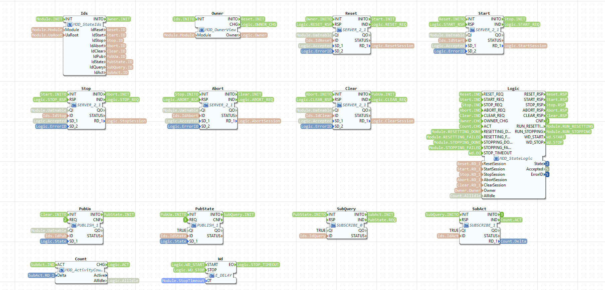

| Inside | Type | What it does |
| --- | --- | --- |
| `Ids` | `MOD_StateIds` | Builds the addresses (`/Objects/Filling/Module/...`) and channel names |
| `Owner` | `MOD_OwnerView` | Knows the owner: only the owner may change the state |
| `Reset`, `Start`, `Stop`, `Abort`, `Clear` | `SERVER_2_1` | The five OPC UA methods |
| `Logic` | `MOD_StateLogic` | The PackML state machine |
| `PubUa`, `PubState` | `PUBLISH_1` | Write the state to `Module/State` and to `loc[Filling/state]` |
| `SubQuery` | `SUBSCRIBE_0` | Hears a block that asks for the state; `PubState` then sends it again |
| `SubAct`, `Count` | `SUBSCRIBE_1`, `MOD_ActivityCount` | Hear the skills' +1 and -1 on `loc[Filling/activity]` and count how many run |
| `Wd` | `E_DELAY` | The watchdog: when the skills have not stopped after `StopTimeout`, the module aborts |

#### `MOD_StateLogic` (basic): the PackML state machine


```
 Stopped (2) ──Reset──► Resetting (15) ──procedure done──► Idle (4) ──Start──► Starting (3) ──► Execute (6)
                            │ procedure failed
                            ▼
                         Aborting (8)

 Resetting, Idle or Execute ──Stop──► Stopping (7) ──no skill runs any more──► Stopping procedure
                                         │                                        │ done
                                         │ StopTimeout, or the procedure failed    ▼
                                         ▼                                     Stopped (2)
                                      Aborting (8)

 any state but Aborted ──Abort──► Aborting (8) ──► Aborted (9) ──Clear──► Clearing (1) ──► Stopped (2)
```

| Command | Accepted only in | What happens |
| --- | --- | --- |
| Reset | Stopped | Resetting: runs the Resetting procedure (home, tare). Idle when it is done, Aborting if it fails |
| Start | Idle | Starting, at once Execute. Only now may skills be started |
| Stop | Resetting, Idle, Execute | Stopping: every skill a client started stops; when none runs any more (the count is 0) the Stopping procedure runs (home), then Stopped. If the skills still run after `StopTimeout`, or the procedure fails: Aborting |
| Abort | every state but Aborted | Aborting, at once Aborted. Every skill aborts and every piece of equipment switches all off |
| Clear | Aborted | Clearing, at once Stopped |

Every command must come from the owner (otherwise `[FALSE, 5]`), and in a state where it is not
allowed the answer is `[FALSE, 4]` (NotReady). The states named `Chk...` in its state machine
check a command and answer it; a small variable (`Here`) remembers where the machine was, so that a
refused command takes it back there.

#### `MOD_StateIds` (simple)


Builds the nine addresses at start-up: the five methods `opc_ua[CREATE_METHOD;/Objects/Filling/Module/Reset]`
and the others, `opc_ua[WRITE;/Objects/Filling/Module/State]`, and the channels `loc[Filling/state]`,
`loc[Filling/state/query]` and `loc[Filling/activity]`.

#### `MOD_ActivityCount` (simple): a tally counter at the door


Every skill says +1 on the activity channel when it starts and -1 when it ends. This block adds them
up (`Active`, never below 0) and says `AllIdle` when the count is 0. Stopping waits for that.

#### `MOD_StateView` (composite) and `MOD_StateLatch` (simple): the ear for the module state

 

Built exactly like `MOD_OwnerView` (section 7.4), for the module state: it listens on
`loc[Filling/state]`, asks once on `loc[Filling/state/query]`, and gives `State` with `CHG`. Every
skill has one (`Mode` in `SKILL_Core`: may it start, must it stop?) and every piece of equipment
(`Mode` in `EQ_...`: everything off when the module aborts).


### 7.6 What every skill shares: `SKILL_Core`

Think of the front desk of a workshop: it takes the customer's order, checks that the customer may
order and that the workshop is open, says yes or no, keeps the status board up to date, and only
then hands the job to the people who do the work. Every skill has one, whatever it does: each
primitive as `Control` inside its `SK_` block, and each module level skill as its `Control` block.

#### `SKILL_Core` (composite)


The inputs set once at start-up: `Module`, `UaRoot`, `UaPath` (the skill's folder below `UaRoot`,
such as `/Skills/Dispensing`), `UaEnable`, `Methods` (offer Start, Stop, Abort and Reset over OPC UA:
TRUE when the skill is offered on its own, FALSE for a step that its parent runs), `Holder` (the name
the equipment is held under) and `ReleaseAll` (TRUE for a module level skill: give up everything held
under `Holder` when a run ends).

Its events, in plain words:

| In | Means | Out | Means |
| --- | --- | --- | --- |
| `START_REQ` | A client called Start (the parameters are already checked) | `START_RSP` | The answer to the client |
| `START`, `HALT`, `ABORT`, `RESET` | The same, from a parent (a step in a sequence): no session check | `RUN` | Go: the parameters are taken and the work starts |
| `EXECUTE_DONE`, `EXECUTE_FAILED` | The work ended well, or failed (`ExecuteError`) | `HALT_SEQ`, `ABORT_SEQ`, `RESET_SEQ` | Stop, abort or reset the work |
| `STOPPING_DONE` | The stop sequence ended | `RUN_STOPPING` | Run the stop sequence |
| | | `SUCCESS`, `FAILURE` | Tell the parent how the run ended |

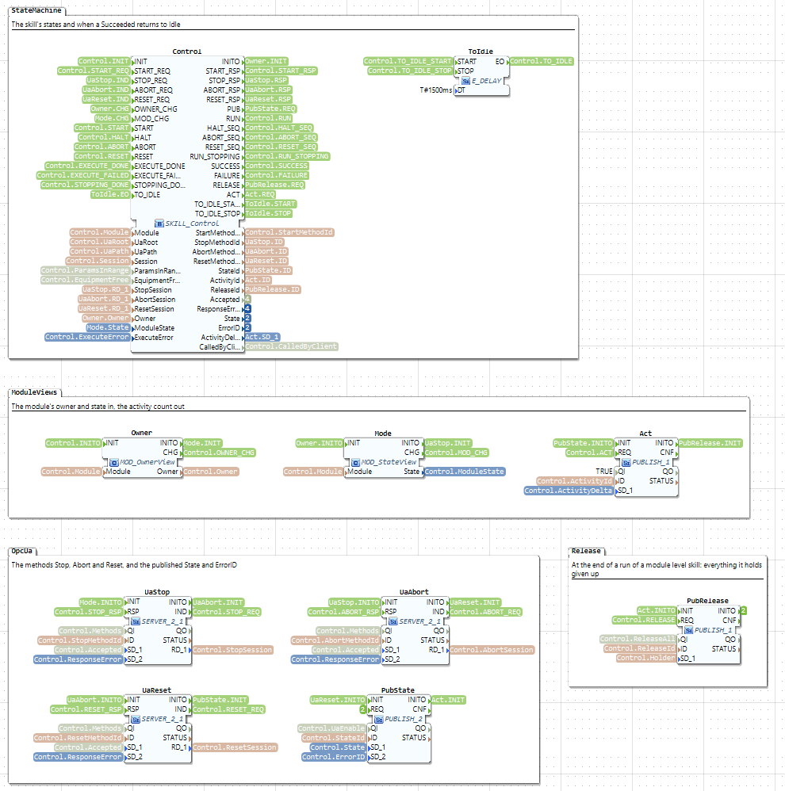

| Inside | Type | What it does |
| --- | --- | --- |
| `Control` | `SKILL_Control` | The skill's state machine (below) |
| `Owner` | `MOD_OwnerView` | Knows the owner (only the owner may command the skill over OPC UA) |
| `Mode` | `MOD_StateView` | Knows the module state: start only in Execute; stop or abort with the module |
| `UaStop`, `UaAbort`, `UaReset` | `SERVER_2_1` | The OPC UA methods Stop, Abort, Reset. The Start method is outside `SKILL_Core`, because its size follows the skill's parameters |
| `PubState` | `PUBLISH_2` | Writes `State` and `ErrorID` |
| `Act` | `PUBLISH_1` | Says +1 or -1 on the activity channel |
| `ToIdle` | `E_DELAY` | Brings a succeeded skill back to Idle after 1.5 s |
| `PubRelease` | `PUBLISH_1` | When a run ends, says on `loc[Filling/release]` that `Holder` gives up its equipment. Only switched on with `ReleaseAll` (a module level skill); a primitive gives its equipment up with its last command instead |

#### `SKILL_Control` (basic): the skill's state machine


```
 Idle (0) ──Start──► Running (1) ──work done──► Succeeded (3) ──1.5 s later──► Idle (0)
                        │    └──work failed──► Failed (4): stays so until the next Start
                        │
                        └──Stop──► Stopping (2): the work ends, the stop sequence runs ──► Failed (4), error 7

 any state but Aborted ──Abort──► Aborted (5) ──Reset, or the module is cleared──► Idle (0)
```

A client's Start is checked in this order; the first that fails gives the answer:

| Check | If it fails |
| --- | --- |
| The caller holds the occupation | `[FALSE, 5]` NotPermitted |
| The module is in Execute | `[FALSE, 4]` NotReady |
| The skill does not run (not Running or Stopping) | `[FALSE, 6]` Busy |
| The skill is not Aborted | `[FALSE, 4]` NotReady (Reset it first) |
| Every parameter is within its limits | `[FALSE, 8]` OutOfRange |
| Its equipment is free, or held by this skill | `[FALSE, 6]` Busy |

Stop is accepted only while Running, Abort in every state but Aborted, Reset only in Aborted; each
only from the owner (5) and otherwise 4. A parent's `START` needs no checks (the parent was
checked); from Aborted it fails at once with 4. The skill also follows the module: when the module
aborts, the skill aborts; when the module is cleared or stopped, an aborted skill becomes Idle; and
when the module stops, a skill a client started stops (a step is stopped by its parent instead).
Every start says +1 on the activity channel and every end -1.

### 7.7 Parameters and failures

#### `SKILL_Param_LREAL` (and `_BOOL`, `_INT`, `_DINT`, `_UINT`): a door check with a memory


One block per parameter of a skill. Like a door check that compares a value with the allowed range
and then remembers it for the whole run:

- `INIT`: the value is the default (`Default`).
- `CHECK`: is the value the client asks for (`Requested`) between `Lower` and `Upper`? `AllInRange`
  is TRUE only if this one and all checked before it (`PreviousInRange`) are.
- `LATCH`: take the value for this run. If a client started the skill (`CalledByClient`), its value;
  if a parent did, `Default`. A step gets its value from its parent through `Default`: a constant
  (`NeedleDown`'s Position 40) or a wire from the parent's own parameter (`Dispense`'s Volume).

With several parameters the blocks are chained: `CHECKED → next CHECK`, `AllInRange → next
PreviousInRange`, and the last one's `AllInRange` goes to `Control.ParamsInRange`; then `LATCHED →
next LATCH`, and the last `LATCHED` publishes the values and starts the work. `_BOOL` has no limits.

#### `SKILL_FailMerge` (simple): a funnel


Joins two failures into one: `FAIL_1` (with `Error1`) or `FAIL_2` (with `Error2`) gives `FAIL` with
that error code. It is needed because a data input can take only one wire: four steps cannot all
wire their `ErrorID` to one pin. In `Dispensing.Execute`, `Fail1` joins `NeedleDown` and
`Dispense`, `Fail2` joins `Fail1` and `Home`, `Fail3` joins `Fail2` and `Weigh`; in `Resetting`,
`Fail1` joins `Home` and `Tare`.

#### `SKILL_Join2` to `SKILL_Join4`, `SKILL_Merge`, `SKILL_Condition_LREAL`, `SKILL_Condition_BOOL`: for later

 


For skills whose steps run side by side or depend on a decision (rule set 2,
[module-rules.md](module-rules.md), section 3). A `Join` waits until every branch is done (`DONE`);
if one fails, it says `HALT` to the others and `FAILED` once all have ended. A `Condition` compares
`Operand` with `Expected` (`Operator` `eq`, `ne`, `gt`, `gte`, `lt`, `lte`) and answers `YES` or
`NO`. A `Merge` is where the two branches of a decision meet again. The filling program does not use
them yet; the syringe's `BottomUpFilling` (`cell/eval/scenarios.py`) does.

### 7.8 The IO blocks: one pin each

Think of a travel plug adapter. The equipment block plugs into an IO block in the same way whether
the pin is a GPIO line on the Pi, a register of the Modbus simulator on the PC, or only simulated.
Only the address changes, so the same equipment type runs on every target.

#### `IO_DI`, `IO_DO`, `IO_AI`, `IO_AO` (composite)

 
 

`D` digital (TRUE or FALSE), `A` analog (a number), `I` input, `O` output. Each has `INIT` with
`Address` (set up the pin) and `REQ` (read the pin, or write `OUT` to it); `QO` says whether the pin
can be reached and the last access worked, and an input gives its value on `IN`. The extras:
`IO_DI` and `IO_AI` have `SimValue` (the value when simulated), `IO_AI` has `Scale` (the value per
raw count: the scale's 0.001 g), and `IO_AO` has `EN` (FALSE writes 0), `Gain` and `Bias`: it writes
`Bias + OUT × Gain`, kept between 0 and 65535. The axis's `Step` has the gain 655.35, so 50 % becomes
32 767, half of 65 535: the pin is on for half of each period.

| Address | Meaning |
| --- | --- |
| `gpio[0:23:pull_up:active_low]` | Raspberry Pi GPIO chip 0, line 23, with the pull-up on, read inverted |
| `gpio[0:17:active_low]` | Line 17 as an output, written inverted |
| `pwm[0:2:500000:/hostsys/class/pwm]` | PWM chip 0, channel 2, period 500 000 ns (2 kHz), in the folder the container passes in |
| `modbus[127.0.0.1:1502:1:10:d0:]` | A Modbus register of the simulator on the PC |
| `sim` | Simulated: an input gives `SimValue`, an output goes nowhere |
| another name | An IO point set up somewhere else in FORTE, read or written by that name |
| empty | Not connected: `QO` is FALSE |


| Inside | Type | What it does |
| --- | --- | --- |
| `Route` | `IO_RouteDO` (`IO_RouteDI`, `IO_RouteAI`, `IO_RouteAO`) | Reads the address and decides which way the value goes (below) |
| `Line` | `GPIOChip` (in `IO_DI`, `IO_DO`), `PWMChip` (in `IO_AO`); `IO_AI` has none | Sets up the Pi line or PWM channel when the address names one |
| `Local` | `QX` (`IX`, `IW`, `QW`) | Reads or writes the point by its name |
| `Bus` | `CLIENT_1_0` (`CLIENT_0_1` for inputs) | Reads or writes the Modbus register |

How it runs: at start-up `Route` reads the address and switches on only the part that is needed (the
others get `QI` FALSE); then `Line`, `Local` and `Bus` are set up in turn and `Route` reports
whether the pin is reachable (`INITO` with `QO`). On each `REQ`, `Route` passes the value to `Local`
or `Bus`, or answers itself (simulated, or not connected), and `CNF` comes back.

#### `IO_RouteDI`, `IO_RouteDO`, `IO_RouteAI`, `IO_RouteAO` (basic): the switchboard


Inside each IO block. At start-up it takes the address apart (`gpio[chip:line:...]`,
`pwm[chip:channel:period:folder]`, `modbus[...]`, `sim`, a name, or empty) into the numbers the
`Line` block needs, and remembers which way the pin is reached. Then it passes every value that way
only. `IO_RouteAO` also turns `OUT` into the raw value with `Gain` and `Bias`, and `IO_RouteAI` the
raw value into `IN` with `Scale`.

## 8. The filling module's own blocks

These types are made by the generator from the filling module's spec, `cell/modules/filling.yaml`,
in the package `filling::`. They come in two families:

- **a piece of equipment** gets four types: `EQ_<Item>`, `EL_<Item>`, `EV_<Item>`, `EC_<Item>`
  (the axis, the pump, the scale: sections 8.1 to 8.4);
- **a skill primitive** gets two: `SK_<Skill>` and `SL_<Skill>` (Home, MoveAxis, Dispense, Tare,
  Weigh: sections 8.5 and 8.6).

The module level skill (Dispensing) and the procedures (Resetting, Stopping) have no types of their
own: they are subapplications of blocks of these types (section 8.7).

### 8.1 Equipment: four types for each piece

Think of a machine in a workshop with one operator:

- `EQ_<Item>` is **the operator**: the only one who touches the machine's buttons (its output pins)
  and reads its gauges (its input pins). It is the block you see in the application.
- `EL_<Item>` is **the operator's rules**, inside the `EQ_` block: one customer at a time; let go of
  a button before pressing another; everything off when the customer leaves or the alarm goes.
- `EC_<Item>` is **the cheat sheet** the customer carries: "Up means: Enable on, Step at 50 %". It
  sits inside every skill that uses the equipment, not in the equipment, so the equipment block only
  ever hears "switch these outputs", whatever they mean.
- `EV_<Item>` is **the report form**, also inside every skill that uses it: it unpacks what the
  operator reports into values with names.

How a skill and its equipment talk, here `MoveAxis` and the axis:

```
 SK_MoveAxis (the skill)                        EQ_LinearAxis (the equipment)
 Logic (SL_MoveAxis): "move to 40 mm"
   │ command 3, argument 40
   ▼
 Driver (EC_LinearAxis): the values to send
   │ holder, release, Enable, Down, Step, ...
   ▼
 EqCmd ═════ loc[Filling/LinearAxis/cmd] ═════► SubCmd
                                                  ▼
                                                Logic (EL_LinearAxis): one holder, off before on
                                                  ▼
                                                Out_Enable, Out_Down, Out_Step ──► GPIO17, GPIO27, GPIO18
                                                In_AtHome ◄── GPIO23
                                                  ▼
 EqState ◄══ loc[Filling/LinearAxis/state] ════ PubState: AtHome, ActualPosition, Homed, Moving, holder
   ▼
 EqView (EV_LinearAxis): the values by name
   ▼
 Logic: "not moving, and at 40 mm: done"
```

**Holding.** One skill at a time holds a piece of equipment, under a name (its `Holder`): `MoveAxis`
when it runs on its own, `Dispensing` for every step of Dispensing, `Procedures/Resetting` for the
steps of Resetting. The equipment takes commands only from its holder, or from anyone when it is
free; it reports the holder on its state channel, so the other skills can see it is taken. It is
free again when the holder's last command says so (`release`), when a module level skill says so on
`loc[Filling/release]`, or when the module aborts.

### 8.2 The linear axis: the needle's lift

The hardware: a stepper motor behind a TB6600 driver, which needs three outputs (`Enable` on GPIO17,
active low; `Down` on GPIO27; `Step`, pulses from PWM on GPIO18) and has one input, the limit switch
at the top (`AtHome` on GPIO23). Each pulse is a small step: 160 pulses per mm, so at 2 kHz the
needle moves 12.5 mm/s. There is no sensor for the position: the axis counts the time it moves.

#### `EQ_LinearAxis` (composite)


Its inputs: `Module`, `Name` (`"LinearAxis"`: its channels and OPC UA folder), `UaRoot`, `UaEnable`,
`CycleTime` (50 ms: how often the switch is read), and for each pin its address: `AtHome_Address`
(with `AtHome_Sim`, its value when simulated), `Enable_Address`, `Down_Address`, `Step_Address`
(with `Step_Gain` 655.35 and `Step_Bias` 0). In `Filling_pi` the addresses are the Pi's pins, in
`Filling` the simulator's registers; that is the only difference between the two applications.


| Inside | Type | What it does |
| --- | --- | --- |
| `Logic` | `EL_LinearAxis` | The rules (below) |
| `SubCmd` | `SUBSCRIBE_8` | Hears the commands on `loc[Filling/LinearAxis/cmd]`: holder, release, Enable, Down, Step, Step enabled, Move, Goal |
| `SubRelease` | `SUBSCRIBE_1` | Hears `loc[Filling/release]` |
| `Mode` | `MOD_StateView` | Knows the module state (all off when the module aborts) |
| `Cycle` | `E_CYCLE` | Ticks every 50 ms: read the switch, write the outputs again |
| `MoveT` | `E_DELAY` | Times a move to a position |
| `In_AtHome` | `IO_DI` | The limit switch |
| `Out_Enable`, `Out_Down` | `IO_DO` | The driver's enable and direction |
| `Out_Step` | `IO_AO` | The step pulses: 50 % while it moves |
| `PubState` | `PUBLISH_5` | Writes AtHome, ActualPosition, Homed, Moving and the holder on `loc[Filling/LinearAxis/state]` |
| `PubUa` | `PUBLISH_4` | Writes the same four values (not the holder) to `Equipment/LinearAxis/...` over OPC UA |

How it runs: every tick of `Cycle`, `In_AtHome` reads the switch and `Logic` gets the value
(`SAMPLE`); `Logic` also writes its outputs again (`REFRESH`). When `Logic` switches outputs
(`DRIVE`), the three output blocks write one after the other (`Out_Enable`, then `Out_Down`, then
`Out_Step`) and the last one says `DRIVEN`.

#### `EL_LinearAxis` (basic): the axis's rules


1. **One holder at a time.** A command is taken only when nobody holds the axis or its sender
   already does. Any other is ignored; that skill sees the holder on the state channel and waits, or
   fails with Busy.
2. **Off before on** ("break before make"). For a new command the axis first switches off what the
   new command does not want on, writes that, and only then switches the new values on. The motor
   never gets a new direction while it is still being driven the old way. A command that arrives
   while the outputs are being written waits its turn.
3. **The position, by counting time.** While moving, `ActualPosition` is where the move began plus
   12.5 mm/s times the time since. At the switch it is 0 and the axis is `Homed`. For a move to a
   position (`MoveTo`, only when homed) it works out the direction and the time the move takes (the
   distance divided by 12.5 mm/s), switches Enable, Down (when going down) and Step on, and starts
   `MoveT`; when `MoveT` ends, the axis is at the goal and everything goes off. When a skill drives
   the axis with plain `Up` or `Down` instead (Home uses `Up`), the axis cannot count, so it is no
   longer `Homed` until it reaches the switch.
4. **Everything off** when its holder gives it up and when the module aborts.
5. **Reporting.** It sends its state when something changed, at least once a second, and every
   0.2 s while it moves.

The speed, 12.5 mm/s, is written into this type from the spec. Another speed means a regenerated
type, not another value on the block: that is why the stoppering module has its own (section 9).

#### `EC_LinearAxis` (basic): the axis's command table


| Number | Command | Outputs |
| --- | --- | --- |
| 0 | Stop | Everything off (the safe command, always the first) |
| 1 | Up | Enable on, Step 50 % |
| 2 | Down | Enable on, Down on, Step 50 % |
| 3 | MoveTo | Move to the position given as the argument (the axis works out the direction itself) |

`PLAY` (with `Holder`, `Command`, `Arg` and `Release`) plays a command; `OUT` gives the values to
send. A command may have several timed phases: then the table asks for a timer (`PHASE_START`),
plays the next phase when it ends (`PHASE_T`), and says `PLAYED` after the last. The axis's
commands have one phase each. The release is sent only with the last phase.

#### `EV_LinearAxis` (simple): the axis's report form


`REQ` with the values as they arrived on the state channel (`I_AtHome`, `I_ActualPosition`,
`I_Homed`, `I_Moving`, `I_Holder`) gives them on `CNF` with their names (`AtHome`, ...).

### 8.3 The pump

No pump is wired yet, so the pump has no pins. It is there all the same, so that `Dispense` can hold
it while it "dispenses" (by time).


`EQ_Pump` has the same parts as the axis without the pins: `Logic` (`EL_Pump`), `SubCmd`
(`SUBSCRIBE_2`: only the holder and the release), `SubRelease`, `Mode`, `Cycle` and `PubState`
(`PUBLISH_1`: only the holder). It has no `PubUa`, because there is no input to show.

 


`EL_Pump` only keeps the holder. `EC_Pump` has two commands, 0 `Idle` and 1 `Run`, with no outputs
to switch. `EV_Pump` gives only `Holder`. When a pump is wired, its outputs are added to the spec
(section 10 shows how) and the four types are generated again; the spec of `Dispense` stays as it is.

### 8.4 The scale

The hardware has no scale yet: its weight is simulated.


`EQ_Scale` has one input, `Weight`, read by `In_Weight` (an `IO_AI`). In `Filling_pi` its address
is `sim`, so it always gives `Weight_Sim`, 2.0 g; in `Filling` it reads the simulator's register
times `Weight_Scale` (0.001 g per count). `PubState` (`PUBLISH_2`) sends Weight and the holder,
`PubUa` (`PUBLISH_1`) writes `Equipment/Scale/Weight`.

 


`EL_Scale` keeps the holder and reports the weight when it changes. `EC_Scale` has 0 `Idle`, 1
`Tare` and 2 `Measure`, but the scale has no outputs: taring and measuring only hold the scale for a
time (2 s and 0.2 s). Taring does not zero anything yet. `EV_Scale` gives `Weight` and `Holder`.

### 8.5 A skill primitive: two types

A primitive is **one command to one piece of equipment, until a sensor says it is done or a time has
passed**. `SK_<Skill>` is the whole job (the front desk, the recipe, the line to the equipment);
`SL_<Skill>` is the recipe itself.

#### `SK_<Skill>` (composite), with `SK_Home` as the example


**The inputs of a primitive block** (what you set on a block of this type): `Module` (the module's
name, for the channel names), `UaRoot` and `UaPath` (where its OPC UA variables go), `UaEnable`
(publish them at all), `Methods` (offer Start, Stop, Abort and Reset over OPC UA: TRUE when it is
offered on its own, FALSE as a step), `Holder` (the name it holds the equipment under),
`ReleaseAfter` (give the equipment up when it ends: TRUE on its own, FALSE as a step, so the next
step keeps it), `Timeout` (only a skill a sensor ends has one), and one input per parameter, whose
value is the default. Its events are those a parent needs: `INIT`, `START` (with the parameters),
`HALT`, `ABORT`, `RESET`; `SUCCESS` (with the results) and `FAILURE` (with `ErrorID`).

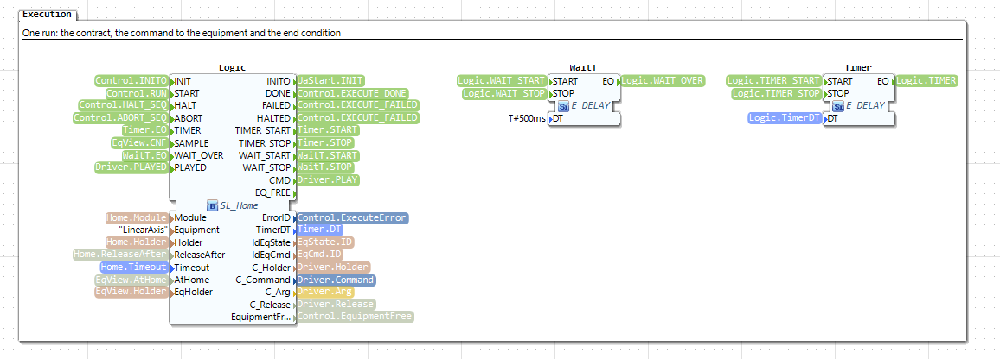

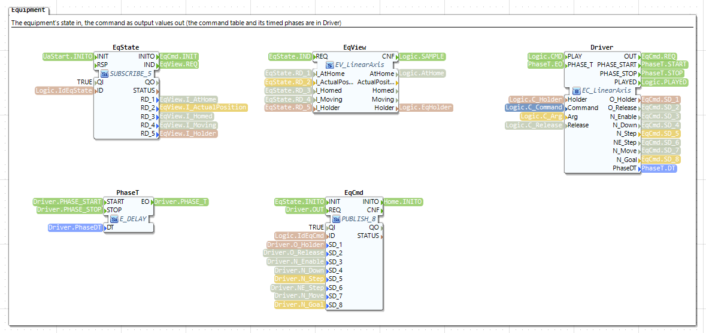

No screenshot of the group `SkillControl` yet; the drawing of the whole type is [inside-SK_Home.svg](filling-program/inside-SK_Home.svg).

| Inside | Type | What it does |
| --- | --- | --- |
| `Control` | `SKILL_Core` | The front desk: checks a Start, the state machine, the methods Stop, Abort and Reset (section 7.6) |
| `UaStart` | `SERVER_2_1` (`SERVER_2_<1 + parameters>`) | The OPC UA method `Start(Session, parameters)` |
| `Par_<p>` | `SKILL_Param_...` | One per parameter (Home has none; MoveAxis has `Par_Position`) |
| `PubParams` | `PUBLISH_<parameters>` | Writes `Parameters/...` (Home has none) |
| `Logic` | `SL_Home` | The recipe (below) |
| `EqState`, `EqView` | `SUBSCRIBE_n`, `EV_LinearAxis` | Hear the equipment's state channel and unpack it |
| `WaitT` | `E_DELAY` | Waits up to 0.5 s for the equipment to become free |
| `Driver` | `EC_LinearAxis` | The cheat sheet: turns `Logic`'s command number into output values |
| `PhaseT` | `E_DELAY` | Times a command made of phases |
| `EqCmd` | `PUBLISH_n` | Sends the holder and the output values on `loc[Filling/LinearAxis/cmd]` |
| `Timer` | `E_DELAY` | Ends a timed skill, or fails a skill after its timeout |
| `PubResults` (only `SK_Weigh`) | `PUBLISH_1` | Writes `Results/Weight` |

A client's Start, step by step: the call arrives at `UaStart`; the parameter blocks check the values
(Home has none, so `UaStart.IND` goes straight to `Control.START_REQ`); `Control` answers through
`UaStart` and, when it accepts, fires `RUN`; the parameter blocks take the values for the run and
start `Logic`. A parent's `START` goes to `Control.START` and from there the same way, with the
defaults.

#### `SL_<Skill>` (basic): the recipe

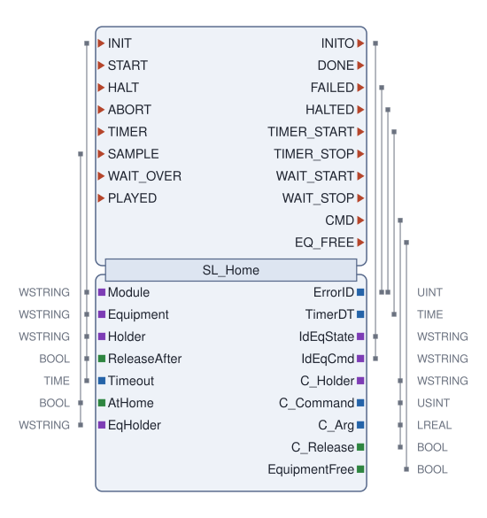

The same pattern for every primitive; only the conditions, the command and the time differ:

```
 START ──► Check ──precondition does not hold───────────────────────► FAILED, error 1
             ├──another skill holds the equipment──► wait up to 0.5 s ──freed──► Check again
             │                                                └──still held──► FAILED, error 6
             ├──the end condition holds already─────────────────────► DONE at once (nothing moves)
             └──else: send the command, start the Timer──────────────► Running

 Running ──end condition holds (a sensor skill), or the Timer ends (a timed skill)──► Done
         ──the Timer ends (a sensor skill: its timeout)─────────────────────────────► TimedOut, error 3
         ──the invariant stops holding──────────────────────────────────────────────► Unsafe, error 2
         ──another skill now holds the equipment───────────────────────────────────► FAILED, error 6
         ──HALT─────────────────────────────────────────────────────────────────────► Halt, error 7
         ──ABORT────────────────────────────────────────────────────────────────────► Abort

 Done, TimedOut, Unsafe, Halt, Abort: send the closing command, wait until it is played,
 then DONE, FAILED or HALTED (after Abort nothing: the parent aborted it)
```

The *precondition* must hold for the skill to start; the *end condition* (postcondition) says when
it is done; the *invariant* must hold all the while it runs. The *closing command* is the
equipment's safe command (all off) unless the spec gives another (`stop:`); it carries the release
when `ReleaseAfter` is TRUE, and always after an abort. Every time the equipment's state arrives
(`SAMPLE`), `Logic` also updates `EquipmentFree`, which `Control` checks before it accepts a Start.

### 8.6 The five filling primitives

| Primitive | Precondition | Command (equipment) | Ends when | Timeout | Parameters | Results |
| --- | --- | --- | --- | --- | --- | --- |
| `Home` | – | `Up` (LinearAxis) | `AtHome` (sensor) | 60 s | – | – |
| `MoveAxis` | `Homed` | `MoveTo(Position)` (LinearAxis) | not `Moving` and at `Position` (sensor, the axis' own count) | 30 s | Position 0 to 60 mm | – |
| `Dispense` | – | `Run` (Pump) | after Volume / FlowRate s (time) | – | Volume 0.5 to 10 mL, FlowRate 0.1 to 5 mL/s | – |
| `Tare` | – | `Tare` (Scale) | after 2 s (time) | – | – | – |
| `Weigh` | – | `Measure` (Scale) | after 0.2 s (time) | – | – | Weight (the scale's input) |

#### `SK_Home`, `SL_Home`: needle up to the switch

The pictures are in section 8.5. It drives the axis `Up` until the limit switch closes; then the
position is 0 and known (`Homed`). If the needle is at the switch already, it is done at once. If the
switch never closes, the timeout (60 s) stops the motor and the skill fails with 3. It is used five
times: on its own, as the first step of Resetting, as Stopping, as the third step of Dispensing, and
as Dispensing's stop sequence.

#### `SK_MoveAxis`, `SL_MoveAxis`: needle to a position

 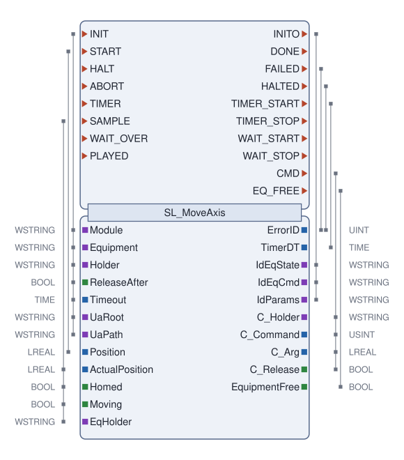

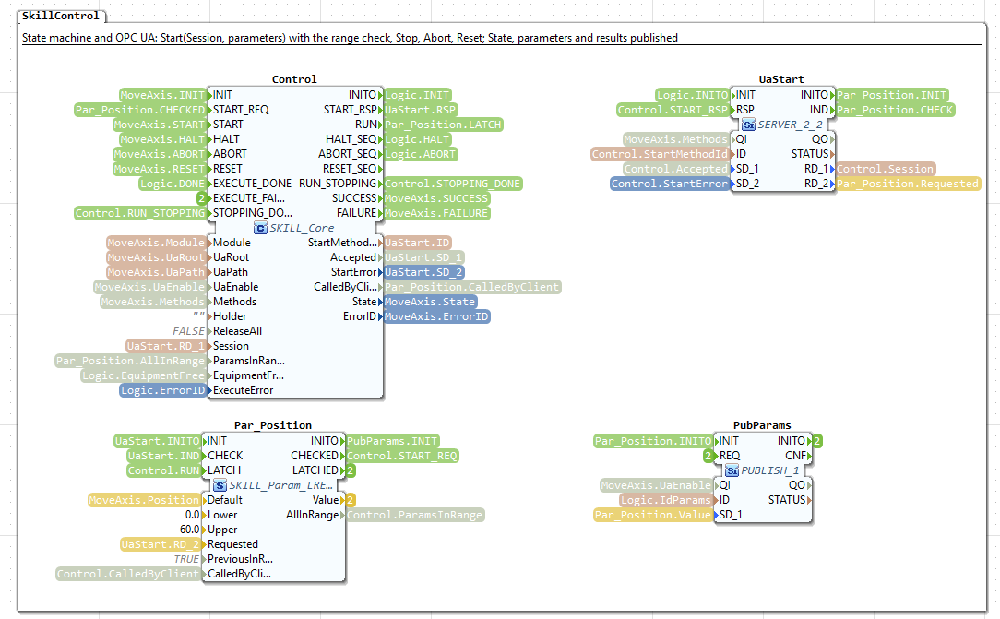

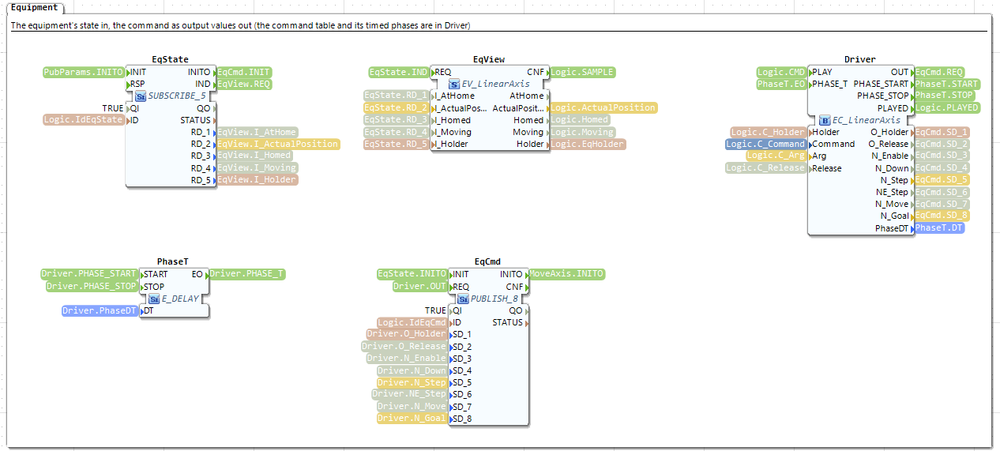

No screenshot of the group `Execution` yet; the drawing of the whole type is [inside-SK_MoveAxis.svg](filling-program/inside-SK_MoveAxis.svg).

It needs the axis homed (otherwise it fails at once with 1, PreconditionViolated). It sends `MoveTo`
with the position (0 to 60 mm, measured down from the switch); the axis itself times the move, and
the skill only waits until the axis reports that it no longer moves and is within 0.001 mm of the
position. Timeout 30 s. It has one parameter, so `UaStart` is a `SERVER_2_2`, with `Par_Position` and
`PubParams` (`PUBLISH_1`). In Dispensing it is the step `NeedleDown`, with the constant Position 40.

#### `SK_Dispense`, `SL_Dispense`: dispense a volume

 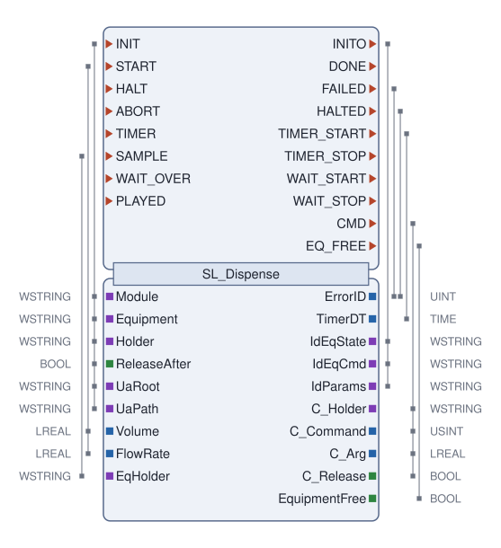

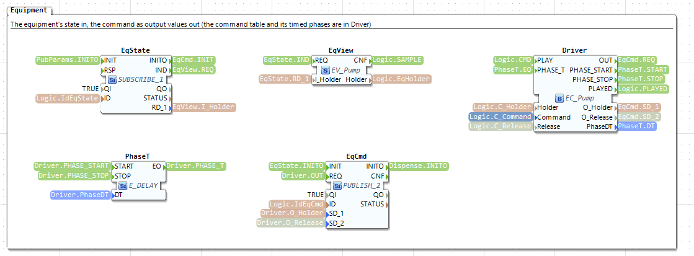

No screenshot of the groups `SkillControl` and `Execution` yet; the drawing of the whole type is [inside-SK_Dispense.svg](filling-program/inside-SK_Dispense.svg).

It holds the pump with `Run` for Volume / FlowRate seconds (2 mL at 1 mL/s: 2 s), then sends `Idle`.
Two parameters, so `SERVER_2_3`, `Par_Volume` and `Par_FlowRate` (checked one after the other) and
`PubParams` (`PUBLISH_2`). It has no timeout: the time ends it. In Dispensing, FlowRate is the
constant 1.0 and Volume comes from Dispensing's own parameter.

#### `SK_Tare`, `SL_Tare`: tare the scale

 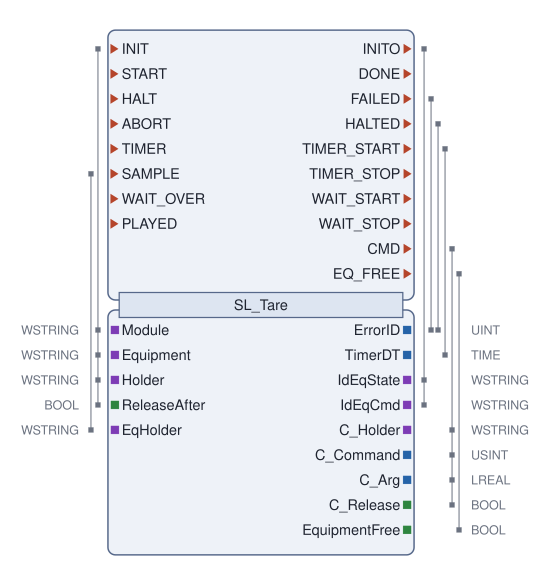

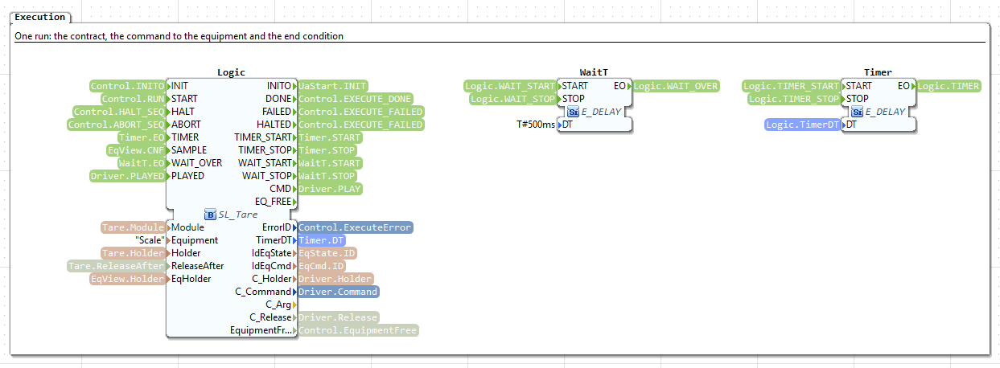

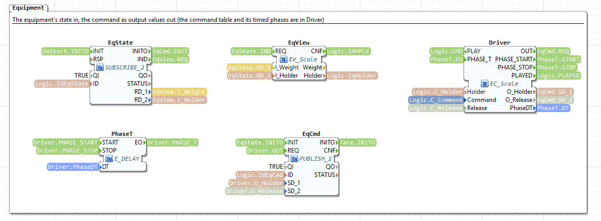

No screenshot of the group `SkillControl` yet; the drawing of the whole type is [inside-SK_Tare.svg](filling-program/inside-SK_Tare.svg).

It holds the scale with `Tare` for 2 s. No parameters, no results. The second step of Resetting.

#### `SK_Weigh`, `SL_Weigh`: read the weight

 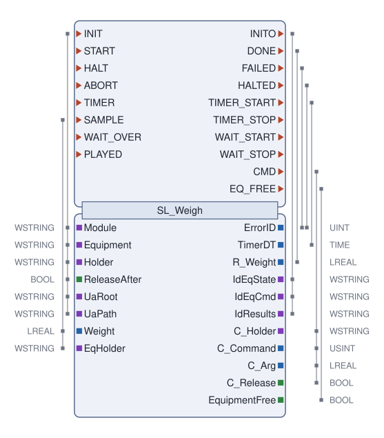

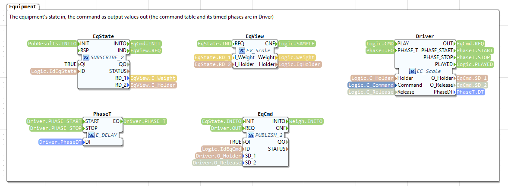

No screenshot of the groups `SkillControl` and `Execution` yet; the drawing of the whole type is [inside-SK_Weigh.svg](filling-program/inside-SK_Weigh.svg).

It holds the scale with `Measure` for 0.2 s; when it is done, `SL_Weigh` takes the weight the scale
reported last as its result (`R_Weight`). `PubResults` writes it to `Results/Weight`, and the block's
`SUCCESS` carries it to a parent: in Dispensing it becomes Dispensing's result.

### 8.7 The subapplications: procedures and the module level skill

#### `Resetting` and `Stopping`: the procedures


`Resetting` is what the module does when it is reset: `START → Home.START`, `Home.SUCCESS →
Tare.START`, `Tare.SUCCESS → DONE`. Either step's failure goes through `Fail1` to `FAILED`, with its
error code on `ErrorID`. The state manager starts it (`Module.RUN_RESETTING`) and hears how it ended.
Its steps have `Methods` FALSE (a client cannot start them; their State and ErrorID are still
published, at `/Procedures/Resetting/Home` and `.../Tare`), the holder `Procedures/Resetting`, and
`ReleaseAfter` TRUE.


`Stopping` is one step, `Home`: after a stop, the needle goes back up to the switch.

#### `Dispensing`: the module level skill


| Block | Type | What it does here |
| --- | --- | --- |
| `Control` | `SKILL_Core` | The front desk of Dispensing: `UaPath "/Skills/Dispensing"`, `Holder "Dispensing"`, `ReleaseAll` TRUE (when a run ends, every piece of equipment its steps held is released) |
| `UaStart` | `SERVER_2_2` | The method `Skills/Dispensing/Start(Session, Volume)` |
| `Volume` | `SKILL_Param_LREAL` | The parameter: default 1.0, limits 0.5 to 10 mL |
| `PubParams` | `PUBLISH_1` | Writes `Skills/Dispensing/Parameters/Volume` |
| `Execute` | subapplication | The steps (below) |
| `Stop` | subapplication | What runs when Dispensing is stopped: `Home` |
| `PubResults` | `PUBLISH_1` | Writes `Skills/Dispensing/Results/Weight` when Execute is done |

The wiring, in words: the call goes `UaStart.IND → Volume.CHECK`, the check `Volume.CHECKED →
Control.START_REQ`, the answer `Control.START_RSP → UaStart.RSP`. When accepted, `Control.RUN →
Volume.LATCH`, and `Volume.LATCHED` both publishes the volume and starts `Execute`, with the volume
on `Execute.Volume`. `Execute.DONE` tells `Control` and `PubResults`; `Execute.FAILED` with its
`ErrorID` tells `Control`. When Dispensing is stopped, `Control.HALT_SEQ` halts `Execute`, then
`Control.RUN_STOPPING` starts `Stop`, whose end comes back on `Control.STOPPING_DONE`.


`Execute` holds the four steps, each a block of a primitive type with `Methods` FALSE,
`Holder "Dispensing"` and `ReleaseAfter` FALSE (the next step keeps the equipment):
`NeedleDown` (`SK_MoveAxis`, Position 40), `Dispense` (`SK_Dispense`, FlowRate 1.0, Volume from
`Execute.Volume`), `Home` (`SK_Home`) and `Weigh` (`SK_Weigh`, its `R_Weight` is `Execute.Weight`).
The chain: `START → NeedleDown.START`, each step's `SUCCESS` to the next step's `START`, `Weigh.SUCCESS →
DONE`. `HALT`, `ABORT` and `RESET` go to every step. `Fail1` to `Fail3` join the four steps' failures
into one `FAILED` (section 7.7).


`Stop` holds one step, `Home`, with the holder `Dispensing`.

## 9. What is different in the stoppering module

The stoppering module (`cell/modules/stoppering.yaml`, the project `cell/control/StopperingModule`,
the Pi 5 at 192.168.0.134) is built in the same way. Everything in section 7 is the same, block for
block. What section 8 describes is generated again from the stoppering spec, in the package
`stoppering::`: some types are like the filling ones, others are new.

| | Filling | Stoppering |
| --- | --- | --- |
| Module name, OPC UA folder | `Filling`, `/Objects/Filling` | `Stoppering`, `/Objects/Stoppering` |
| Equipment | `LinearAxis` (the needle), `Pump`, `Scale` | `LinearAxis` (the head), `Piston` |
| The axis | 12.5 mm/s, PWM 2 kHz | 20 mm/s (assumed until measured), PWM 1 kHz |
| Primitives | `Home` (60 s), `MoveAxis` (30 s), `Dispense`, `Tare`, `Weigh` | `Home` (8 s), `MoveAxis` (8 s), `PressStopper`, `RetractPiston` |
| Module level skill | `Dispensing`: NeedleDown (40 mm), Dispense, Home, Weigh; parameter Volume, result Weight | `Stoppering`: HeadDown (40 mm), PressStopper, Home; no parameters, no results |
| Resetting | Home, Tare | RetractPiston, Home (the piston in before the head moves) |
| Stopping | Home | Home |


### 9.1 The same name is not the same type

Both modules have an `EL_LinearAxis`, but `filling::EL_LinearAxis` counts the position at 12.5 mm/s
and `stoppering::EL_LinearAxis` at 20 mm/s: the speed is written into the type (section 8.2).
`SK_Home` differs in its default timeout (60 s and 8 s). Because the packages differ, both can be
built into one FORTE. So never copy a module's `EQ_`, `EL_`, `EV_`, `EC_`, `SK_` or `SL_` types into
another module by hand: write the other module's spec and let the generator make its own.

### 9.2 The piston instead of the pump and the scale

The piston is a small linear actuator on an L298N motor driver: two outputs, `Retract` (GPIO 5, the
driver's IN1) and `Extend` (GPIO 6, IN2), and no sensors.


Compared with the filling equipment: two output blocks (`Out_Retract`, `Out_Extend`, both `IO_DO`);
no input blocks and so no `PubUa`; `PubState` sends only the holder (`PUBLISH_1`); `SubCmd` is a
`SUBSCRIBE_4` (holder, release, Retract, Extend); no position, so no `MoveT`.


Its command table has the first command with **timed phases**: 0 `Stop`, 1 `Extend`, 2 `Retract`,
and 3 `Back`, which is Retract on for 3 s and then everything off. The `Driver` in the skill plays
the first phase, `PhaseT` waits 3 s, then it plays the second; the release goes with the last phase
only. In the filling module every command has one phase, so `PhaseT` is never used there.

### 9.3 Its primitives


`PressStopper` extends the piston for 3 s and then closes with `Back` (its spec says `stop: Back`)
instead of the safe command, also when it is stopped halfway: so it ends with the piston back in. An
abort switches everything off at once; `RetractPiston` retracts the piston for 3 s afterwards (it is
the first step of Resetting). Both are open loop: no sensor
says where the piston is, only the time. `Home` and `MoveAxis` are the filling ones with the head's
timeouts.

## 10. A new piece of equipment with its pins, and a primitive that uses it

### 10.1 The example: a stopper feeder

Say the stoppering module gets a feeder: a small double-acting air cylinder that pushes the next
rubber stopper under the head. It has two valve coils, `Advance` (out) and `Retract` (in), and a
reed switch at its front end, `Advanced`, that closes when the cylinder is fully out. We want a
primitive `FeedStopper`: push until the switch closes, and fail if that takes longer than 2 s.

For the example the pins are GPIO 22 (Advance, Pi pin 15), GPIO 25 (Retract, pin 22) and GPIO 24
(Advanced, pin 18), which the stoppering spec does not use yet (it uses 23, 17, 27, 18, 5 and 6), and
the simulator's coils `c4`, `c5` and input `d1`. Check them against the real wiring first.

### 10.2 What you write: two entries in the spec

In `cell/modules/stoppering.yaml`, below the `Piston`, the equipment:

```yaml
  Feeder:
    kind: StopperFeeder
    description: Small air cylinder that pushes the next stopper under the head, with a switch at its front end
    inputs:
      Advanced: {modbus: d1, gpio: {line: 24, bias: pull_up, active_low: true}}   # pin 18, reed switch at the front
    outputs:
      Advance: {modbus: c4, gpio: 22}                              # pin 15, valve coil: out
      Retract: {modbus: c5, gpio: 25}                              # pin 22, valve coil: in
    commands:
      Stop: {}
      Advance: [Advance]
      Retract: [Retract]
    sim: {axis: {forward: Advance, backward: Retract, travel_s: 0.5, start: 0.0, switches: {Advanced: 1.0}}}
```

- `inputs` and `outputs`: one line per pin. `modbus` is the pin on the PC (the simulator's register),
  `gpio` the pin on the Pi. A switch to ground needs the pull-up and reads inverted, as the axis's
  limit switch. A number (a pressure, a speed) would be `type: LREAL` and become an `IO_AI` or
  `IO_AO`.
- `commands`: what a skill may ask for, by name, and the outputs each switches on. The first is the
  safe one (everything off), used to close every skill.
- `sim`: how the PC's simulator moves it: the cylinder goes out in 0.5 s while `Advance` is on, and
  `Advanced` closes at the front.

And under `skills:`, the primitive:

```yaml
  FeedStopper:
    description: Push the next stopper under the head, until the cylinder's front switch closes
    equipment: Feeder
    command: Advance
    postcondition: Advanced
    timeout: 2s
```

`postcondition` makes it a skill a sensor ends (with a timeout); `after: 0.5` instead would make it
a timed one. The other fields (parameters, precondition, invariant, results) are in
[building-skills.md](building-skills.md), section 3.1.

### 10.3 What the generator makes of it

Run `python -m modgen`. It writes six new types into `cell/control/StopperingModule`, and puts two new
blocks into both applications (`Stoppering` for the PC, `Stoppering_pi` for the Pi): `Feeder` comes
after the other equipment in the start-up chain, `FeedStopper` after the other primitives.

| New | What it is |
| --- | --- |
| `EQ_Feeder` | The equipment block; in the application as `Feeder`, with `Advanced_Address 'gpio[0:24:pull_up:active_low]'`, `Advance_Address 'gpio[0:22]'`, `Retract_Address 'gpio[0:25]'` (in `Stoppering` the simulator's registers) |
| `EL_Feeder` | Its rules: one holder, off before on, all off on release or abort, the switch reported when it changes |
| `EV_Feeder` | Its report form: `Advanced`, `Holder` |
| `EC_Feeder` | Its command table: 0 Stop, 1 Advance, 2 Retract |
| `SK_FeedStopper` | The primitive; in the application as `FeedStopper`, with `UaPath "/Skills/FeedStopper"` and `Holder "FeedStopper"` |
| `SL_FeedStopper` | Its recipe: no precondition; already done if `Advanced`; command 1 (Advance); done on `Advanced`; after 2 s TimedOut (3); closes with 0 (Stop: both coils off) |

These are the pictures of what it generated (drawn from a copy of the spec with the two entries
above; the repository's spec does not have them):


How the sizes inside follow from the spec, for any new equipment:

| Part of `EQ_<Item>` | For the feeder | The rule |
| --- | --- | --- |
| `In_<input>` | `In_Advanced` (`IO_DI`) | One per input: `IO_DI` for a BOOL, `IO_AI` for an LREAL |
| `Out_<output>` | `Out_Advance`, `Out_Retract` (`IO_DO`) | One per output: `IO_DO` for a BOOL, `IO_AO` for an LREAL (an analog value or PWM) |
| Inputs of the block | `Advanced_Address`, `Advanced_Sim`, `Advance_Address`, `Retract_Address` | `<pin>_Address` per pin; `<input>_Sim` per input; `<input>_Scale` per LREAL input; `<output>_Gain` and `_Bias` per LREAL output |
| `SubCmd` (and `EqCmd` in the skills) | `SUBSCRIBE_4` (`PUBLISH_4`): holder, release, Advance, Retract | 2, plus one per output, plus one per LREAL output (its "enabled"), plus two with a position (Move, Goal) |
| `PubState` (and `EqState` in the skills) | `PUBLISH_2` (`SUBSCRIBE_2`): Advanced, holder | One per input, plus three with a position (ActualPosition, Homed, Moving), plus the holder |
| `PubUa` | `PUBLISH_1`: `Equipment/Feeder/Advanced` | One per input (and the position values); none without inputs |
| `MoveT` | none | Only with a `position:` in the spec |

And for any new primitive: `UaStart` is `SERVER_2_<1 + parameters>`, there is one `Par_<p>` per
parameter and a `PubParams` (`PUBLISH_<parameters>`) if it has any, a `PubResults` if it has results,
and a `Timeout` input if a sensor ends it. `FeedStopper` has no parameters: `SERVER_2_1`, no `Par_`,
no `PubParams`.

### 10.4 Build, test, put it on the Pi

New block types mean a new FORTE: FORTE can only create blocks of the types it was built with
([building-skills.md](building-skills.md), section 1). The steps, as in section 11 for the filling
module:

1. `python -m modgen`: generate (section 10.3). A layout you arranged in the IDE is kept; the new
   blocks get a free place in their group.
2. `runtime/build-modules.ps1`: the IDE exports the types as C++ and FORTE for Windows is built with
   them.
3. Test on the PC: `python cell/sim/run_module.py cell/modules/stoppering.yaml --opcua-port 4841
   --mgmt-port 61500 --forte <the new forte.exe>` starts the simulator (which now moves the feeder),
   FORTE and the PC application. Then, with an OPC UA client: `Occupation/Occupy("me")`,
   `Module/Reset("me")`, `Module/Start("me")`, `Skills/FeedStopper/Start("me")`, and watch
   `Skills/FeedStopper/State` go 1 Running, 3 Succeeded, 0 Idle, and `Equipment/Feeder/Advanced` go
   TRUE.
4. FORTE for the Pi: `runtime/build-modules.ps1 -Config pi/modules-pi -SkipValidate`, then
   `runtime/package-runtime.ps1`; commit `runtime/bin/forte-aarch64` and its `.sha256`.
5. On the Pi, with someone at the module (the program starts and may move the head):
   `python deploy/pi.py install --spec cell/modules/stoppering.yaml`, then
   `python deploy/pi.py module --spec cell/modules/stoppering.yaml`.
6. Check that the module is what its spec says: `python -m modsync pull --spec
   cell/modules/stoppering.yaml --target pi`.

To use the feeder in the module's sequence, add it as a step, and a second primitive to pull it back
(for example `RetractFeeder`: `command: Retract`, `after: 0.5`):
`execute: [FeedStopper, {MoveAxis: {Position: 40.0}, as: HeadDown}, PressStopper, Home, RetractFeeder]`.
A changed sequence alone needs no new FORTE ([building-skills.md](building-skills.md), section 2); a
new primitive does.

### 10.5 By hand, block by block

Use the spec and the generator for real work: the next `python -m modgen` writes the program again
from the spec, and a primitive that is not in the spec is gone. Building one by hand is still the
best way to learn what a primitive is made of. Below is `FeedStopper` exactly as the generator
makes it, so you can build it in the 4diac IDE and compare.

#### What is already there

You do not make these; a new primitive only uses them.

| What | Where it comes from | What the primitive does with it |
| --- | --- | --- |
| `SKILL_Core` (with `SKILL_Control`, `MOD_OwnerView`, `MOD_StateView` inside) | ModLib, the same in every module (section 7.6) | The skill's state machine and its OPC UA methods Stop, Abort, Reset; State and ErrorID |
| `SKILL_Param_<type>` | ModLib (section 7.7) | One per parameter: the range check and the value of the run |
| `E_DELAY`, `SERVER_2_n`, `PUBLISH_n`, `SUBSCRIBE_n` | FORTE (section 7) | Timers, the Start method, the channels. FORTE makes any `n` from the name |
| `EQ_Feeder`, `EL_Feeder` | Made with the equipment (section 10.3) | Nothing directly: it talks to the equipment block over two channels |
| `EC_Feeder`, `EV_Feeder` | Made with the equipment, for its skills | Used inside the primitive: the command table and the typed view of the state |
| `Occupation`, `Module` | The module level (sections 7.4, 7.5) | Nothing directly: `SKILL_Core` listens to the owner and the module state |

So for a primitive on equipment that already exists, the only new types are `SK_<Skill>` and
`SL_<Skill>`.

#### What a primitive connects to

A primitive has **no wires to anything in the application**. It reaches everything else through
its outside pins, OPC UA and local channels, and it builds the channel names itself at `INIT` from
`Module` and `Equipment`.

| It talks to | How | Through which block inside `SK_` |
| --- | --- | --- |
| Its parent (the application, or a module level skill it is a step of) | Outside pins: `INIT`/`INITO` (the start-up chain), `START`, `HALT`, `ABORT`, `RESET` in; `SUCCESS`, `FAILURE` out; the values `Module`, `UaRoot`, `UaPath`, `UaEnable`, `Methods`, `Holder`, `ReleaseAfter`, `Timeout`, one per parameter | `Control`, `Logic` |
| OPC UA clients | Methods `<UaRoot><UaPath>/Start`, `/Stop`, `/Abort`, `/Reset`; variables `State`, `ErrorID`, `Parameters/...`, `Results/...` | `UaStart`; `Control` (its `UaStop`, `UaAbort`, `UaReset`, `PubState`); `PubParams`; `PubResults` |
| The owner and the module state | `loc[<Module>/owner]`, `loc[<Module>/state]` | inside `Control` (`Owner`, `Mode`) |
| The activity count | `loc[<Module>/activity]` | inside `Control` (`Act`) |
| The equipment | `loc[<Module>/<Equipment>/state]` in, `loc[<Module>/<Equipment>/cmd]` out | `EqState`, `EqCmd` |

#### Which blocks never change

`SK_FeedStopper` has ten blocks. Only one of them, `Logic`, is the primitive's own; the others are
the same in every primitive, or the same in every primitive of the same equipment, or sized by the
number of parameters and results.

| Block | Type | Values | Changes with |
| --- | --- | --- | --- |
| `Control` | `modlib::SKILL_Core` | – | **Never** |
| `Timer` | `iec61499::events::E_DELAY` | – | **Never** (the run's time-out, or its time) |
| `WaitT` | `iec61499::events::E_DELAY` | `DT T#500ms` | **Never** (how long to wait for the equipment to be free) |
| `PhaseT` | `iec61499::events::E_DELAY` | – | **Never** (the command's timed phases) |
| `UaStart` | `iec61499::net::SERVER_2_1` | – | The parameters: `SERVER_2_<1 + parameters>` |
| `Par_<p>` | `modlib::SKILL_Param_<type>` | `Lower`, `Upper` | The parameters: one each (FeedStopper has none) |
| `PubParams` | `iec61499::net::PUBLISH_<parameters>` | – | The parameters (none here) |
| `PubResults` | `iec61499::net::PUBLISH_<results>` | – | The results (none here) |
| `EqState` | `iec61499::net::SUBSCRIBE_2` | `QI TRUE` | The equipment: one value per input, and the holder |
| `EqView` | `stoppering::EV_Feeder` | – | The equipment |
| `Driver` | `stoppering::EC_Feeder` | – | The equipment |
| `EqCmd` | `iec61499::net::PUBLISH_4` | `QI TRUE` | The equipment: holder, release, one value per output |
| `Logic` | `stoppering::SL_FeedStopper` | `Equipment "Feeder"` | **The primitive itself** |

The blocks of the Equipment group (`EqState`, `EqView`, `Driver`, `PhaseT`, `EqCmd`) and their
wiring are the same in every primitive of an equipment: compare the Equipment groups of `SK_Home`
and `SK_MoveAxis`, both on the axis
([screenshot](figures/4diac_figs/home_equipment.png),
[screenshot](figures/4diac_figs/move_axis_equipment.png)).

#### Step 1: the basic type `SL_FeedStopper`

In the IDE: *File > New > Type*, template *Basic*, name `SL_FeedStopper`, in the folder
`Type Library/Skills/Logic`. Its interface (`Equipment` is the name of the equipment, it makes the
channel names):

| Pin | Kind | Type | With |
| --- | --- | --- | --- |
| `INIT` | event in | | `Module`, `Equipment`, `Holder`, `ReleaseAfter`, `Timeout` |
| `START`, `HALT`, `ABORT`, `TIMER`, `WAIT_OVER`, `PLAYED` | events in | | – |
| `SAMPLE` | event in | | `Advanced`, `EqHolder` (the inputs the skill uses, and the holder) |
| `INITO` | event out | | `IdEqState`, `IdEqCmd` |
| `DONE`, `TIMER_STOP`, `WAIT_START`, `WAIT_STOP` | events out | | – |
| `FAILED`, `HALTED` | events out | | `ErrorID` |
| `TIMER_START` | event out | | `TimerDT` |
| `CMD` | event out | | `C_Holder`, `C_Command`, `C_Arg`, `C_Release` |
| `EQ_FREE` | event out | | `EquipmentFree` |
| `Module`, `Equipment`, `Holder`, `EqHolder` | data in | `WSTRING` | |
| `ReleaseAfter`, `Advanced` | data in | `BOOL` | |
| `Timeout` | data in | `TIME` | |
| `ErrorID` | data out | `UINT` | |
| `TimerDT` | data out | `TIME` | |
| `IdEqState`, `IdEqCmd`, `C_Holder` | data out | `WSTRING` | |
| `C_Command` | data out | `USINT` | |
| `C_Arg` | data out | `LREAL` | |
| `C_Release`, `EquipmentFree` | data out | `BOOL` | |
| `Outcome` | internal variable | `USINT` | (how the run ended: 1 done, 2 failed, 3 halted, 0 aborted) |

**The algorithms** (*Algorithms* tab, language ST). `C_Command` is the command's number in
`EC_Feeder`: the commands in the order of the spec, so `Stop` 0, `Advance` 1, `Retract` 2.

| Algorithm | ST |
| --- | --- |
| `Alg_Init` | `IdEqState := CONCAT(CONCAT(CONCAT(CONCAT("loc[", Module), "/"), Equipment), "/state]");` and the same with `"/cmd]"` for `IdEqCmd` |
| `Alg_Sample`, `Alg_RunSample` | `EquipmentFree := (EqHolder = "") OR (EqHolder = Holder);` |
| `Alg_Reject` | `ErrorID := 1;` (PreconditionViolated) |
| `Alg_Busy`, `Alg_Lost` | `ErrorID := 6;` (Busy) |
| `Alg_Run` | `C_Holder := Holder; C_Command := 1; C_Arg := 0.0; C_Release := FALSE; TimerDT := Timeout;` |
| `Alg_Done` | `C_Holder := Holder; C_Command := 0; C_Arg := 0.0; C_Release := ReleaseAfter; Outcome := 1;` |
| `Alg_Unsafe` | as `Alg_Done`, with `ErrorID := 2; Outcome := 2;` |
| `Alg_TimedOut` | as `Alg_Done`, with `ErrorID := 3; Outcome := 2;` |
| `Alg_Halt` | as `Alg_Done`, with `ErrorID := 7; Outcome := 3;` |
| `Alg_Abort` | as `Alg_Done`, with `C_Release := TRUE; Outcome := 0;` (an abort always gives the equipment up) |

**The states** (*ECC* tab): 23 states. Each action is an algorithm, then an output event; a state
with two output events has two actions.

| State | Actions | What it is |
| --- | --- | --- |
| `Idle` (the first, initial) | – | Waiting |
| `Init` | `Alg_Init` → `INITO` | Names the two channels |
| `Sample` | `Alg_Sample` → `EQ_FREE` | A new equipment state while idle: keeps `EquipmentFree` up to date for `Control`'s Start check |
| `Check` | – | A start: decide |
| `Reject` | `Alg_Reject` → `FAILED` | Precondition does not hold |
| `WaitFree`, `WaitW`, `Recheck` | → `WAIT_START`; –; → `WAIT_STOP` | Another holder: wait up to 0.5 s for it to let go |
| `Busy` | `Alg_Busy` → `FAILED` | It did not let go |
| `AlreadyDone` | → `DONE` | The postcondition already holds: succeed without moving |
| `Run` | `Alg_Run` → `CMD`; → `TIMER_START` | Send the command, start the time-out |
| `Running` | – | Waiting for the end condition |
| `RunSample` | `Alg_RunSample` → `EQ_FREE` | A new equipment state that ends nothing |
| `Done`, `Unsafe`, `TimedOut`, `Halt`, `Abort` | the algorithm of the same name → `CMD` (and → `TIMER_STOP`, except `TimedOut`) | The ways a run ends: send the closing command |
| `Lost` | `Alg_Lost` → `TIMER_STOP`; → `FAILED` | Someone else took the equipment |
| `Ending` | – | Wait until `Driver` has played the closing command |
| `EndDone`, `EndFailed`, `EndHalted` | → `DONE`; → `FAILED`; → `HALTED` | Tell `Control` how it ended |

**The transitions**, in this order. Where several leave the same state, the IDE tries them by
priority, the small number at the start of each transition, in the order you draw them: draw them
as listed.

| From | To | Condition |
| --- | --- | --- |
| `Idle` | `Init` | `INIT` |
| `Init` | `Idle` | `1` |
| `Idle` | `Check` | `START` |
| `Check` | `Reject` | `NOT (TRUE)`: the precondition (FeedStopper has none) |
| `Idle` | `Sample` | `SAMPLE` |
| `Sample` | `Idle` | `1` |
| `Check` | `WaitFree` | `(EqHolder <> "") AND (EqHolder <> Holder)` |
| `WaitFree` | `WaitW` | `1` |
| `WaitW` | `Recheck` | `SAMPLE[NOT ((EqHolder <> "") AND (EqHolder <> Holder))]` |
| `WaitW` | `Busy` | `WAIT_OVER` |
| `WaitW` | `Idle` | `HALT`, and a second one `ABORT` |
| `Recheck` | `Check` | `1` |
| `Check` | `AlreadyDone` | `Advanced`: the postcondition |
| `Running` | `Unsafe` | `SAMPLE[NOT (TRUE)]`: the invariant (none) |
| `Running` | `Lost` | `SAMPLE[(EqHolder <> "") AND (EqHolder <> Holder)]` |
| `Running` | `Done` | `SAMPLE[Advanced]`: the postcondition |
| `Running` | `TimedOut` | `TIMER` |
| `Running` | `RunSample` | `SAMPLE` |
| `RunSample` | `Running` | `1` |
| `Busy`, `Lost`, `AlreadyDone` | `Idle` | `1` |
| `Unsafe`, `Done`, `Halt`, `Abort`, `TimedOut` | `Ending` | `1` |
| `Ending` | `EndDone`, `EndFailed`, `EndHalted` | `PLAYED[Outcome = 1]`, `PLAYED[Outcome = 2]`, `PLAYED[Outcome = 3]` |
| `Ending` | `Idle` | `PLAYED` (an abort: nothing to report) |
| `Ending` | `Abort` | `ABORT` |
| `EndDone`, `EndFailed`, `EndHalted` | `Idle` | `1` |
| `Check` | `Run` | `1` |
| `Run` | `Running` | `1` |
| `Running` | `Halt` | `HALT` |
| `Running` | `Abort` | `ABORT` |
| `Reject` | `Idle` | `1` |

A tidy way to place the states: `Idle`, `Init` and `Sample` in the top row; the start path
(`Check`, `Reject`, `WaitFree`, `WaitW`, `Recheck`, `Busy`, `AlreadyDone`, `Run`) in the second;
`Running` and `RunSample` in the middle; the five ends and `Lost` below them; `Ending` and the three
`End...` states at the bottom.

**Only five things in all of this are FeedStopper's own**: the precondition (`Check` → `Reject`),
the postcondition (`Check` → `AlreadyDone` and `Running` → `Done`), the invariant (`Running` →
`Unsafe`), `Alg_Run` (which command, its argument, the time) and `Alg_Done` (the closing command,
and the results). Everything else is the same in every primitive. A primitive that ends after a
time instead of on a sensor (like `Dispense`) has no `Timeout` input and no `AlreadyDone` or
`TimedOut`: `Running` → `Done` is `TIMER`, and `Alg_Run` sets `TimerDT := MUL_TIME(T#1s, <seconds>);`.
Its parameters are data inputs `WITH START`.

#### Step 2: the composite type `SK_FeedStopper`

*File > New > Type*, template *Composite*, name `SK_FeedStopper`, in `Type Library/Skills`. Its
interface:

| Pin | Kind | Type | With |
| --- | --- | --- | --- |
| `INIT` | event in | | every data input |
| `START`, `HALT`, `ABORT`, `RESET` | events in | | – (`START` with the parameters, if any) |
| `INITO`, `SUCCESS` | events out | | – (`SUCCESS` with the results, if any) |
| `FAILURE` | event out | | `ErrorID` |
| `Module`, `UaRoot`, `UaPath`, `Holder` | data in | `WSTRING` | |
| `UaEnable`, `Methods` | data in | `BOOL` | |
| `ReleaseAfter` | data in | `BOOL`, initial value `TRUE` | |
| `Timeout` | data in | `TIME`, initial value `T#2000ms` | |
| `State` | data out | `USINT` | |
| `ErrorID` | data out | `UINT` | |

Put the ten blocks of the table above into its network, with their values, in three groups as the
generator does: `SkillControl` (`Control`, `UaStart`, and `Par_`, `PubParams`, `PubResults` when
there are any), `Execution` (`Logic`, `Timer`, `WaitT`) and `Equipment` (`EqState`, `EqView`,
`Driver`, `PhaseT`, `EqCmd`). Then the 68 connections (35 event, 33 data), by what they do:

| What | Connections |
| --- | --- |
| The start-up chain (the order matters: `Control` makes the Start method's id that `UaStart` needs, `Logic` the channel names `EqState` and `EqCmd` need) | `INIT` → `Control.INIT`; `Control.INITO` → `Logic.INIT`; `Logic.INITO` → `UaStart.INIT`; `UaStart.INITO` → `EqState.INIT`; `EqState.INITO` → `EqCmd.INIT`; `EqCmd.INITO` → `INITO` |
| The outside to `Control` and back | `Module`, `UaRoot`, `UaPath`, `UaEnable`, `Methods` → the inputs of the same name on `Control`; `Methods` → `UaStart.QI`; `START`, `HALT`, `ABORT`, `RESET` → `Control` (same names); `Control.SUCCESS` → `SUCCESS`; `Control.FAILURE` → `FAILURE`; `Control.State` → `State`; `Control.ErrorID` → `ErrorID` |
| The Start method | `Control.StartMethodId` → `UaStart.ID`; `UaStart.IND` → `Control.START_REQ`; `UaStart.RD_1` → `Control.Session`; `Control.START_RSP` → `UaStart.RSP`; `Control.Accepted` → `UaStart.SD_1`; `Control.StartError` → `UaStart.SD_2` |
| The outside to `Logic` | `Module`, `Holder`, `ReleaseAfter`, `Timeout` → the inputs of the same name on `Logic` |
| `Control` and `Logic` | `Control.RUN` → `Logic.START`; `Control.HALT_SEQ` → `Logic.HALT`; `Control.ABORT_SEQ` → `Logic.ABORT`; `Logic.DONE` → `Control.EXECUTE_DONE`; `Logic.FAILED` and `Logic.HALTED` → `Control.EXECUTE_FAILED`; `Logic.ErrorID` → `Control.ExecuteError`; `Logic.EquipmentFree` → `Control.EquipmentFree`; and `Control.RUN_STOPPING` → `Control.STOPPING_DONE` (a primitive has no stop procedure) |
| The equipment's state in | `Logic.IdEqState` → `EqState.ID`; `EqState.IND` → `EqView.REQ`; `EqState.RD_1` → `EqView.I_Advanced`; `EqState.RD_2` → `EqView.I_Holder`; `EqView.CNF` → `Logic.SAMPLE`; `EqView.Advanced` → `Logic.Advanced`; `EqView.Holder` → `Logic.EqHolder` |
| The command out | `Logic.IdEqCmd` → `EqCmd.ID`; `Logic.CMD` → `Driver.PLAY`; `Logic.C_Holder`, `C_Command`, `C_Release` → `Driver.Holder`, `Command`, `Release` (and `C_Arg` → `Driver.Arg` on equipment whose commands take one, like the axis); `Driver.OUT` → `EqCmd.REQ`; `Driver.O_Holder`, `O_Release`, `N_Advance`, `N_Retract` → `EqCmd.SD_1` to `SD_4`; `Driver.PHASE_START` → `PhaseT.START`; `Driver.PHASE_STOP` → `PhaseT.STOP`; `Driver.PhaseDT` → `PhaseT.DT`; `PhaseT.EO` → `Driver.PHASE_T`; `Driver.PLAYED` → `Logic.PLAYED` |
| The timers | `Logic.WAIT_START` → `WaitT.START`; `Logic.WAIT_STOP` → `WaitT.STOP`; `WaitT.EO` → `Logic.WAIT_OVER`; `Logic.TIMER_START` → `Timer.START`; `Logic.TIMER_STOP` → `Timer.STOP`; `Logic.TimerDT` → `Timer.DT`; `Timer.EO` → `Logic.TIMER` |

**With parameters** there is more between `UaStart` and `Control` (as in
[`SK_MoveAxis`](figures/4diac_figs/move_axis.png)): `UaStart.IND` goes to the first
`Par_<p>.CHECK` instead of `Control.START_REQ`; each `Par_` hands on to the next (`CHECKED` →
`CHECK`, `AllInRange` → `PreviousInRange`, `LATCHED` → `LATCH`); the last one's `CHECKED` →
`Control.START_REQ` and `AllInRange` → `Control.ParamsInRange`; `Control.RUN` → the first `LATCH`;
the last `LATCHED` → `Logic.START` and `PubParams.REQ`. Each parameter also needs
`UaStart.RD_<k + 1>` → `Par_<p>.Requested`, `Control.CalledByClient` → `Par_<p>.CalledByClient`,
the outside input `<p>` → `Par_<p>.Default`, `Par_<p>.Value` → `Logic.<p>` and → `PubParams.SD_<k>`;
and `Logic.IdParams` → `PubParams.ID`, `UaEnable` → `PubParams.QI`, `PubParams.INITO` →
`PubParams.REQ` (publish the defaults once), with `UaRoot` and `UaPath` → `Logic`. Results go
`Logic.DONE` → `PubResults.REQ`, `Logic.R_<r>` → `PubResults.SD_<k>` and → the outside output
`R_<r>`, with `Logic.IdResults` → `PubResults.ID` and `UaEnable` → `PubResults.QI`. In the start-up
chain the `Par_` blocks, `PubParams` and `PubResults` come after `UaStart`, before `EqState`.

#### Step 3: into the application

In `Stoppering_pi` (and `Stoppering`, the PC's application), in the group `SkillPrimitives`, add a
block `FeedStopper` of type `SK_FeedStopper` with the values `Module "Stoppering"`,
`UaRoot "/Objects/Stoppering"`, `UaPath "/Skills/FeedStopper"`, `UaEnable TRUE`, `Methods TRUE`,
`Holder "FeedStopper"`; `ReleaseAfter` and `Timeout` keep their initial values. Put it into the
start-up chain after `RetractPiston`: replace `RetractPiston.INITO` → `Resetting.INIT` by
`RetractPiston.INITO` → `FeedStopper.INIT` and `FeedStopper.INITO` → `Resetting.INIT`. That is all: no other wire, because it finds the equipment, the owner and the module
state over the channels.

#### Step 4: build it

New types need a new FORTE: export and build as in section 11.4, try it on the PC (11.5), then the
Pi (11.6). To keep it, add the two entries of section 10.2 to the spec as well; the generator then
makes the same types and the next `python -m modgen` does not remove it.

## 11. Building the program and putting it on the Pi

The filling program is not drawn by hand: a generator writes it from a short description of the
module, the *spec*. So "building" it means: change the spec, let the generator write the program,
build a FORTE that knows its block types, try it on the PC, then put it on the Pi. Every command
below is run from the repository's root in PowerShell. In more detail: [building-skills.md](building-skills.md)
(section 5) and [tooling.md](tooling.md) (sections 1, 2, 4 and 5).

```
 cell/modules/filling.yaml        the spec: equipment, pins, skills, sequences
        │  python -m modgen
        ▼
 cell/control/FillingModule       the 4diac project: types (.fbt) and the system (.sys)
        │  runtime/build-modules.ps1
        ▼
 forte.exe (PC)  ──  python cell/sim/run_module.py   the program on the PC, with a simulated module
        │  runtime/build-modules.ps1 -Config pi/modules-pi, runtime/package-runtime.ps1
        ▼
 runtime/bin/forte-aarch64 (Pi)  ──  python deploy/pi.py install / module   the program on the Pi
```

### 11.1 What you need

- **Python** (3.11 is used here) with the repository's packages, installed once
  ([onboarding.md](onboarding.md)):
  `python -m venv .venv; .venv/Scripts/python.exe -m pip install -e ".[test,registration,opcua,planning,agents]"`.
  With the `.venv` active, `python` below is that one.
- **The 4diac IDE 3.3**, to look at the program (and, headless, to export the types as C++;
  `runtime/validate.ps1` names the path it expects).
- **The 4diac FORTE Build Environment** in `C:\4diac-fbe`: the compilers for the PC, and the cross
  compiler for the Pi. Only needed when FORTE must be built again (section 11.4).
- **For the Pi**: this PC's SSH key on the Pi, and the Pi set up once with `runtime/install.sh`
  ([tooling.md](tooling.md), section 5).

### 11.2 Change the spec, not the program

Everything the program is made of comes from [cell/modules/filling.yaml](../cell/modules/filling.yaml):
the equipment and its pins, the primitives with their parameters and limits, and the module level
skill Dispensing with its steps. To change the program, change the spec. A change made to the XML or
in the IDE is lost the next time the generator runs (the layout you arranged in the IDE is the
exception: it is kept).

### 11.3 Generate the program and check it

```powershell
git status                                                     # a modified .sys is your IDE layout: it is kept
python -m modgen                                               # writes cell/control/FillingModule (and the other modules)
python -m pytest -q iec61499-skill-lib/tests/test_modgen.py    # the generator's tests
runtime/check-project.ps1 -ProjectDir cell/control/FillingModule   # the IDE's own checks, headless
```

The check should report 0 errors and 0 application collisions. To look at the result, open the
project in the 4diac IDE: *File > Import > Existing Projects*, choose `cell/control/FillingModule`,
then open the system `FillingModule.sys` and the application `Filling` (the PC) or `Filling_pi`
(the Pi). The two applications differ only in their IO addresses (section 8.2).

### 11.4 Does it need a new FORTE?

FORTE is a compiled program, and it can only create blocks of the types it was built with (section
6.1: the cookie cutters are built in). So:

| You changed | New FORTE? |
| --- | --- |
| A value: a parameter's default or limits, a step's constant, a time-out | No |
| A module level skill (Dispensing's steps, a new sequence of existing primitives) | No |
| A comment or a description | No |
| A primitive (new or changed) | Yes |
| A piece of equipment, its pins or its commands (new or changed) | Yes |
| Anything in ModLib (`modgen/library.py`) | Yes |

If it does, build FORTE for the PC:

```powershell
runtime/build-modules.ps1      # runs modgen, exports every type as C++ with the IDE, builds forte.exe
```

It prints where the new `forte.exe` is (usually
`runtime/fbe/build/modules-win/forte/build/forte/forte.exe`).

### 11.5 Try it on the PC

```powershell
python cell/sim/run_module.py cell/modules/filling.yaml --forte runtime/fbe/build/modules-win/forte/build/forte/forte.exe
```

This starts three things: a simulator of the module's hardware (the axis with its switch, the pump
and the scale, over Modbus), FORTE, and the application `Filling` in it. The module is then at
`opc.tcp://localhost:4840`, below `/Objects/Filling`. With any OPC UA client (UaExpert, or the HMI,
[tooling.md](tooling.md) section 3) call, with a session id of your own, say `"me"`:

1. `Occupation/Occupy("me")`: the module is yours.
2. `Module/Reset("me")`: Resetting homes the needle and tares the scale; `Module/State` goes 15,
   then 4 (Idle).
3. `Module/Start("me")`: `Module/State` 6 (Execute).
4. `Skills/Dispensing/Start("me", 2.0)`: watch `Skills/Dispensing/State` go 1 (Running), 3
   (Succeeded), 0 (Idle), and read the weight in `Skills/Dispensing/Results/Weight`.

Section 4 follows these calls through the blocks. With `--no-deploy` FORTE starts empty, and you can
deploy the application from the IDE yourself. The automatic tests of a module on the PC are in
`cell/tests` ([tooling.md](tooling.md), section 1).

### 11.6 Put it on the Pi

The Pi needs its own FORTE (for its processor, aarch64) only when section 11.4 said "yes":

```powershell
runtime/build-modules.ps1 -Config pi/modules-pi -SkipValidate   # FORTE for the Pi, from the exports of 11.4
runtime/package-runtime.ps1                                     # into runtime/bin/forte-aarch64, with its checksum
```

Commit `runtime/bin/forte-aarch64` and `runtime/bin/forte-aarch64.sha256` with the change.

Then, **only with someone at the module**: once the program runs, a Reset or a skill moves the
needle.

```powershell
python deploy/pi.py install    # only with a new FORTE: copies it to the Pi and restarts its container
python deploy/pi.py module     # the application Filling_pi as the Pi's boot file, FORTE restarted
python deploy/pi.py status     # is it running?
```

`deploy/pi.py` takes the Pi's address (192.168.0.203) and login from the spec's `pi` target; without
`--spec` it is the filling module. After this the module is Stopped and free: occupy, reset and
start it as in section 11.5, at `opc.tcp://192.168.0.203:4840`.

### 11.7 Check that the Pi runs what the spec says

```powershell
python -m modsync pull --spec cell/modules/filling.yaml --target pi   # differences between the Pi and the spec
python -m modsync verify aas --host 192.168.0.203                     # is the module what its AAS describes?
```

`pull` lists every difference between what runs on the Pi and what the spec says; after a fresh
deployment there should be none.

## 12. Where the descriptions are in 4diac

- **A block in a network**: its comment is drawn with it, and shown in *Properties > Comment*.
  It says the block's role in this program: where its OPC UA nodes are, which channels it uses, what
  it is handed.
- **A block type**: its comment (in the type's *Properties*, and as the tooltip in the palette)
  begins with what it is for in plain words; after "Technical:" comes a short technical summary.
- **A pin**: every input and output of the generated types has a comment of its own.

To change a description, change `iec61499-skill-lib/modgen/explain.py` (the plain words) or the
spec (`cell/modules/filling.yaml`: an equipment's or a skill's `description`) and regenerate
(`python -m modgen`). A comment typed in the IDE is lost at the next generation.

## 13. Drawing the pictures again

The pictures are drawn from the program's files, so they go out of date when the program is
regenerated or its layout is changed in the IDE. From the repository's root:

```powershell
python docs/filling-program/draw_blocks.py
```

draws every `type-`, `inside-` and `app-` picture of the filling module again (and `legend.svg`).
The `stoppering-` pictures come from
`python docs/filling-program/draw_blocks.py --project cell/control/StopperingModule --app Stoppering_pi --out <folder>`,
copied from there with the prefix; the `example-` pictures from a copy of the stoppering spec with
the two entries of section 10.2, generated into a folder of its own and drawn the same way.

The contents at the top are made from the headings. After a heading changed, make them again, and
then the version with screenshots ([filling-program-screenshots.md](filling-program-screenshots.md)):

```powershell
python docs/filling-program/toc.py
python docs/filling-program/with_screenshots.py
```

The screenshots in `docs/figures/4diac_figs` are taken by hand in the IDE; after the program changes,
take them again under the same names. This file is made again with

```powershell
python docs/filling-program/with_screenshots.py
```
