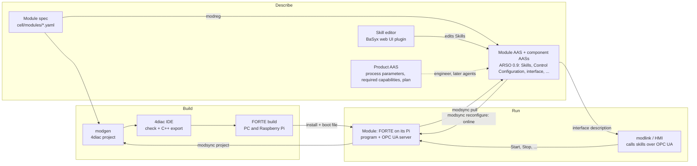

# From AAS to running code, and back

How a module's control program comes about, how it is described in its Asset Administration
Shell (AAS), and how it is changed: through the description of its skills, or because a product
or an order asks for something the module does not do yet. Every step says whether it is built
(and tried on which hardware) or still missing.

The details are elsewhere: what each AAS holds in [aas-models.md](aas-models.md), the rules a
module is built by in [module-rules.md](module-rules.md), how each tool works in
[work.md](work.md), what was decided in [decisions.md](decisions.md), the plan in
[next-steps.md](next-steps.md).

## 1. The picture

The same with the module itself drawn out (the blocks running on FORTE, the OPC UA nodes they
serve, and what each tool reads, writes and sends): [figures/module-tools.drawio](figures/module-tools.drawio).



Three things describe a module, each for its own purpose:

| Description | What it is | Used for |
| --- | --- | --- |
| Module spec (YAML) | Equipment and its wiring per target, skill primitives, module level skills, procedures | Generating the first program and the first AAS. Ours only: a vendor's module has none |
| Module AAS (and one per component) | What the module offers and how it is called; what its skills are made of; what was built | Operating the module, verifying it, changing it. **The desired state** |
| Running program (FORTE) | Instances, connections, values, type hashes | What is true. Read back over the management protocol at any time |

The spec is where a module starts. After delivery the AAS and the running program are enough:
the module can be verified, operated and changed from those two, without the spec (the claim of
the paper).

## 2. First deployment: from description to running program

| Step | Tool | What happens | State |
| --- | --- | --- | --- |
| 1. Describe the module | `cell/modules/<module>.yaml` | Equipment with its IO points (Modbus register for the PC simulator, GPIO line or PWM channel for the Pi), skill primitives (one equipment command until a sensor or a time), module level skills (sequences of primitives with bound values), the Resetting and Stopping procedures, targets (PC, Pi) | Built: filling, stoppering |
| 2. Generate the program | `python -m modgen` | One 4diac project per module (`cell/control/<Project>`): a block type per equipment item and per primitive, built from the module library (ModLib: occupation, PackML state manager, skill state machine, IO blocks); one application per target, mapped to that target's FORTE device. Laid out compactly; a layout arranged in the IDE is kept | Built |
| 3. Check and export | `runtime/build-modules.ps1` | The 4diac IDE checks every type and system headless and exports the types to C++ | Built |
| 4. Build the runtime | the same script; `-Config pi/modules-pi` for the Pi | FORTE with every module's types: Windows (PC, simulator), aarch64 (Raspberry Pi). A Pi can only run programs whose types its FORTE was built with | Built |
| 5. Install on the Pi | `runtime/install.sh` on the Pi, or `python deploy/pi.py install` | FORTE in Docker with the Pi's GPIO lines and PWM channels | Built, on both Pi 5s (and the Pi 4 used until 22 Oct) |
| 6. Deploy the program | `python deploy/pi.py module`, or `python -m modsync push` | A boot file with the application inside its container (`Filling_pi.Home`, as the 4diac IDE names it, so the IDE can monitor it); FORTE restarts and runs it. The resource's own START block starts the INIT chain; each IO block sets up the GPIO line or PWM channel its address names | Built |
| 7. Describe it as an AAS | `modreg` (via `modsync describe` or `pull`) | The module's AAS and one per component (Section 3) | Built |
| 8. Check and publish the AAS | `modreg serve` (registration service) | Checks the AAS against the resource ontology (ARSO) and publishes it to an AAS server (BaSyx) | Built; registration on the lab's server not done |

The program follows fixed rules ([module-rules.md](module-rules.md)): one application per module,
equipment reached over local channels, every skill the same state machine and the same OPC UA
methods (Start, Stop, Abort, Reset), one INIT chain a new skill is appended to. These rules are
what lets the tools read a program back and change it later.

## 3. What the module's AAS holds

| Submodel | Holds | Used by |
| --- | --- | --- |
| Nameplate, asset type | What the asset is (line, module, component) | the ontology check |
| Hierarchical Structures | The module's components (an AAS each) | everyone, to find the components |
| Capability Description | What the module offers (Filling, 0.5 to 10 mL) and which skill realizes it | matching a product's needs |
| Skills (module and components) | Each skill as its commands (Start, Stop, Abort, Reset), each an Operation whose variables are the parameters (with limits, units, meanings) and results; a module level skill also its **steps**: which component skill runs, what each input is handed (a constant or a parameter of the skill), which step gives which result. The module's own commands (Occupy, Reset, ...) are skills too | `modlink`, the HMI, `modsync verify` and `reconfigure`, the skill editor |
| Asset Interfaces Description | OPC UA endpoint and the browse path of every action and property | `modlink`, the HMI |
| Mapping Configuration, Operational Data | Which interface element carries a skill's state, error, results | `modlink` |
| Control Configuration | What was built: every skill and step instance with its block type and the type hash FORTE reports, the rule set, a change log | `modsync verify` |

The Skills submodel says **what is wanted**; the Control Configuration says **what was built**.

## 4. Operating the module from its AAS

`modlink` (HMI repository, a submodule here) and the HMI read the module's AAS and nothing else:
the interface description gives the OPC UA node of each skill's Start, Stop, Abort and Reset and of
its state and results; the skill's Start Operation gives its parameters with their limits. A
capability is run by occupying the module, calling the skill that realizes it with the values,
and waiting for its state. Built: the HMI operates the filling module on its Pi this way.

## 5. Changing a module through its skills in the AAS

Built and tried: on FORTE on the PC, and on the Raspberry Pi 5 while another skill of the module
was running.

1. **Edit the description.** The skill editor (a plugin of the BaSyx web UI fork) shows a skill as
   a flow: add, remove or reorder steps, choose the component skill a step runs, hand an input a
   constant or a parameter, set a parameter's default and limits, or describe a new skill from an
   existing one. It warns of what the module could not carry out and saves the Skills submodel.
   A new skill is now *described, not built*. It has no capability yet, and the matching does
   not tell a described skill from a built one: both come with deriving capabilities from skills
   ([ppr-model.md](ppr-model.md), section 5; plan step F3).
2. **Compare.** `python -m modsync reconfigure <AAS folder or server> --host <module>` reads the
   AAS (what is wanted) and the running program (what is), both into the same structure, and
   finds three kinds of differences:
   - a described skill the program lacks: **create** it;
   - a value that differs (a step's constant, a parameter's default or limits): **write** it;
   - anything else (another order of steps, other equipment): needs a restart; refused.
3. **Check.** Every step runs a skill a component has; every constant lies within that skill's
   limits; a skill does not offer more than the component it hands the value to can do.
4. **Guard.** Values are written only while the module is not executing and not occupied by
   someone else. A new skill touches nothing that runs, so it is created in any state.
5. **Apply online.** Management commands to FORTE, inside the application's container: the new
   skill's instances (the generator's own pattern), its values and connections, appended to the
   end of the INIT chain and started; then INIT is fired once into it. No restart.
6. **Verify.** The program is read back and compared with the AAS again.
7. **Keep it.** The change is added to the module's boot file, so a restart keeps it.
8. **Record.** The Control Configuration gets the new instances with block types and type hashes,
   the change log an entry; the interface description gets the new skill's actions and
   properties, so `modlink` and the HMI find it.

Measured: the skill DoubleDose (19 instances, 84 connections, 190 commands) was created in
0.04 s on the PC and in 1.6 s in all on the Pi (most of it the boot file over SSH), while
Dispensing ran; it then ran from its AAS alone.

**What can change online and what cannot:**

| Change | How |
| --- | --- |
| A parameter's value or limits, a step's constant | Online (written) |
| A new module level skill made of primitives the module has | Online (created) |
| Another order of steps, removing a skill | New boot file and a FORTE restart (not built from the AAS: it lacks the wiring) |
| A new primitive or equipment item, other IO | New block types: a FORTE build, an install and a redeployment |

`python -m modsync verify <AAS> --host <module>` only compares: is the module what its AAS says?

## 6. Changing a module because of a product or an order

A product AAS states what the product needs: its processes with parameters (Process Parameters,
IDTA 02031, extended), the capabilities they require (Capability Description, role Required) and
the plan (Production Sequence: the steps, each assigned to a resource and a skill, with bindings
that hand the skill's parameters the product's values).

An order or product change leads to one of three cases:

| The product needs | Example | What changes | Reconfiguration |
| --- | --- | --- | --- |
| A value inside what a skill offers | 2 mL instead of 1 mL | Nothing in the module: the value is handed over when the skill is called | None |
| A value outside what the skill offers, inside what its component can do | A higher flow rate than Dispensing allows | A limit or a step's constant in the module's Skills submodel | Online (Section 5: write) |
| A capability no skill realizes, or another sequence of the same primitives | Two doses per vial | A new module level skill described in the module's Skills submodel | Online (Section 5: create) |

Anything beyond that (a new primitive, new equipment) is a new build, not a reconfiguration.

**One value from the product to the motor** (the fill volume):

| | Step | State |
| --- | --- | --- |
| 1 | The product asks for 2 mL (process parameter FillVolume) | Built |
| 2 | Its Filling process requires the capability Filling with that volume | Built |
| 3 | The filling module offers Filling for 0.5 to 10 mL; the meanings match | Built |
| 4 | Filling is realized by the skill Dispensing; its parameter Volume carries the meaning FillVolume | Built |
| 5 | The plan's step is assigned to the module and Dispensing, Volume bound to the product's FillVolume | Built: the planner reads the modules' ARSO skills and binds Volume to FillVolume by their meaning (web UI fork, `ac9eb64`) |
| 6 | Someone runs the step: occupies the module, calls Dispensing with Volume = 2 | **Missing** as an executor (agents, future work); `modlink` does it for one module, the HMI by hand |
| 7 | The call becomes `Skills/Dispensing/Start(Session, 2.0)` over OPC UA | Built |
| 8 | Dispensing hands Volume to its Dispense step; the pump runs; the axis moves; the scale is read | Built (no pump yet: a time stands in) |

**Who turns a product change into a module change.** Today an engineer: they see that the
product's requirement lies outside what the module offers (the matching says so), change the
limit or describe the new skill in the module's AAS with the skill editor, and run `modsync
reconfigure`. Section 5 does the rest. Not built: deriving the module's change from the product
automatically, and agents that bid for the steps of a plan and trigger the reconfiguration
themselves (future work after the paper). A skill described but not built is to show up in
matching as "offered after a reconfiguration" (F3), which is what such an agent would act on.

## 7. Back to the 4diac IDE

FORTE keeps the program, not the project (no layout, comments or type sources). `python -m
modsync project --host <module>` reads the program, recognises the module, reads its structure by
the module rules, including skills added online, and writes the 4diac project of exactly what
runs (`projects/<Project>`), with the layout of the repository's project. It checks that this
project deploys the program that runs. Open it in the IDE (File, Import, Existing Projects) and
monitor or keep working on it. Built; tried live with a skill added online.

## 8. The commands

```powershell
python -m modgen                                          # generate the 4diac projects from the specs
runtime/build-modules.ps1                                 # IDE check + export, FORTE for the PC
runtime/build-modules.ps1 -Config pi/modules-pi -SkipValidate   # FORTE for the Raspberry Pi
python deploy/pi.py install; python deploy/pi.py module   # runtime and program on the Pi
python -m modsync pull --host 192.168.0.203               # which module runs there, drift, its AAS
python -m modsync verify aas --host 192.168.0.203         # is the module what its AAS describes?
python -m modsync reconfigure aas --host 192.168.0.203 --dry-run   # what would change
python -m modsync reconfigure aas --host 192.168.0.203    # bring it to its AAS, record it
python -m modsync project --host 192.168.0.203            # a 4diac project of what runs
modreg serve --ontology ontology/ARSO --basyx http://<host>:8081   # registration service
```

## 9. Built and missing, in one view

| Part | Built | Missing |
| --- | --- | --- |
| Spec to program to running module | Generation, IDE check, FORTE for PC and Pi, deployment, IDE monitoring | – |
| Module AAS | ARSO 0.9 resource AASs, built and checked against the ontology, published locally | Registration on the lab's server; live values in Operational Data |
| Operating from the AAS | `modlink`, the HMI | – |
| Changing from the AAS | Skill editor; verify, create a skill, change a value, record; online on PC and Pi | Reordering or removing steps online; the editor's last fixes committed |
| Changing from a product | Matching of required and offered capabilities, the planner binding a step to a module's skill; the three cases defined | Capabilities derived from skills and "offered after a reconfiguration" (F3); an executor of plans; deriving a module change from a product automatically (agents) |
| Back to the IDE | `modsync project` | Programs that do not follow the module rules |
