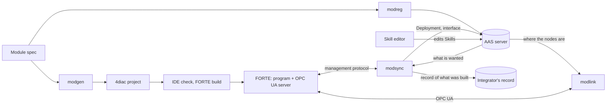

# How the tools work: modgen, modsync, modlink

A description for the paper's method and implementation sections, kept with the code (state of
27 Oct 2026). Each tool is given by what it takes and gives, the algorithm it runs, and what it
assumes. The rules the tools rely on are [module-rules.md](module-rules.md); the AAS they read is
[aas-models.md](aas-models.md); how to run them is [tooling.md](tooling.md); what could be made
simpler is [simplification.md](simplification.md).

## 1. Three tools, one contract

A module is generated, changed and operated. Each job has one tool, and each tool speaks one
interface of the module:

| Tool | Job | Takes | Gives | Speaks to the module over |
| --- | --- | --- | --- | --- |
| **modgen** | Make the program | A module spec (YAML) | A 4diac project: block types, the system, one application per target | – (writes files) |
| **modsync** | Keep the program and its description in step | The module's AAS (or its spec); the running program | Management commands; the boot file; `Deployment` and a built skill's interface in the AAS; the integrator's record of what was built; a 4diac project of what runs | IEC 61499 management protocol |
| **modlink** | Operate the module | The module's AAS | Calls of skills and module commands; their states and results | OPC UA |

A fourth tool, **modreg**, makes and checks the AAS (from a spec, or from what modsync read), derives
the offered capabilities from the skills, and registers the AAS; it is the vendor's and the
registration service's tool and is described in [aas-models.md](aas-models.md).

**The contract is the module rules, not the tools.** modgen writes programs by the rules, modsync
reads programs back by them, modreg describes programs by them, and modlink calls the interface they
fix. A program written by hand inside the same shell is read, changed and operated alike. The rules
fix four patterns: the shell (occupation, PackML state, equipment, one INIT chain), a skill primitive
(a block type with a fixed interface), a module level skill (a subapplication of library and
primitive instances only, with a fixed wiring), and, since rule set 2, a flow (parallel blocks and
decisions made of three library block types).

**The two interfaces are kept apart.** Changing the program goes over the management protocol and
only modsync uses it after the first deployment; operating goes over OPC UA and only modlink (and the
HMI built on it) uses it. Operating a module never changes it; changing it never runs a skill.

**Sizes** (Python, without tests and generated code): modgen 4,235 lines, modsync 2,171, modlink
1,369, modreg 3,050, and the management protocol client they share (`iec61499_mgmt`) 926.

## 2. modgen: generation by patterns

**Takes** a module spec: the module's names, its targets (a PC with a Modbus simulator, a Raspberry
Pi with GPIO and PWM), its equipment (IO points and command tables), its skill primitives (one
equipment command until a sensor condition or a time), its module level skills (parameters and a
flow of steps), its procedures (what Resetting and Stopping run) and the facts of its capabilities.
The spec is validated before anything is written: every name an expression uses is a signal or a
parameter, a constant lies within the limits of the parameter it is bound to, two parallel branches
use different equipment, a condition compares what is known when it is evaluated.

**Gives** a 4diac project per module and the shared library project ModLib:

| Generated | Pattern |
| --- | --- |
| ModLib types | Occupation, the PackML state manager, the skill state machine (`SKILL_Core`), parameter latches, IO blocks, and the flow blocks `SKILL_Join2` to `4`, `SKILL_Condition_LREAL` and `_BOOL`, `SKILL_Merge` |
| `EQ_<Item>` per equipment item | Owns its IO points; writes what its one holder commands; publishes its inputs |
| `SK_<Skill>` per primitive | `SKILL_Core`, one latch per parameter, the contract, the command table of its equipment |
| The application per target | Occupation, Module, the equipment with that target's IO addresses, the offered primitives, the procedures, each module level skill as a subapplication of library and primitive instances; one INIT chain from the resource's `START` |

**Algorithm.** Generation is deterministic: the same spec gives the same files. A module level skill
is made by one function, `module_skill`, from the skill's parameters and flow: `Control`, the Start
method `UaStart`, one latch per parameter, the publishers, and the `Execute` and `Stop`
subapplications. A flow is built recursively: a step is a primitive instance; steps one after the
other are chained `SUCCESS` to `START`; a parallel block fans its start out to its join first and then
to every branch, and the join answers when all branches are done (or halts them when one fails); a
decision evaluates its comparisons (a chain for all, a chain for any) and its branches meet in a
merge. Failures are merged pairwise (a data input takes one connection).

**Why it matters for the method.** modsync calls the same `module_skill` to create a skill online.
The program created online and the program generated from a spec with that skill are therefore the
same by construction; a test compares them for every shape of flow.

Not in modgen: the FORTE build (the 4diac IDE headless, then CMake), deployment, the AAS. It is the
vendor's tool; an integrator never runs it.

## 3. modsync: the running program against its AAS

### 3.1 Reading what runs

FORTE answers, over the management protocol, every instance of a resource under its dotted name
(inside subapplications too), every event and data connection, every type with its hash, and the
value of any input. One read gives a **snapshot**: instances with types, connections, type hashes,
values on demand. A program the IDE deployed lies inside its application's container; the snapshot
leaves the container out of every name.

**Read-back by the rules** (`structure`) turns the snapshot into the module's structure:

1. The INIT chain from the resource's `START.COLD` gives the order the blocks were declared in.
2. Equipment items are the `EQ_` instances; offered primitives the top-level `SK_` instances.
3. A module level skill is a top-level name with a `.Control` of type `SKILL_Core`. Its parameters are
   the latches the Start method hands argument k + 1 to, with their default and limits as written;
   its results are the publisher's inputs.
4. A flow is read from the event inputs inside `<skill>.Execute` (and `.Stop`) that are started from
   outside it:
   - a step `START`: the step; its binding of each parameter is the value written on the input, or
     the latch connected to it (a parameter of the skill); go on from its `SUCCESS`;
   - a join's `START` with other starts: a parallel block; each start is grouped into the branch
     whose success edges reach `DONE_<i>`; each branch is read until it reaches its `DONE_<i>`; go on
     from `DONE`;
   - a condition's `EVAL`: a decision; its merge is named by the condition (`<decision>_C<k>`); the
     ports the conditions' `YES` and `NO` lead to are split by whether they reach the merge's `EI1`
     or `EI2`; the condition tree is rebuilt from the YES and NO chains (a chain of YES is all, of NO
     is any) and brought to a canonical form (groups of one dissolved, nested groups of one kind
     merged); both branches are read until their merge input; go on from `EO`.
5. The procedures are read like a sequence.

The structure is a plain dictionary in the same shape as `stated(spec)` gives for a spec, so the two
compare with `==`. A test reads back the program generated for every shape of flow and gets the spec.

### 3.2 What the AAS describes

`described` turns the module's AAS and its components' AASs into a module spec without wiring:

| From the AAS | Becomes |
| --- | --- |
| Hierarchical Structures | The equipment items (one per component) |
| A component's Skills | The primitives: parameters with limits and defaults from the Start Operation's inputs, results from its outputs, the contract |
| A module skill of the kind Composite | A module level skill: parameters, the flow of `Start/Steps` and `Stop/Steps` in their `Order` (steps of the kind `step`, `parallel` with `Branches`, `decision` with a `Condition` and two `Branches`, `conditional` with a `Condition` and `Steps`), results from the steps' `Outputs` |
| The steps of the module's Reset and Stop | The procedures |
| `Deployment` | Whether the program is to carry the skill out already (Built) or it is only described |

While reading, it refuses what the module could not carry out: a step that runs a skill no component
has, a binding to a parameter the skill lacks, a constant outside the primitive's limits, a skill
parameter whose range is wider than the primitive's it is handed to, two parallel branches on one
component, a condition on what has not run, a kind of step the rules do not know. The flow is
checked by the same function that checks a spec.

### 3.3 Comparing and classifying

`differences(wanted, running)` compares the two structures and sorts every difference into one class:

| Class | Example | Action |
| --- | --- | --- |
| create | A skill the AAS describes that the program lacks | Created online |
| write | A step's constant, a parameter's default or limits | Written online, guarded |
| restart | Another flow or order of steps, a skill the AAS no longer describes, other equipment | Refused: needs a new boot file and a restart |
| record | The integrator's record names an instance, type or hash the program does not have | Refused: the record is wrong |

### 3.4 Changing online

For the skills to create, `fragment` runs modgen's `module_skill` on the described skills, flattens
the result into instances, values and connections, and adds one connection: from the end of the
program's INIT chain to the first new skill. modsync asks FORTE for every block type the fragment
uses; a missing type means a new FORTE build, and nothing is sent. The commands are sent in a fixed
order:

1. `WRITE` the changed values;
2. `CREATE` every new instance;
3. `WRITE` their values;
4. `CONNECT` their connections, the INIT link included;
5. `START` every new instance;
6. `WRITE $e` to the INIT input where the chain enters the new skill: INIT runs once through it, so its
   OPC UA nodes and channels come up in order.

Values are written only while the module is Stopped, Idle or Aborted and nobody occupies it. A new
skill touches nothing that runs and is created in any state.

**Verify, keep, record.** The program is read back and compared with the AAS once more; anything left
over is an error. The create, write and connect commands are added to the module's boot file before
its final `START`, so a restart brings the changed program up. Then:

- in the AAS, every skill the program now carries out gets `Deployment = Built`; a skill that was
  built online gets its interface (actions, properties, data points, mappings, the commands'
  `InterfaceReference`), written by modreg's rules, so a client finds it; the offered capabilities are
  derived anew (a capability offered after a reconfiguration is offered now);
- the integrator's record, a Control Configuration submodel kept outside the AAS (a folder, or the
  registration service), gets every built instance with block type and hash, where the module is
  managed, when it was read, and an entry in the change log.

### 3.5 What an online change costs

| Skill | Flow | Instances | Connections | Management commands |
| --- | --- | --- | --- | --- |
| Dispensing | 4 steps | 13 | 63 | 142 |
| DoubleDose | 5 steps | 15 | 73 | 165 |
| Checked | 6 steps, two decisions (one conditional), a group of comparisons | 23 | 98 | 224 |
| Ready | a parallel block of two steps | 5 | 31 | 64 |

Measured: DoubleDose (in the pattern of 9 Oct, 190 commands) was created in 0.04 s on a PC and in
1.6 s in all on a Raspberry Pi 5, most of it the boot file over SSH, while another skill ran;
verifying a module against its AAS took 0.15 s over the network. Checked and Ready were created on
FORTE on a PC while the module was in Execute and occupied, and run: the chosen branch ran, the other
did not.

### 3.6 Back to the IDE

FORTE keeps the program, not the project. `modsync project` reads the program, reads its structure by
the rules (flows and skills added online included), writes the spec of what runs, has modgen make the
project with the layout of the existing one, and checks that the project deploys exactly the program
that runs.

### 3.7 What modsync does not do

It never calls a skill (modlink does). It never removes or reorders anything online: that needs a
restart, and the AAS does not hold the wiring of the rest of the program from which a whole boot file
could be made. It changes no block types.

Besides the AAS mode above, modsync has an older mode against a module spec (`pull`, `push`, `watch`):
the program modgen generates from the spec is compared instance by instance, and anything other than
a value or a new skill is deployed by a new boot file and a restart. It is the vendor's and the lab's
development tool; [simplification.md](simplification.md) proposes to fold it into the AAS mode.

## 4. modlink: operating a module from its AAS

**Takes** a module's AAS (a file or an AAS server, read as plain JSON; no AAS library). **Gives** a
`Resource` (its capabilities, skills with parameters and limits, and for each the OPC UA browse paths
to call and to watch) and, through a supervised OPC UA connection, the calls.

### 4.1 Resolving by references

modlink follows references and meanings, never names:

1. **Capability Description**: each offered capability with its properties and ranges, and the skill
   that realizes it (`CapabilityRealizedBy`).
2. **Skills**: each skill's commands, each with its `InterfaceReference` to an action of the module's
   interface; the Start Operation's inputs are the parameters, its outputs the results. The module's
   own commands (Occupy, Release, Reset, Start, Stop, Abort, Clear) are skills of the kind
   ModuleControl, called by their Start.
3. **Mapping Configuration** with **Operational Data**: which interface property shows a skill's
   state, its error and each result (matched by the data point's meaning).
4. **Asset Interfaces Description**: the endpoint and the browse path of every action and property.

A skill built online is found as soon as modsync has recorded its interface; no client changes.

### 4.2 The connection and a run

`Link` keeps one OPC UA connection per endpoint: it resolves every node by browse path (FORTE gives
its nodes new numeric ids at every start), reads them once, subscribes to every variable, reconnects
with back-off, and serialises method calls. `Module` stands for one module and one occupation session.
A run:

1. occupy the module with a session id and bring it to Execute (Clear, Reset, Start, as its state needs);
2. listen to the skill's State before anything is sent;
3. call `Skills/<Skill>/Start(Session, parameters...)`; FORTE answers `[Accepted, ErrorID]` at once, and
   a refusal (NotReady, NotPermitted, Busy, OutOfRange) is raised;
4. the first end state notified after the start (Succeeded, Failed, Aborted) ends the run;
5. on a failure the error id is waited for briefly; the results are read from the subscribed values.

`run_capability` asks the resource which skill realizes a capability and runs it with the given values
and the skill's defaults for the rest.

### 4.3 What modlink does not do

It writes nothing into the AAS and never uses the management protocol. It does not plan (which module
runs which step is the planner's, later the agents'), and it does not check a value against the
capability's range before calling: FORTE refuses an out-of-range value itself.

## 5. Each tool and the paper's claim

> A module that is delivered with an IEC 61499 program and an AAS can be verified, operated and
> changed online from those two alone, without the files it was generated from.

| Part of the claim | Tool | What it uses |
| --- | --- | --- |
| Delivered with a program and an AAS | modgen, modreg (vendor) | The spec; not needed afterwards |
| Verified | `modsync verify` | The AAS and the program read back by the rules |
| Operated | modlink | The AAS and the program's OPC UA interface |
| Changed online | `modsync reconfigure` | The AAS (as edited in the skill editor), the program, the rules, modgen's skill pattern |
| Without the files it was generated from | modsync, modlink | No spec, no 4diac project, no type sources. (`modsync project`, which makes an IDE project of what runs, is the exception: it takes the equipment and primitives from the module's spec) |
