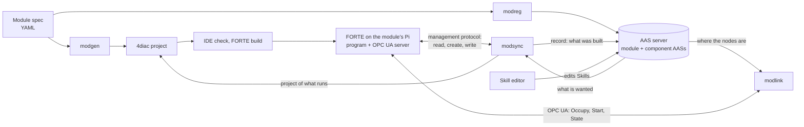

# The tools: modgen, modsync, modlink and modreg

What each tool is for, what it reads and writes, how it works inside, and where one tool ends and
the next begins. State of 27 Oct 2026. The rules the tools rely on are in
[module-rules.md](module-rules.md), the AAS they read in [aas-models.md](aas-models.md), the whole
chain in [pipeline.md](pipeline.md), how to run them in [tooling.md](tooling.md).

## 1. The roles in one view

A module is described, built, changed and operated. Each tool has one of these jobs and speaks one
protocol to the module:

| Tool | Job | Reads | Writes | Speaks to the module | Who uses it |
| --- | --- | --- | --- | --- | --- |
| **modgen** | Make the program: a module spec becomes a 4diac project | The module spec (YAML) | A 4diac project (block types, system, one application per target) | Nothing: it writes files | The vendor, once per module or per new primitive |
| **modreg** | Make, check and publish the AAS | The module spec and, if given, the running program (through modsync); the ontologies | The AASs of the line, a module and its components; derived capabilities | Nothing | The vendor (first AAS), the integrator (registration), the skill editor (derivation) |
| **modsync** | Keep the program and its description in step: read it back, compare, change it online, record | The running program (management protocol); the AAS, or the module spec; the record of what was built | Management commands; the boot file; a built skill's `Deployment` and interface in the AAS; the record of what was built; a 4diac project of what runs | IEC 61499 management protocol (port 61499) | The integrator, at a changeover |
| **modlink** | Operate the module: occupy it, call its skills, follow its states | The AAS (to find the nodes); the module's OPC UA values | Nothing in the AAS | OPC UA (port 4840) | The HMI, scripts, the scenario runner, later the agents |

Two libraries sit under them: **iec61499_mgmt** (the management protocol, boot files, `.sys`
files; used by modsync and the deployment scripts) and **ModLib**, the IEC 61499 module library
that modgen generates and every module's program is made of.

The split follows the two interfaces a FORTE has. The **management protocol** changes the program
itself (create a block, connect, write an input): only modsync uses it after the first deployment.
**OPC UA** is the interface the program offers while it runs (methods to call, values to watch):
only modlink uses it. No tool does both, so operating a module never changes it, and changing it
never runs a skill.

The tools share one assumption: the program follows the module rules. modgen produces programs
by them, modsync reads programs back by them, modreg describes programs by them, and modlink calls
the interface they define. The rules, not the generator, are the contract: a module written by hand
in the 4diac IDE inside the same shell works with modsync, modreg and modlink alike.

## 2. modgen: from a module spec to a 4diac project

Package `modgen` in [iec61499-skill-lib/](../iec61499-skill-lib/). Command:
`python -m modgen [cell/modules/filling.yaml ...]`.

### What it reads

One module spec per module (`cell/modules/<module>.yaml`), checked by pydantic before anything is
written (`modgen/spec.py`; an unknown key is an error):

| Section | Holds | Example (filling) |
| --- | --- | --- |
| `module`, `project`, `package`, `opcua_root` | Names: the module, its 4diac project, the package of its own types, its OPC UA root | `Filling`, `FillingModule`, `filling`, `/Objects/Filling` |
| `targets` | Each FORTE the module can run on: host, management port, SSH user, how its IO is reached (`modbus` or `gpio`), the board | `pc` (Modbus to the simulator), `pi` (GPIO and PWM on a Pi 5) |
| `equipment` | Each equipment item: its inputs and outputs (a GPIO line, a PWM channel, a Modbus register), its command table (outputs per command, in timed phases), and for an axis its position (speed, travel, home switch) | `LinearAxis`, `Pump`, `Scale` |
| `skills` | The skill primitives: one equipment command until a sensor condition (`ensures`) or a time (`after`); parameters with type, unit, limits, default and meaning; results; timeout; whether it is offered on its own | `MoveAxis(Position)`, `Home`, `Dispense(Volume, FlowRate)`, `Weigh` |
| `composites` | The module level skills: parameters, the `execute` steps (each a primitive with its bindings, a constant or a parameter of the skill), an optional `stop` sequence, results taken from a step | `Dispensing: [MoveAxis{Position: 40} as NeedleDown, Dispense{Volume: Volume, FlowRate: 1.0}, Home, Weigh]` |
| `procedures` | What the module runs itself while Resetting and Stopping | `Resetting: [Home, Tare]` |
| `capabilities` | Only the facts of the machine for its AAS (container type, grasp diameter); which capability is offered is derived from the skills | `Filling: ContainerType vial, ...` |

Validation is fail-closed: every name in a contract expression must be a signal of the skill's
equipment or one of its parameters, every step must name a known primitive, a default must lie
within its limits, a binding must name a parameter of the step's skill.

### What it writes

One 4diac project per module in `cell/control/<Project>` and the shared library project
`iec61499-skill-lib/ModLib`:

| Part | What it is | Made by |
| --- | --- | --- |
| ModLib types (package `modlib`) | `MOD_Occupation` (Occupy and Release by session id), `MOD_StateManager` (PackML: Stopped, Resetting, Idle, Starting, Execute, Stopping, Aborting, Aborted, Clearing), `SKILL_Core` (the skill state machine with Stop, Abort, Reset, State, ErrorID), `SKILL_Param_<type>` (default, range check and latch of one parameter), `SKILL_FailMerge`, and the IO blocks `IO_DI`, `IO_DO`, `IO_AI`, `IO_AO` (each reaches its point where its address says: a GPIO line, a PWM channel, Modbus, or simulated) | `modgen/library.py` |
| Equipment types `EQ_<Item>` | Own the item's IO points; write what their one holder commands (break before make); publish their inputs; switch off on release or abort. An axis also keeps its position (`ActualPosition`, `Homed`, `Moving`, `MoveTo`) | `make_equipment` |
| Skill primitive types `SK_<Skill>` | A composite of `SKILL_Core`, a parameter block per parameter, the contract (`SL_<Skill>`: requires, ensures, invariant, timeout) and the command table of its equipment | `make_skill`, `make_skill_logic` |
| The application per target | `Occupation`, `Module`, the equipment instances with their IO addresses for that target, an instance per offered primitive, the procedures, and each module level skill as a subapplication of library and primitive instances only; one INIT chain started by the resource's `START` block | `application`, `module_skill`, `sequence` |
| The system (`.sys`) | One device per target, the application mapped to its resource | `make_system` |
| Layout and comments | Compact groups (Core, Start, Sequences, Results); a layout arranged in the IDE is kept, a new block gets a free place; every pin has a comment saying what it carries | `layout.py`, `pins.py` |
| `types-manifest.json` | Which types the project exports; read by the IDE check and the FORTE build | `Project.write_manifest` |

### How it works

`generate(spec)` cleans the project folder, writes the project files and the standard types, the
ModLib declarations (so the IDE opens each project on its own; ModLib is compiled once), then the
module's own types and its system, then removes what is no longer generated. Every file is made as
XML in Python (`fbxml.py`), never from templates.

The important pattern is `module_skill` (`modgen/module.py`), which builds a module level skill as
the rules prescribe: `Control`, `UaStart`, one latch per parameter, `PubParams`, `PubResults`,
and the `Execute` and `Stop` sequences, where `sequence` creates one primitive instance per step,
chains `SUCCESS` to the next `START`, merges failures pairwise with `SKILL_FailMerge`, writes
constants as input values and connects handed-down parameters. **modsync reuses this function** to
create a skill online, so a skill created from the AAS is exactly the program modgen would have
generated with that skill in the spec (a test compares them).

### What it does not do

It does not build FORTE (that is `runtime/build-modules.ps1`, which runs the 4diac IDE headless to
check and export the types to C++), does not deploy (that is `deploy/pi.py` or `modsync push`), and
does not write the AAS (modreg). It is the vendor's tool: an integrator who receives a module never
runs it.

## 3. modsync: the running program against its description

Package `modsync` in [aas61499-tools/](../aas61499-tools/). Command: `python -m modsync <command>`.

### Two kinds of description, one way of reading

modsync compares what runs on a module with what it should be. "What it should be" comes from one
of two places:

| Mode | Commands | Description | Who wins |
| --- | --- | --- | --- |
| Against the **module spec** | `describe`, `pull`, `push`, `watch`, `project` | The program modgen generates from the spec for a target | The spec; a value changed online shows as drift |
| Against the **AAS** | `verify`, `reconfigure` (with `--record`) | What the module's and its components' AASs describe | The AAS: it is the desired state |

The spec mode came first and is the vendor's and the lab's own way of working. The AAS mode is the
paper's: no spec is read, so it works for a module someone else built.

### Reading what runs (`device.py`, `structure.py`)

FORTE answers enough over the management protocol to read the whole program back:

1. `QUERY` of the resource's instances gives every instance under its dotted name, also those
   inside subapplications (`Dispensing.Execute.NeedleDown`), with its type.
2. `QUERY` of the connections gives every event and data connection.
3. `QUERY` of each type gives its hash (the runtime's digest of the type).
4. `READ` gives any input or output value, also inside a composite block (`Module.Logic.State`).

The result is a `Snapshot`. A program the IDE deployed lies inside its application's container
(`Filling.Home`); the snapshot leaves the container out of every name so both read the same.

`structure()` then reads the snapshot **by the module rules**: the equipment items are the `EQ_`
instances, the offered primitives the `SK_` instances at the top, a module level skill a top-level
name with a `.Control` of type `SKILL_Core`, its parameters the `SKILL_Param_` latches with their
`Default`, `Lower` and `Upper`, its steps the instances in `.Execute` and `.Stop` in the order the
`SUCCESS` to `START` connections give, and a step's binding either the constant written on its
input or the connection from the sequence's input. The procedures are read the same way. The
result is a plain dictionary in the same shape as `stated(spec)` gives for a spec, so the two
compare with `==`.

### Comparing

Against a spec (`compare.py`): the program modgen would generate (`expected`) against the snapshot:
missing and unexpected instances and connections, other types, other values. A `Drift`.

Against the AAS (`desired.py`): first `described()` turns the AASs into a module spec without
wiring: the components in Hierarchical Structures are the equipment, a component's skills the
primitives (parameters, limits, results), a skill of the kind Composite a module level skill with
its steps (from `Start/Steps` and `Stop/Steps`, in their `Order`), the steps of the module's Reset
and Stop the procedures. While doing so it **refuses what the module could not carry out**: a step
that runs a skill no component has, a binding to a parameter the skill lacks, a constant outside
the primitive's limits, a skill parameter whose range is wider than the primitive it is handed to,
a step of a kind other than `step`. Then `differences()` compares the described and the running
structure and sorts every difference into one of four kinds:

| Kind | Example | What reconfigure does |
| --- | --- | --- |
| `create` | A skill described but not in the program (DoubleDose) | Creates it online |
| `values` | A step's constant, a parameter's default or limits differ | Writes it online (guarded) |
| `restart` | Another order of steps, a skill the AAS no longer describes, other equipment | Refuses: needs a new boot file and a restart |
| `built` | The record of what was built names an instance or hash the program does not have | Refuses: the record is wrong |

### Changing online (`sync.online`, `desired.reconfigure`)

For a new skill, `fragment()` runs modgen's `module_skill` on the described skill and flattens it
into instances, values and connections, with one more connection: from the current end of the
program's INIT chain (`init_tail`, found by following `INITO` to `INIT` from `START.COLD`) to the new
skill. Before anything is sent, `lacking()` asks FORTE whether it has every block type; a missing
type means a new FORTE build, and the change is refused. Then the commands go out in this order:

1. `WRITE` the changed values;
2. `CREATE` each new instance;
3. `WRITE` the new instances' values;
4. `CONNECT` the new connections, the INIT link included;
5. `START` each new instance;
6. `WRITE $e` to the INIT input where the chain enters the new skill, which fires INIT once
   through it, so its OPC UA nodes and channels come up in order.

Values are written only while the module is Stopped, Idle or Aborted and not occupied (`guard`,
which reads `Module.Logic.State` and `Occupation.Logic.Occupied`), unless `--force`. A new skill
touches nothing that runs, so it is created in any state, also while another skill runs.

Afterwards the program is read again and compared with the AAS once more; anything left over is an
error. Then the change goes into the module's boot file (`amended`: the create, write and connect
commands before the boot file's final `START`), so a restart keeps it. The boot file is local
(`LocalDeployer`) or reached over SSH on the Pi (`PiDeployer`). `push` in the spec mode does the
same for a spec, and for anything that needs a restart writes a whole new boot file and restarts
the FORTE container.

### Recording (`desired.record`, `desired.store`)

After a change (or with `verify --record`), the module's AAS and the record of what was built are
updated:

- in the AAS, every module level skill the program carries out gets `Deployment = Built`;
- the **record of what was built**, a Control Configuration submodel kept outside the AAS (in a
  folder, `--records`, or at the registration service, `/build/<idShort>`), gets an instance entry
  for every skill and step that is built (`InstancePath`, `FBType`, `TypeHash`, a reference to the
  skill element), where the module is managed, `ReadAt`, `SyncState`, and one more `ChangeLog`
  entry (time, trigger, what was done). `verify` and `reconfigure` take the management endpoint
  from it when `--host` is not given;
- a skill that was described and is now built gets **its interface** (`modreg.offer.offered`): the
  actions of its commands and the properties of its state, error, parameters and results in the
  Asset Interfaces Description, a data point for each in Operational Data, the mappings, and the
  `InterfaceReference` of each command. A client finds it from then on;
- the **capabilities** are derived anew from the skills (`modreg.offer.capabilities`): a skill that
  was offered "after a reconfiguration" is now offered.

`store()` puts the changed submodels back where the AAS came from: a folder of files or the AAS
server.

### Back to the IDE (`project.py`)

FORTE keeps the program but not the project (no layout, comments or type sources). `modsync
project --host <module>` reads the program, recognises which spec it comes from, reads its structure
by the rules (skills added online included), writes the spec of what runs, lets modgen make the
project from it with the layout of the repository's project, and checks that this project deploys
exactly the program that runs.

### What it does not do

It never calls a skill or reads a skill's state (that is modlink). It never removes or reorders
anything online: a removed skill or a changed order of steps needs a restart, and from the AAS
alone it cannot make the boot file for one, because the AAS does not hold the wiring of the rest
of the program. It changes no block types.

## 4. modlink: operating a module from its AAS

Package `modlink` in [iec61499-opcua-hmi/](../iec61499-opcua-hmi/) (a submodule). Asyncio, plain JSON
in, plain dataclasses out; it needs no AAS library.

### Parts

| Part | Does |
| --- | --- |
| `aas.describe`, `aas.load` | Read a module's AAS (from a file or an AAS server) into a `Resource`: its capabilities with their values and ranges, its skills with parameters, limits and results, and for each the OPC UA browse paths to call and to watch. Reads ARSO 0.9, and 0.8 and 0.7 |
| `Interface` | The variables and methods of one module by browse path; from a `Resource`, or found by browsing the server (`discover`) |
| `Link` | One supervised OPC UA connection per endpoint: resolves every node by browse path, reads them once, subscribes to the variables, reconnects with back-off, serialises method calls, tells listeners of every change |
| `Module` | One module for one occupation session: `occupy`, `release`, module commands, `skill(...)` calls, `bring_to_execute`, `run`, `run_capability`, waiting for states |
| `codes` | The module states (PackML), the skill states and the error ids |

### How it finds what to call

modlink follows references and meanings, never names, through four submodels:

1. **Capability Description**: the capability a caller asks for (by name or meaning), its
   properties and ranges, and `CapabilityRealizedBy`, a reference to the skill.
2. **Skills**: the skill's commands (Start, Stop, Abort, Reset), each with its `InterfaceReference`
   to an action; the Start Operation's input variables are the parameters (unit, limits, default),
   its outputs the results.
3. **Asset Interfaces Mapping Configuration** with **Operational Data**: which property of the
   interface shows the skill's state, its error and each result.
4. **Asset Interfaces Description**: the OPC UA endpoint and the browse path of every action and
   property.

The module's own commands (Occupy, Release, Reset, Start, Stop, Abort, Clear) are skills of the kind
ModuleControl and are found the same way.

### How a skill is run

`Module.run(skill, *params)`:

1. the caller has occupied the module with its session id (`Occupation/Occupy(Session)`) and
   brought it to Execute (`bring_to_execute`: Clear from Aborted, Reset from Stopped, Start from
   Idle);
2. a listener is attached to the skill's `State` before anything is sent;
3. `Skills/<Skill>/Start(Session, params...)` is called; FORTE answers `[Accepted, ErrorID]` at
   once, and a refusal (4 NotReady, 5 NotPermitted, 6 Busy, 8 OutOfRange) raises `Refused`;
4. the first end state notified after the start (Succeeded, Failed, Aborted) ends the run, so a
   Succeeded left over from the last run does not count;
5. on a failure the `ErrorID` is waited for briefly (it may arrive just after the state); the
   results are read from the subscribed values.

`run_capability(capability, values)` asks the `Resource` which skill realizes the capability and
runs it with the given values and the skill's defaults for the rest.

### What it does not do

It writes nothing into the AAS and never uses the management protocol, so it cannot change a
program. It does not plan: which module runs which step is the planner's (and later the agents')
decision. It does not check a value against the capability's range before calling; FORTE refuses an
out-of-range value itself (OutOfRange).

## 5. modreg: the AAS

Package `modreg` in [aas61499-tools/](../aas61499-tools/). The other tools lean on it, so in short:

| Command or module | Does |
| --- | --- |
| `modreg profile` (`profile.py`) | The profiles (pydantic dumps on aas-model's classes) of a module and its components, from a spec and, if read, the running program |
| `model.py`, `templates.py`, `generated/` | ARSO's submodels as templates and classes, generated from the ontology (`modreg generate`) |
| `modreg check` (`ontology.py`) | An AAS checked against ARSO: every element typed by its semantic id, every restriction held |
| `modreg graph` (`projection.py`) | The AASs projected into RDF: elements typed by their semantic id, individuals by their supplemental id, references made relations (rules in `ontology/PPRL/projection`) |
| `derive.py`, `offer.capabilities` | The offered capabilities derived from the skills by the rule `ontology/PPRL/derivation/10-capabilities.rq`; a described, not built skill offers `Availability = AfterReconfiguration` |
| `offer.offered` | The interface of a skill built online (used by `modsync record`) |
| `modreg serve` (`service.py`) | The registration service: read, build, check and publish a profile; `POST /capabilities/<shell>` derives a module's capabilities anew on the AAS server |

## 6. Where the tools meet

| Seam | How it is joined | Why that way |
| --- | --- | --- |
| modgen and modsync | modsync imports `module_skill` and the spec model | One pattern for a module level skill: what is generated and what is created online cannot drift apart |
| modsync and modreg | modsync imports `modreg.offer` for the record; modreg imports `modsync.desired` for the service | The record and the derivation write the AAS the way modreg builds it; the service checks a description the way modsync reads it |
| The AAS and modlink | modlink reads the AAS as plain JSON | The client side needs no AAS library and no ontology; it can live in another repository (it does) |
| modsync and FORTE | iec61499_mgmt's `Client` and `Command` | One implementation of the management protocol for deployment, read-back and change |
| Skill editor and modsync | The editor writes the Skills submodel; modsync reads it | Today the editor checks a description with its own TypeScript copy of modsync's rules ([skill-authoring.md](skill-authoring.md) proposes one service for both) |

## 7. Each tool and the paper's claim

> A module that is delivered with an IEC 61499 program and an AAS can be verified, operated and
> changed online from those two alone, without the files it was generated from.

| Part of the claim | Tool | What it uses |
| --- | --- | --- |
| Delivered with a program and an AAS | modgen, modreg (the vendor's side) | The spec; not needed afterwards |
| Verified | `modsync verify` | The AAS and the program read back, by the module rules |
| Operated | modlink | The AAS and the program's OPC UA interface |
| Changed online | `modsync reconfigure` | The AAS (as edited in the skill editor), the program, the module rules, modgen's skill pattern |
| Without the files it was generated from | All three | No spec, no 4diac project, no type sources; `modsync project` can make a project again from what runs |
